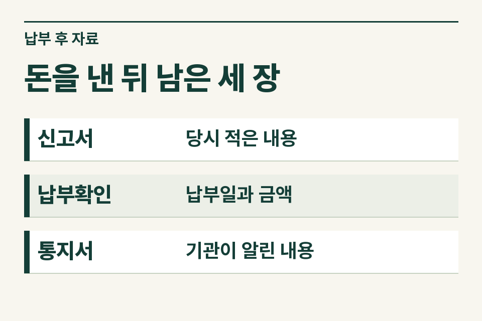
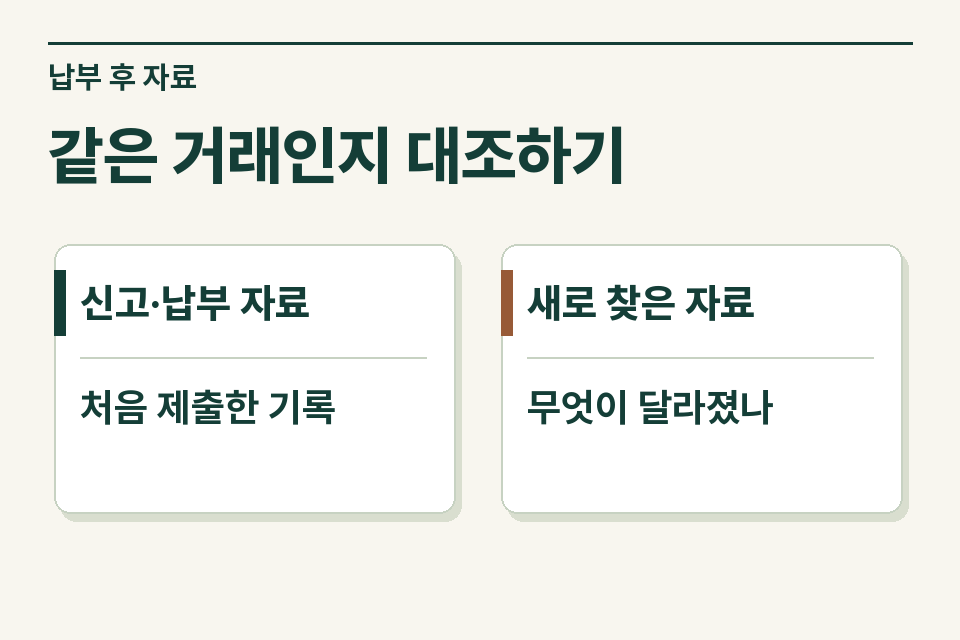

의뢰인이 “취득세를 더 낸 것 같다”고 연락하면 먼저 **서로 비교한 두 문서가 무엇인지** 물어보세요. 정산서와 계좌이체를 비교한 고객, 신고서와 납부확인서를 비교한 고객, 신고서는 일치하지만 감면을 빠뜨렸다고 생각하는 고객에게 필요한 자료가 각각 다릅니다.

## 금액 차이는 어느 두 줄에서 나왔나요?

가정 사례입니다. 매수인은 잔금일에 사무소에 보낸 금액과 취득세 납부확인서의 합계가 달라 환급을 요청합니다. 사무소에 남아 있는 것은 잔금 전 예상 비용표입니다. 이때 먼저 최종 정산서의 예치금·실비·잔액을 확인한 뒤 세금 항목과 지자체 납부 내역을 세목별로 대조합니다. 예치금 차액이 정산 과정에서 이미 고객에게 돌아갔는지도 기록합니다. 이 단계에서 해결되는 차이라면 세무상 경정청구까지 검토할 일이 생기지 않을 수도 있습니다.

| 대조할 문서 | 확인할 줄 | 다음 행동 |
|---|---|---|
| 예상 비용표와 최종 정산서 | 예치금, 실제 지출, 반환 잔액 | 사무소 보유 정산 근거와 고객 송금 내역 확인 |
| 최종 정산서와 납부확인서 | 취득세 본세, 함께 낸 세목과 각각의 금액 | 물건·납세자·납부일이 같은 건인지 확인 |
| 원신고서와 납부확인서 | 신고세액, 실제 납부액 | 추가 신고나 별도 고지·결정이 있었는지 확인 |
| 신고서와 취득 당시 자료 | 취득 원인, 신고한 금액, 감면 신청 여부 | 신고에서 빠졌다고 보는 사실과 당시 증빙 특정 |

<figure style="margin:28px 0"><figcaption>돈을 낸 뒤 남은 세 장 — 신고서 · 당시 적은 내용 / 납부확인 · 납부일과 금액 / 통지서 · 기관이 알린 내용</figcaption></figure>

## 신고 내용 자체를 다툰다면 무슨 자료가 하나 더 필요할까요?

사례를 조금 바꿔 보겠습니다. 원신고서의 세액과 실제 납부액은 같습니다. 의뢰인은 취득 당시에 감면 요건에 해당하는 사정이 있었는데 신고서에 반영되지 않았다고 말합니다. 이때는 ‘납부확인서 금액이 맞다’는 말만으로 질문이 해결되지 않습니다. 신청 당시 제출한 감면 관련 서류, 관할 지자체의 회신문, 고객이 새로 제시하는 자료를 각각 받습니다.

고객 설명을 기록할 때는 자료의 작성일과 사실이 발생한 날을 따로 적습니다. 최근 발급받은 증명서가 취득 당시 사실을 보여 줄 수도 있고, 취득 후 생긴 사정을 보여 줄 수도 있습니다. 새 증명서가 있다는 사정만으로 후발적 경정청구 사유라고 분류하지 않습니다.

## 신고와 고지가 모두 있었다면 날짜를 어떻게 남기나요?

처음 신고한 날, 수정신고한 날, 결정·경정 또는 고지 문서를 받은 날, 이전에 청구나 불복을 했다면 그 접수일·결과 통지일을 실제 서류에 맞춰 적습니다. 법무사 사무소가 서류를 다시 찾은 날은 별도로 표시합니다. 납부확인서 한 장으로는 이런 절차 이력이 보이지 않습니다.

지방세기본법은 신고 내용에 관한 일반 경정청구와 일정한 사후 사유에 따른 청구를 규정합니다. 접수 당시에는 신고 여부와 처분·통지 경위, 주장하는 사유를 받은 뒤 적용할 절차와 기한을 확인해야 합니다. 결정·경정이 있었다면 통지서의 명칭·내용·받은 날을 누락하지 마세요. 접수 일정이 임박한 통지를 받았다면 정산표가 완성될 때까지 기다리지 말고 그 사실부터 알립니다. [지방세기본법 제50조](https://www.law.go.kr/법령/지방세기본법/제50조)

## 인계 메모에는 무엇을 남길까요?

의뢰인이 직접 정산서를 대조할 때는 제이티 블로그의 [법무사 정산서와 취득세 납부확인서에서 비교할 항목](https://blog.naver.com/jt_tax/224472868628)을 참고하세요.

“같은 주택의 원신고서와 납부확인서를 대조했고 신고세액과 납부액이 일치합니다. 의뢰인은 취득 당시 감면 관련 사실 한 가지가 빠졌다고 합니다. 해당 사실을 보여 주는 서류는 확보했고 기존 감면 신청서와 지자체의 회신 유무는 확인 중입니다.”

단순히 ‘취득세 환급 가능한지’라고 보내는 것보다 어디까지 대조했는지 알 수 있는 메모입니다. 세무사는 원신고 당시의 법령과 취득 경위, 그 뒤의 처분 여부를 확인하고 필요한 절차와 추가 자료를 안내할 수 있습니다. 정산서의 어떤 취득 부대비용이 과세표준에 들어가는지 자체가 질문이면 [취득세 과세표준과 부대비용](https://www.jttax.co.kr/insights/acquisition-tax-costs.html)을, 쟁점이 청구 기한이라면 [경정청구 기한 검토](https://www.jttax.co.kr/insights/acquisition-tax-correction-claim-deadline.html)를 참고할 수 있습니다.

<figure style="margin:28px 0"><figcaption>같은 거래인지 대조하기 — 신고·납부 자료 · 처음 제출한 기록 / 새로 찾은 자료 · 무엇이 달라졌나</figcaption></figure>

## 무엇이 확인되면 사무소로 답을 돌려주나요?

의뢰인의 동의를 받아 문의할 때 처음에는 물건 종류, 취득 시점, 받은 문서, 의문이 생긴 항목만 알려 주세요. 제이티 세무법인은 사무소에서 정산 경위를 설명할 부분, 고객이 추가로 확인할 사실, 세무사가 검토할 절차를 정리하고 개별 검토 범위와 수수료를 안내합니다. 이 단계에서 반환액이나 환급 여부가 정해지는 것은 아닙니다. [제이티 법무사 협업 문의](https://www.jttax.co.kr/desk/scrivener.html)
