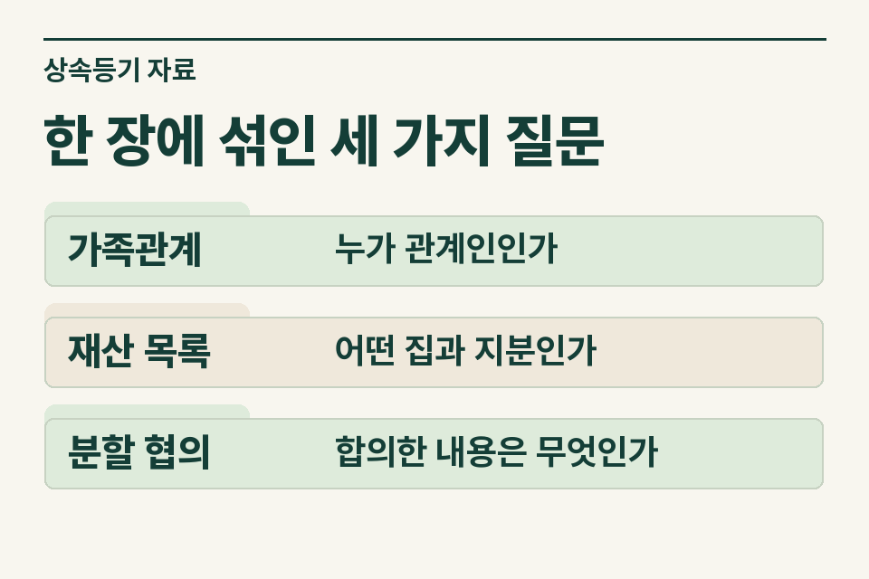
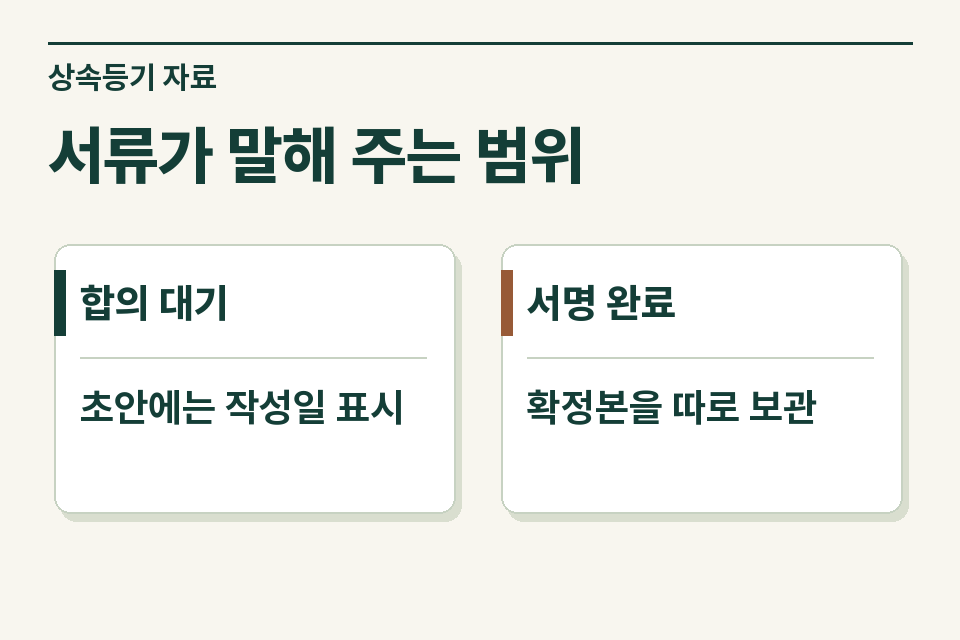

의뢰인이 가져온 서류에서 먼저 **사망일, 상속 부동산의 지분, 협의서의 서명 여부**를 확인합니다. 분할안이 여러 개여도 상담을 시작할 수 있습니다. 먼저 신고 일정을 살피고 이미 확인된 상속재산과 가족에게 다시 물을 항목을 나눕니다.

## 접수 첫날, ‘아직 협의 중’ 옆에 무엇을 적을까요?

다음은 설명을 위한 가정입니다. 어머니가 돌아가신 뒤 두 자녀가 사무소를 찾았습니다. 한 자녀가 살던 집을 계속 쓰기로 구두로 의논했지만 동생은 다른 재산 내역을 아직 보지 못했습니다. 가져온 협의서에는 서명이 없고, 등기사항증명서에는 어머니와 먼저 돌아가신 아버지의 이름이 함께 남아 있습니다.

사무소에서는 집 주소와 협의안만 보내기보다 **이번에 누구의 사망으로 접수했는지, 그분의 지분이 얼마인지, 먼저 돌아가신 분의 지분을 어떻게 처리했는지**를 적어 주는 편이 좋습니다. 아버지 지분의 처리 경위를 따로 확인해야 한다면 그 사실을 표시합니다. 한 채의 집에 두 번의 상속이 걸려 있을 가능성을 처음부터 세무사가 살펴볼 수 있습니다.

<figure style="margin:28px 0"><figcaption>한 장에 섞인 세 가지 질문 — 가족관계 · 누가 관계인인가 / 재산 목록 · 어떤 집과 지분인가 / 분할 협의 · 합의한 내용은 무엇인가</figcaption></figure>

## 의뢰인이 건넨 자료에서는 무엇을 확인하나요?

| 먼저 볼 자료 | 확인할 내용 | 뒤이어 할 질문 |
|---|---|---|
| 사망일·가족관계가 표시된 자료 | 이번 상속개시일, 피상속인과 가족관계 | 앞선 상속이나 해외 주소 등 일정을 따로 확인할 사정이 있나요? |
| 등기사항증명서 | 소유자, 지분, 대상 부동산 | 공동명의자가 사망한 경우 그 지분을 누가 어떤 경위로 취득했나요? |
| 분할협의 관련 서류 | 작성일, 서명 여부, 최종본 여부 | 이미 서명하거나 등기에 사용한 문서가 따로 있나요? |
| 임대차계약서·채무 자료 | 사망 당시 남아 있던 보증금·차입금 | 이후 갱신·반환·상환한 거래가 있나요? |
| 기존 신고서·접수증 | 세목, 신고일, 신고한 사람과 대상 재산 | 취득세와 상속세 중 어느 신고를 어디까지 진행했나요? |

아직 확인하지 못한 금액은 빈칸에 ‘잔액 확인 전’이라고 씁니다. 가족이 금융기관에 조회 중인 대출이라면 기관과 확인 예정일 정도로 충분합니다. 세무사는 재산 목록을 보면서 필요한 기간과 서류를 좁힐 수 있습니다.

## 등기 일정과 신고 일정을 어떻게 맞출까요?

가족에게 첫 상담 준비물을 안내할 때는 제이티 블로그의 [상속등기 서류, 분할 협의 전 챙길 자료](https://blog.naver.com/jt_tax/224469250751)를 함께 보내 주세요.

사망일, 분할안 작성일, 실제 서명일, 등기 접수 예정일을 한 줄씩 기록합니다. 상속세 신고와 상속 취득세 신고 일정을 검토할 때는 상속이 개시된 날이 중요합니다. 분할을 마치는 날짜로 신고 기한까지 미뤄진다고 전제하면 일정이 어긋납니다. 취득세는 등기를 먼저 신청하려는 경우의 신고·납부 시점도 살펴야 합니다. 세목별 신고 대상, 국내외 주소와 개별 사정에 따른 기한을 확인해 사무소와 가족에게 각각 필요한 일정을 안내합니다. [상속세 및 증여세법 제67조](https://www.law.go.kr/법령/상속세및증여세법/제67조) · [지방세법 제20조](https://www.law.go.kr/법령/지방세법/제20조)

## 이미 서명한 협의서가 뒤늦게 나왔다면요?

가정 사례를 바꿔 보겠습니다. 동생이 뒤늦게 이전에 서명한 협의서를 가져왔고, 지금 가족이 의논하는 안은 그 문서와 내용이 다릅니다. 이때는 두 문서의 작성일·서명자·대상 재산을 별도로 정리하고 어느 문서로 이미 신고나 등기를 했는지 확인해야 합니다. 단순 오기 정정인지, 처음으로 분할을 정하는 과정인지, 이미 나눴던 재산을 다시 배분하는 것인지는 세무 검토에 필요한 사실이 서로 다릅니다. 가장 최근 파일만 보내면 종전 경위를 놓칠 수 있습니다.

<figure style="margin:28px 0"><figcaption>서류가 말해 주는 범위 — 합의 대기 · 초안에는 작성일 표시 / 서명 완료 · 확정본을 따로 보관</figcaption></figure>

## 고객에게는 무엇을 한 번 더 부탁하면 될까요?

“가족끼리 작성한 협의서가 여러 장이면 각 문서의 날짜와 서명 여부를 알려 주세요. 어머니 명의였던 집 외에 예금이나 대출이 있다면 금융기관 이름까지 먼저 적어 주세요. 사망 뒤 임대차 조건이 바뀌었으면 당시 계약서와 바뀐 계약서를 둘 다 찾아 주세요.”

사무소가 의뢰인의 동의를 받아 세무 검토를 연결할 때는 첫 문의에 사망 시점, 협의 진행 상태, 기존 신고 여부만 알려 주면 됩니다. 자료 사본은 검토 범위와 전달 방법을 정한 뒤 요청합니다. 제이티 세무법인은 재산 목록의 누락 가능성과 기존 신고 범위를 검토하고, 추가 자료와 개별 업무 보수를 안내합니다. [상속세 계산의 기본 구조](https://www.jttax.co.kr/insights/inheritance-tax-basics.html) · [제이티 법무사 협업 문의](https://www.jttax.co.kr/desk/scrivener.html)
