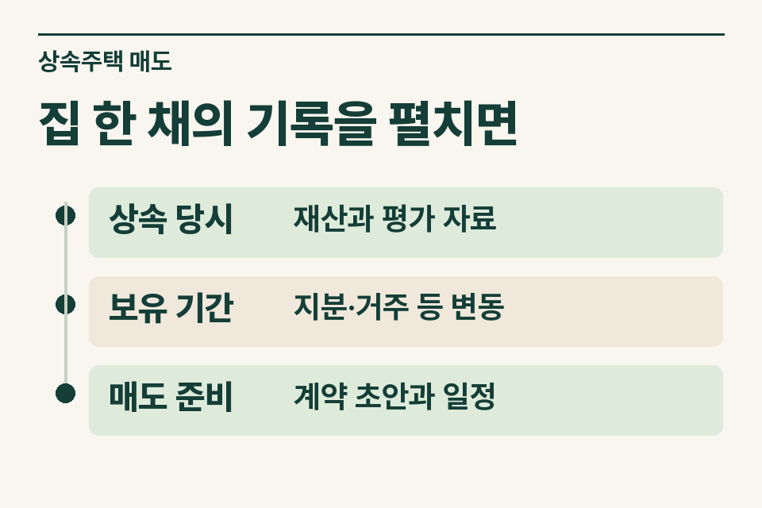
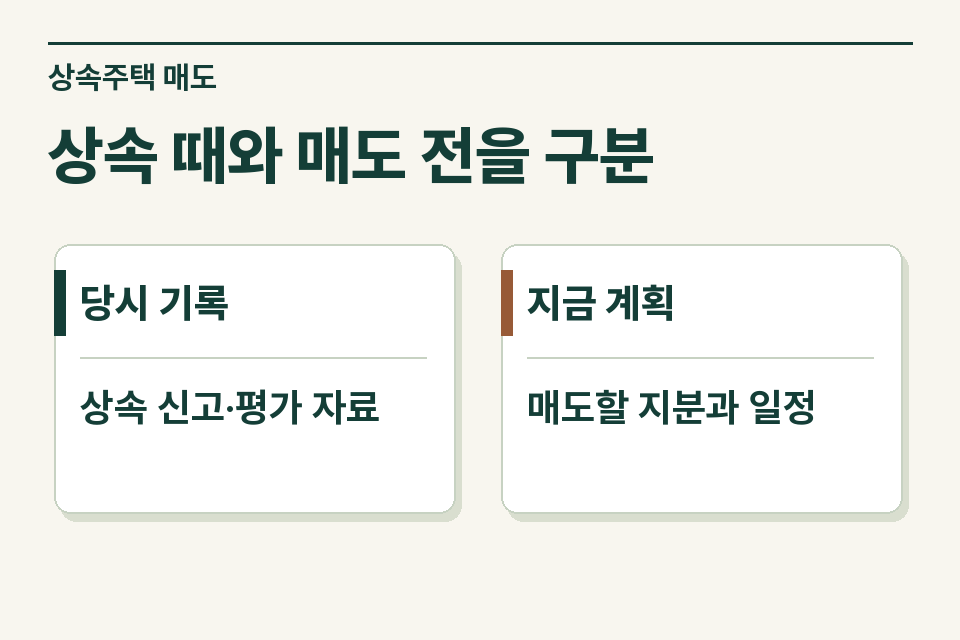

매도인이 등기사항증명서와 상속세 신고 접수증을 들고 왔다면 누가 어느 지분을 파는지부터 기록할 수 있습니다. 양도차익을 검토할 취득가액을 확인하려면 자료가 더 필요합니다. 사무소가 정리할 사실은 어떤 집의 어느 지분에 대해 어느 시점의 평가자료가 확인됐는지입니다. 이 글은 국내 주택을 상속한 개인의 일반적인 매도 상담을 전제로 합니다.

## 매물 한 건을 누구의 양도로 볼 것인가

먼저 매도 대상과 매도인을 짝지어 적습니다. 가족이 같은 집을 공동상속했어도 이번 계약이 전원 지분 매매인지 일부 지분 매매인지에 따라 확인할 범위가 달라집니다. 계약 초안의 물건 표시와 등기사항증명서의 주소·동·호·지분을 맞춥니다. 부속토지나 별도 필지가 있으면 함께 파는지도 확인합니다. ‘형제가 상속한 아파트’라고만 쓰면 각자 파는 지분과 거래대금을 가려내기 어렵습니다.

<figure style="margin:28px 0"><figcaption>집 한 채의 기록을 펼치면 — 상속 당시 · 재산과 평가 자료 / 보유 기간 · 지분·거주 등 변동 / 매도 준비 · 계약 초안과 일정</figcaption></figure>

## 상속 당시 금액을 확인하는 순서

|사무소가 받은 자료|여기서 확인할 항목|다음 확인이 필요한 경우|
|---|---|---|
|상속재산명세|자산 표시, 평가기준일, 전체 재산가액 또는 지분가액|주소는 같은데 동·호가 다르거나 전체·지분 구분이 없음|
|감정평가서·거래자료|평가 대상과 기준 시점, 신고 당시 사용한 근거|감정 대상이 다른 지분이거나 참고용 시세표만 있음|
|신고서 및 이후 결정·경정 자료|신고가액과 결정·경정 내용의 차이|접수증만 남아 개별 물건의 최종 가액을 알 수 없음|
|매매계약 초안|누가 어느 지분을 얼마에 파는지, 계약·잔금 예정일|거래가격이 협의 중이거나 일부 지분만 매도|

상속재산 평가에는 상속개시일을 기준으로 한 시가 원칙과 시가를 산정하기 어려울 때의 법정 방법이 있습니다. 상속 자산의 양도 시 취득가액을 검토할 때에는 관련 규정에 따른 평가액과 결정·경정 여부를 봅니다. 현재 매물의 호가를 곧바로 적용할 수는 없습니다. 상속세 신고를 하지 않은 경우에는 확보할 평가자료와 적용 규정을 별도로 검토합니다. [상속세 및 증여세법 제60조](https://www.law.go.kr/법령/상속세및증여세법/제60조) · [소득세법 시행령 제163조](https://www.law.go.kr/법령/소득세법시행령/제163조)

국세청 사전답변 사전-2024-법규재산-0143도 상속세 신고 여부와 상속주택의 양도 시 취득가액을 구분해 설명합니다. 매도인이 “상속세를 신고한 기억이 없다”고 하면 그 말만으로 취득가액을 정하지 않고, 상속개시 당시 평가자료와 별도로 결정·경정된 가액이 있는지 확인합니다. [국세청 사전답변 원문](https://taxlaw.nts.go.kr/qt/USEQTA002P.do?ntstDcmId=200000000000003446)

## 두 날짜가 다른 가정 사례

어머니가 봄에 돌아가셨고 남매는 가을에 상속등기를 마쳤다고 가정합니다. 매물은 아파트 전체이고 두 사람이 함께 매도합니다. 누나는 상속세 신고를 했다고 기억하지만 동생이 지참한 것은 등기사항증명서와 최근 시세 출력물뿐입니다. 중개사무소는 ‘상속개시일’, ‘등기접수일’, ‘이번 매매의 예정일’을 따로 기록합니다.

세무 검토자는 상속개시 당시 평가자료를 찾고, 신고서의 자산 전체 금액과 각 매도인의 지분 범위를 대조합니다. 확인 전이라면 추정 시세를 빈칸에 채우기보다 ‘상속 당시 평가자료 요청’으로 남겨 둡니다. 상속으로 취득한 자산의 취득시기는 원칙적으로 상속이 개시된 날입니다. [소득세법 시행령 제162조](https://www.law.go.kr/법령/소득세법시행령/제162조)

## 어떤 경우에 계약 전에 검토를 넘길까요?

예상 세후대금으로 다른 집의 잔금을 조달할 계획이라면 계약 전에 문의할 실익이 큽니다. 상속 직후 매도 협의가 시작됐거나, 공동상속인 중 한 명만 자기 지분을 팔거나, 상속세 결정 내용이 신고 내용과 달라졌다면 그 사실을 질문 첫 줄에 둡니다. 비과세를 묻는 경우에는 매도인별 세대 주택·권리 및 취득·거주 경위를 더 확인합니다. 상속주택이라는 이유만으로 매도인의 비과세 여부가 일괄 결정되지는 않습니다.

<figure style="margin:28px 0"><figcaption>상속 때와 매도 전을 구분 — 당시 기록 · 상속 신고·평가 자료 / 지금 계획 · 매도할 지분과 일정</figcaption></figure>

## 고객에게 전달할 문구

매도인이 집에서 서류를 찾아볼 때는 제이티 블로그의 [상속받은 집을 팔기 전, 계약 전에 찾아볼 서류](https://blog.naver.com/jt_tax/224469251114)를 안내하세요. 상속재산명세에서 해당 주택을 찾는 방법부터 설명합니다.

“매도 대상 주소와 파실 지분을 알려 주세요. 상속세 신고서가 있다면 재산명세에서 이 집이 나온 쪽과 나중에 평가금액이 변경된 자료가 있는지 확인해 주세요. 없는 자료는 아직 확인 중이라고 말씀해 주시면 됩니다.”

고객 동의 후 사무소는 물건과 지분, 상속·등기·매도 예정일, 확보한 평가자료, 남은 질문 순으로 제이티에 인계할 수 있습니다. 사전 문의에는 주민등록번호 등 민감정보를 기재하지 않습니다. 확인된 사실을 바탕으로 개별 검토 범위와 수수료를 안내합니다. 상속세 신고 자체의 흐름은 [상속세 기초 안내](https://www.jttax.co.kr/insights/inheritance-tax-basics.html), 사건 인계는 [공인중개사 협업 안내](https://www.jttax.co.kr/desk/broker.html)에서 볼 수 있습니다.
