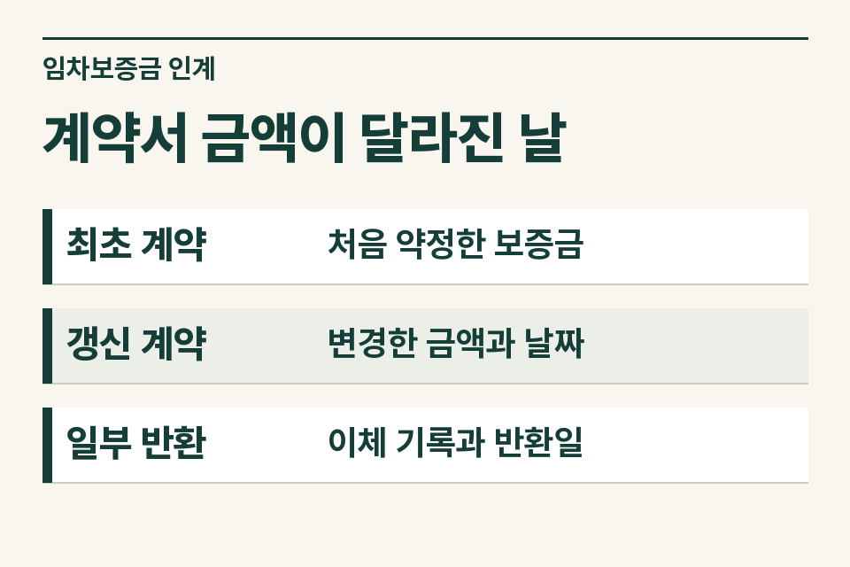
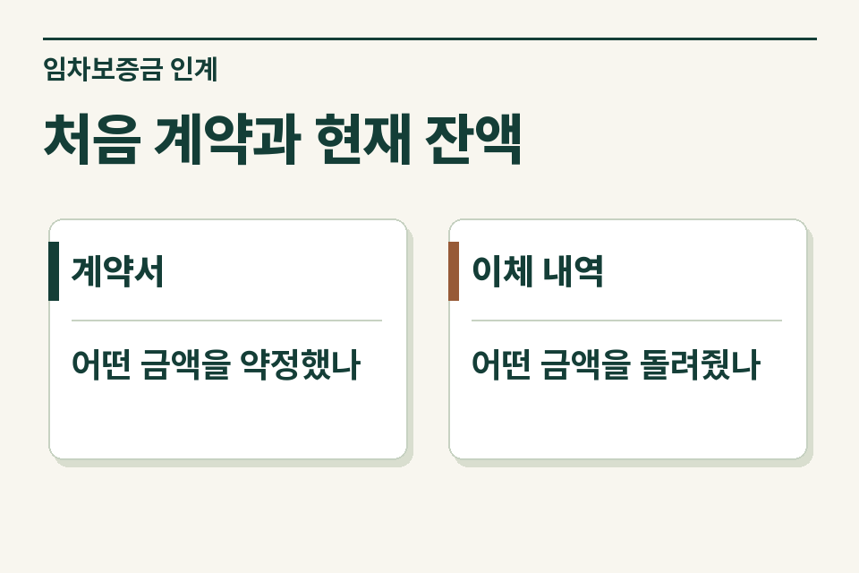

법무사 사무소가 확인할 첫 질문은 두 가지입니다. 증여일에 임차인에게 돌려줘야 할 보증금이 실제 얼마인지, 그 의무를 수증자가 어떤 내용으로 넘겨받는지입니다. 계약서가 여러 장이면 증여일을 표시한 뒤 그날 유효한 계약과 반환 거래를 찾아 연결합니다.

## 갱신계약서와 이체금액이 다르면 어디에 표시할까요?

설명을 위한 가정입니다. 어머니가 임대한 빌라를 딸에게 증여하려고 합니다. 갱신계약서에는 보증금을 낮추기로 했다고 적혀 있습니다. 어머니는 차액을 모두 반환했다고 기억하지만 통장에서는 두 차례로 나눈 이체 중 하나만 확인됩니다. 사무소는 첫 문의에 어느 금액을 적어야 할까요?

계약상 보증금과 확인된 반환금액을 각각 적고, 나머지 이체내역을 찾고 있다고 표시합니다. 지급 약정이 있는 금액, 증여일까지 지급한 금액, 지급일이 증여 뒤인 금액을 섞으면 당시 채무 잔액을 다시 추적하기 어렵습니다. 이체 금액이 확인돼도 계약 상대방이 아닌 계좌로 나갔다면 누구의 요청에 따른 지급인지 추가로 살펴봅니다.

| 자료 | 표시할 내용 | 맞지 않을 때 확인할 자료 |
|---|---|---|
| 최초 임대차계약서 | 동·호수, 임대인, 임차인, 약정 보증금 | 실제 보증금 입금내역 |
| 갱신 계약서·특약 | 종전 계약과의 관계, 변경 금액과 효력 발생일 | 차액 반환 약정·실제 이체일 |
| 증여계약서와 부속 약정 | 인수 대상으로 적은 해당 주택의 보증금, 약정일 | 같은 집의 어떤 계약을 가리키는지, 증여일 잔액과 맞는지 |
| 반환자금 자료 | 반환 주체, 계좌 명의, 자금의 실제 출처 | 앞으로 반환할 자금 계획 또는 이미 실행한 반환 거래 |

<figure style="margin:28px 0"><figcaption>계약서 금액이 달라진 날 — 최초 계약 · 처음 약정한 보증금 / 갱신 계약 · 변경한 금액과 날짜 / 일부 반환 · 이체 기록과 반환일</figcaption></figure>

## 부모와 자녀 사이에서 자료가 더 필요한 이유는 무엇인가요?

상속세 및 증여세법은 증여재산과 관련된 채무 중 수증자가 인수하는 금액에 대해 규정하고 있습니다. 임대보증금도 검토 대상이 될 수 있습니다. 부모와 자녀 사이에서는 채무가 인수되지 않은 것으로 추정하는 규정과 객관적으로 인정되는 경우의 예외가 함께 적용됩니다. 사무소는 증여계약서에 기재된 액수를 그대로 공제액으로 안내하기 전에 계약·잔액·인수 사실을 세무사에게 넘겨 확인하도록 합니다. [상속세 및 증여세법 제47조](https://www.law.go.kr/법령/상속세및증여세법/제47조) · [같은 법 시행령 제36조](https://www.law.go.kr/법령/상속세및증여세법시행령/제36조)

## 무엇을 ‘확인 전’으로 남겨 두면 좋을까요?

가정 사례의 딸이 “세입자가 나가면 제 돈으로 돌려주려고 합니다”라고 말했다면 그 말은 향후 계획으로 기록합니다. 아직 발생하지 않은 반환 거래를 완료된 것처럼 기입하지 않습니다. 반대로 증여 뒤 이미 세입자에게 반환했는데 부모가 먼저 자녀 계좌에 돈을 넣었다면, 두 이체의 날짜와 자금 출처까지 함께 적습니다. 당사자 설명과 객관적인 증빙이 어디까지 일치하는지 세무사가 별도로 검토할 수 있습니다.

공동명의 주택이라면 임대차계약의 임대인, 증여하는 지분, 인수하기로 한 의무의 범위를 각각 확인합니다. 지분 비율만 보고 보증금 인수액을 미리 계산해 적기보다 당사자가 실제 합의한 내용을 전달하는 편이 정확합니다.

## 계약 전 상담과 등기 후 상담은 어디가 다를까요?

계약 전에는 아직 서명하지 않은 초안과 가족의 반환 계획을 검토할 수 있습니다. 등기 후에는 실제 체결한 문서, 등기일, 이미 신고한 세목과 신고서, 증여 후의 반환 경과를 확인합니다. 같은 질문을 보내더라도 “증여 예정이며 계약서 초안만 있음” 또는 “등기 완료, 신고서 사본 보유”라고 첫 줄에 쓰면 검토 순서가 달라집니다.

부모에게 은행 대출도 있다면 임대보증금과 구분하여 별도 행에 기록합니다. 금융기관에서 발급한 채무자료와 임차인에게 반환할 돈은 증빙이 서로 다릅니다. [부담부증여 세무 검토 안내](https://www.jttax.co.kr/insights/burdened-gift.html)

<figure style="margin:28px 0"><figcaption>처음 계약과 현재 잔액 — 계약서 · 어떤 금액을 약정했나 / 이체 내역 · 어떤 금액을 돌려줬나</figcaption></figure>

## 세무사에게 보낼 메모는 어떻게 끝맺을까요?

가족이 직접 서류를 준비한다면 제이티 블로그의 [전세 준 집을 자녀에게 증여할 때 확인할 보증금과 반환 내역](https://blog.naver.com/jt_tax/224471372625)을 함께 참고하세요.

“증여 예정인 빌라에 임차인이 있습니다. 갱신 때 보증금을 낮추기로 했고 실제 이체 한 건을 확인했습니다. 나머지 반환 여부와 자녀의 인수 약정은 확인 중입니다. 증여일 기준 채무 잔액과 증여자·수증자의 세무 검토 범위를 검토해 주세요.”

사무소는 의뢰인의 동의를 받아 자료 현황부터 공유할 수 있습니다. 제이티 세무법인은 추가로 볼 계약서와 지급자료를 특정하고, 검토 범위와 개별 수수료를 안내합니다. [법무사 사무소 협업 문의](https://www.jttax.co.kr/desk/scrivener.html)
