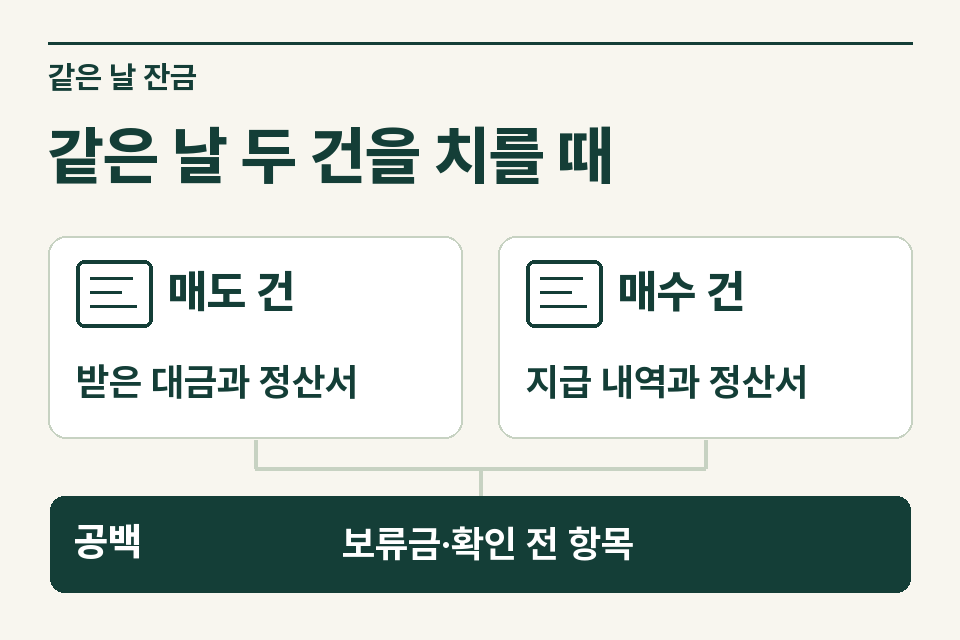
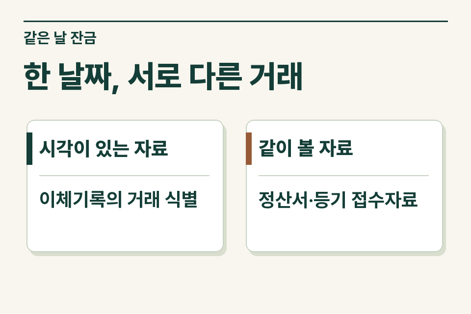

한 사람이 하루에 매도인과 매수인이 되면 같은 돈이 두 계약을 거쳐 이동합니다. 세무 인계 시에는 거래별로 약정 잔금과 실제 지급·승계 내용을 맞춘 뒤, 등기접수가 먼저였는지와 미지급액의 성격을 표시합니다. 첫 이체와 마지막 이체의 시각만으로 양도·취득의 법적 순서를 단정할 수 없습니다.

## 한 계좌에서 두 계약을 분리하는 법

설명을 위한 가정입니다. 고객은 오전에 종전 주택을 팔고 오후에 다른 주택을 삽니다. 오전 매수인은 잔금 일부를 고객의 임차인에게 직접 송금하기로 약정했습니다. 오후에 사는 집에는 계속 거주할 임차인이 있고 고객이 보증금 반환채무를 인수하기로 했습니다. 첫 거래에는 제3자에게 실제 지급한 금액이 있고, 둘째 거래에는 당일 이체가 발생하지 않는 승계분이 있습니다. 통장의 입출금 합계만으로 두 거래의 정산 내용을 재현하기 어려운 사례입니다.

<figure style="margin:28px 0"><picture><source media="(prefers-reduced-motion: no-preference)" srcset="/project/assets/insights/same-day-balances-evidence-steps.webp"></picture><figcaption>같은 날 두 건을 치를 때 — 매도 건 · 받은 대금과 정산서 / 매수 건 · 지급 내역과 정산서 / 공백 · 보류금·확인 전 항목</figcaption></figure>

## 정산표에서 빠지기 쉬운 칸

|거래|계약에서 확인할 것|실행 때 확보할 자료|
|---|---|---|
|종전 주택 매도|계약상 잔금과 고객 직접 수령분|매수인의 송금 내역, 고객 수령 확인|
|종전 주택 보증금 반환|누가 누구에게 지급하기로 했는지|임대차계약 잔액, 반환 약정, 수취인과 금액이 맞는 지급 기록|
|새 주택 매수|매도인에게 보낼 금액과 이미 지급한 금액|매매계약서, 매도인 수령 내역, 별도 정산 명세|
|새 주택 보증금 승계|임대차 보증금과 매매대금에서 반영한 금액|임대차계약·변경 합의와 매매 특약, 승계 잔액 확인자료|
|두 집의 등기·미지급|각 등기접수일, 남은 매매대금의 지급기일|등기사항증명서·접수증, 잔액 합의 및 후속 이체|

각 지급 옆에 어느 계약의 채무를 정리한 것인지 적습니다. 임차인에게 보낸 송금을 매수대금에서 이미 반영했다면 정산표에 한 번만 반영합니다. 관리비·수선비·이사 정산금이 섞이면 별도 행에 금액의 성격을 표시합니다. 차액이 남는다고 곧바로 청산일을 확정하거나 미지급 대금으로 처리해서는 안 됩니다.

## 같은 날이라는 사정과 대금청산일

양도소득세에서 일반 매매는 대금청산일이 원칙입니다. 청산일이 불분명하거나 청산 전에 소유권이전등기가 이뤄진 경우에는 등기접수일 등 별도 기준이 적용됩니다. 실제 송금 시각은 돈의 흐름을 입증하는 자료이고, 조문은 취득·양도 시기를 날짜 기준으로 정하고 있습니다. 청산일이 같은 경우 어떤 특례를 적용할지는 해당 세목과 거래 사실에 맞춰 검토합니다. [소득세법 제98조](https://www.law.go.kr/법령/소득세법/제98조) · [소득세법 시행령 제162조](https://www.law.go.kr/법령/소득세법시행령/제162조)

## 일부 잔금이 다음 날 지급된 경우

앞 사례에서 종전 주택 매수인이 대출 실행을 하루 늦췄다고 가정합니다. 세무 검토에 필요한 질문은 ‘늦은 이체가 있었다’에서 끝나지 않습니다. 종전 집 매매대금 중 어떤 금액이 남았는지, 당초 약정이 어떻게 달라졌는지, 등기가 이미 접수됐는지, 임차인에게 준 금액과 미지급분이 같은 항목인지 확인합니다. 새집 거래의 지급 일정을 함께 변경했는지도 따로 적습니다.

이때 원계약서에는 예정된 잔금일이, 이체확인증에는 실제 지급일이 남아 있어야 두 자료를 대조할 수 있습니다. 원계약서와 수정 합의가 있다면 각각 보관하고, 임대차보증금 관련 금액이 달라졌다면 조정 내역도 함께 남깁니다.

<figure style="margin:28px 0"><figcaption>한 날짜, 서로 다른 거래 — 시각이 있는 자료 · 이체기록의 거래 식별 / 같이 볼 자료 · 정산서·등기 접수자료</figcaption></figure>

## 사무소가 제이티에 넘길 질문

매도인이나 매수인에게 준비할 자료를 안내할 때는 제이티 블로그의 [같은 날 매도·매수 잔금을 치를 때 남겨 둘 이체·보증금 내역](https://blog.naver.com/jt_tax/224472869198)을 공유할 수 있습니다.

“종전 주택 매매 잔금 중 임차인 직접 송금분이 있으며, 새 주택은 임차보증금을 승계했습니다. 종전 주택 등기접수는 확인됐고, 남은 지급 건의 성격은 확인 중입니다. 종전 주택의 양도 시기와 새 주택 취득세 검토에 필요한 자료가 각각 무엇인가요?”

고객 동의를 받고 두 계약의 정산 내역을 인계하면 제이티가 양도소득세와 취득세에서 별도로 확인할 사항, 업무 범위와 수수료를 안내합니다. 취득세의 잔금·등기 판단 사례는 [취득세 취득일 안내](https://www.jttax.co.kr/insights/acquisition-tax-acquisition-date.html), 상담 경로는 [공인중개사 협업 안내](https://www.jttax.co.kr/desk/broker.html)에 있습니다.
