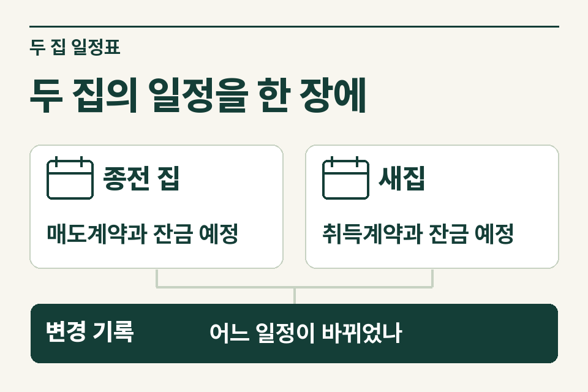
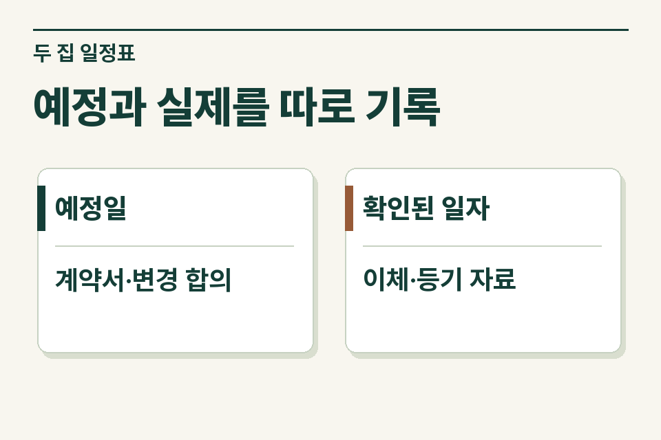

종전 주택을 팔고 새 주택을 사는 중개 의뢰에서는 양도소득세와 취득세 질문이 한꺼번에 들어옵니다. 종전 주택의 매도인이 새 주택 거래에서는 매수인이기 때문입니다. 두 거래의 소재지와 날짜를 한 장에 작성하되, 세무사에게는 어느 거래의 어떤 세금을 먼저 물을지 명시합니다.

## 계약 예정, 계약 체결, 잔금 완료를 구별하기

‘매도 완료’라는 메모의 뜻부터 확인합니다. 매수 희망자가 나타난 것인지, 매매계약을 체결한 것인지, 실제 잔금을 받았는지가 모두 다릅니다. 계약일과 실제 대금청산일은 별도 칸을 씁니다. 양도소득세에서 일반적인 매매의 양도·취득 시기는 대금을 청산한 날을 중심으로 판단하고, 불명확하거나 먼저 등기를 한 경우에는 별도 기준이 있습니다. [소득세법 제98조](https://www.law.go.kr/법령/소득세법/제98조) · [소득세법 시행령 제162조](https://www.law.go.kr/법령/소득세법시행령/제162조)

<figure style="margin:28px 0"><picture><source media="(prefers-reduced-motion: no-preference)" srcset="/project/assets/insights/two-home-contract-timeline-steps.webp"></picture><figcaption>두 집의 일정을 한 장에 — 종전 집 · 매도계약과 잔금 예정 / 새집 · 취득계약과 잔금 예정 / 변경 기록 · 어느 일정이 바뀌었나</figcaption></figure>

## 한 장에 적을 항목

|항목|종전 주택에 적을 사실|신규 주택에 적을 사실|
|---|---|---|
|물건과 소유자|주소·지분·처음 취득한 경위와 날짜|주소·명의 예정자·현재 계약 단계|
|계약|매매계약 체결일 또는 아직 매물인 상태|매수계약일과 계약금 지급일·증빙|
|대금과 등기|매도 잔금 약정일·실제 청산일·등기접수일|매수 잔금 약정일·실제 청산일·등기접수일|
|세대 상황|종전 주택 보유·거주 이력과 다른 주택·권리|취득 시점에 달라지는 세대·권리 관계|
|변경 가능성|매수인 대출 일정, 세입자 퇴거 일정|대출 실행 변경, 먼저 등기하는 약정 여부|

기입한 일자마다 ‘계약서 확인’, ‘고객 진술’, ‘예정’ 중 사실에 맞는 말을 붙입니다. 지역 지정 시점과 비교할 계약이 있다면 주소·계약서와 함께 계약금 이체자료를 보관합니다. 등기 접수가 되지 않은 거래에는 미래 접수일을 확정일처럼 기입하지 않습니다.

## 가정 사례에서 먼저 물을 질문

고객은 새집 매수계약을 마쳤고 종전 주택의 매도계약은 아직 협의 중이라고 가정합니다. 종전 주택의 매수 희망자가 잔금을 당겨 치르겠다고 제안했습니다. 사무소에서 먼저 확인할 것은 고객이 그 제안에 동의했는지, 새 주택 매수 일정도 함께 바뀌는지입니다. 현재 계약안과 변경안 두 줄을 만들어 세무 검토자에게 보냅니다. 어느 쪽이 유리하다고 먼저 이름 붙이지 않습니다.

종전 주택을 오래 보유했다는 설명이 있어도 다른 주택이나 분양권이 있다는 사실을 뒤늦게 알면 판단의 전제가 달라집니다. 정확한 답을 모르면 ‘배우자 명의 권리 확인 중’이라고 기록해 둡니다. 세대의 상황과 지역·계약 시점이 확인된 뒤 세금별 적용 기준과 일정을 다시 대조합니다.

## 지역과 적용 시기를 확인하는 이유

일시적으로 두 주택을 보유하는 경우의 양도소득세 특례는 종전 주택과 신규 주택의 취득 간격, 신규 주택 취득 뒤 종전 주택을 양도하는 시점 등을 규정합니다. 지역 지정 상태, 공고 전 매매계약과 계약금 지급을 증명할 수 있는지에 따라 살필 문구가 달라집니다. 취득 및 양도 당시의 법령과 개정 부칙도 확인해야 하므로 누구에게나 같은 처분기한을 적어 전달하면 곤란합니다. 해당 특례가 적용되더라도 종전 주택의 보유·거주 등 개별 비과세 요건은 별도로 확인합니다. [소득세법 시행령 제155조](https://www.law.go.kr/법령/소득세법시행령/제155조)

<figure style="margin:28px 0"><figcaption>예정과 실제를 따로 기록 — 예정일 · 계약서·변경 합의 / 확인된 일자 · 이체·등기 자료</figcaption></figure>

## 계약 조건을 바꾸기 전 넘기는 인계 문구

“종전 주택 매도 잔금은 아직 협의 중이며 새 주택 매수 잔금은 계약서로 확인했습니다. 종전 주택의 취득 자료와 신규 주택 계약금 영수증을 확보했습니다. 종전 주택 양도소득세와 신규 주택 취득세를 각각 검토할 때 변경 전에 추가로 필요한 사실을 알려 주세요.”

취득세 쪽에 먼저 살펴볼 자료는 [일시적 2주택 취득세 안내](https://www.jttax.co.kr/insights/acquisition-tax-temporary-two-houses.html)에 있습니다. 사무소가 고객 동의를 받아 [공인중개사 상담 창구](https://www.jttax.co.kr/desk/broker.html)로 일정을 인계하면 제이티가 검토할 세목과 범위, 추가 자료, 수수료를 안내합니다.
