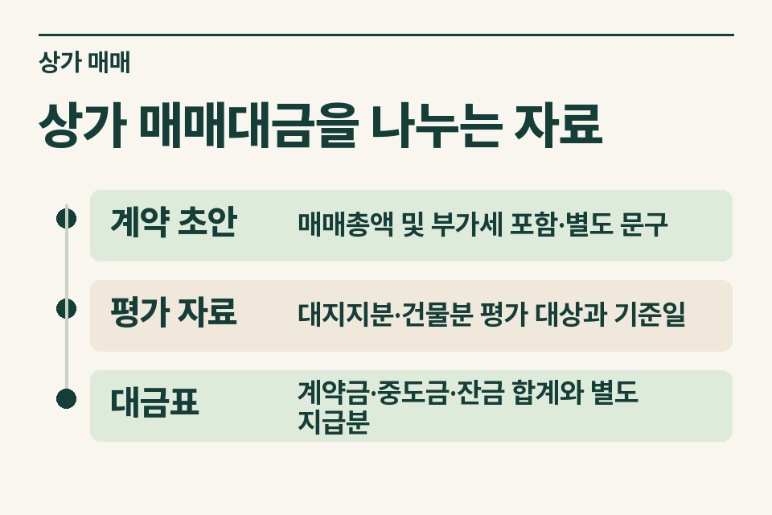
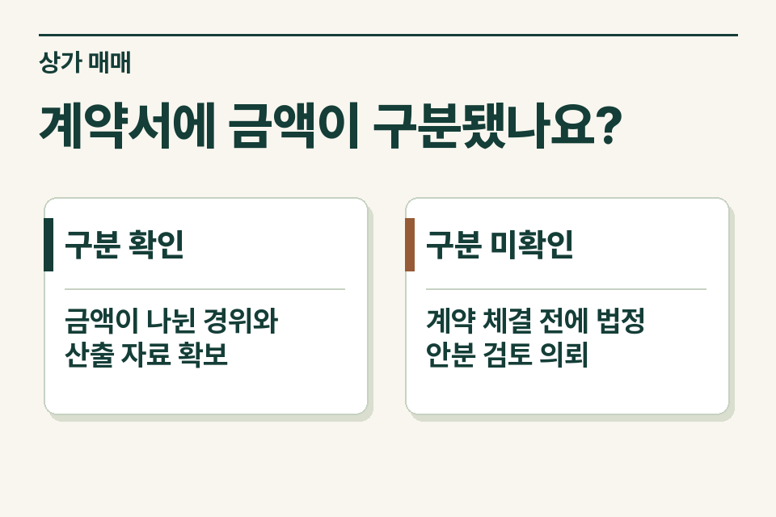

상가 매매 중개에서 총액 합의가 끝난 뒤 ‘건물분 부가세 별도’라는 문구가 등장하면 당사자가 생각한 잔금이 달라질 수 있습니다. 거래가 과세되는지, 건물 공급가액을 어떤 자료로 정했는지, 누가 어떤 금액을 별도로 지급하기로 했는지를 계약 전에 확인합니다. 토지의 공급은 부가가치세 면세이고, 사업자가 사업상 공급하는 상가 건물분은 일반적으로 과세 대상입니다. 임대사업 자체를 넘기는 계약이면 사업 양도 해당 여부도 따로 살펴야 합니다.

## 당사자가 서로 다른 총액을 생각한 경우

매도인은 중개대상물 설명서의 가격을 세금 제외 금액으로, 매수인은 자신이 지급할 전액으로 이해했다고 가정합니다. 같은 숫자를 두고도 매수인이 준비할 잔금이 달라집니다. 사무소는 어느 해석을 선택할지 대신 정하기보다 양측이 합의한 가격의 범위를 다시 확인해 계약서 작성 전 기록합니다.

<figure style="margin:28px 0"><figcaption>상가 매매대금을 나누는 자료 — 계약 초안 · 매매총액 및 부가세 포함·별도 문구 / 평가 자료 · 대지지분·건물분 평가 대상과 기준일 / 대금표 · 계약금·중도금·잔금 합계와 별도 지급분</figcaption></figure>

## 총액을 구성하는 세 자료

| 자료 | 무엇을 읽을까 |
|---|---|
|계약 초안|매매총액 및 부가세 포함·별도 문구|
|평가 자료|대지지분·건물분 평가 대상과 기준일|
|대금표|계약금·중도금·잔금 합계와 별도 지급분|

평가서를 받았다면 구분소유 상가의 대지지분과 건물 전유·공용 부분이 실제 매매 대상과 일치하는지 봅니다. 다른 호실의 평가금액, 취득 당시의 오래된 장부가액, 계약 막바지에 근거 없이 만든 비율은 각각 자료 성격이 다릅니다. 두 당사자가 합의한 숫자라고 해서 어떤 배분이든 세무상 인정된다는 뜻은 아닙니다.

## 누가 어떤 자산을 파는 거래인가

사업자가 공급하는 토지와 건물은 부가가치세 검토 내용이 다릅니다. 토지와 건물을 함께 공급할 때에는 구분되는 실지거래가액, 구분이 불분명하거나 법령상 다시 안분해야 하는 경우의 산정 기준을 살펴야 합니다. 사안에 따라 기준시가·감정평가 등 어떤 자료가 유효한지는 평가 시점과 요건을 확인한 뒤 정합니다. [부가가치세법 제29조](https://www.law.go.kr/법령/부가가치세법/제29조) · [부가가치세법 시행령 제64조](https://www.law.go.kr/법령/부가가치세법시행령/제64조) · [부가가치세법 제26조](https://www.law.go.kr/법령/부가가치세법/제26조)

## 잔금표를 다시 읽을 자리

계약 초안의 매매총액에 토지·건물 합계가 맞는지, 세액 포함·별도 표기와 계약금·중도금·잔금표가 같은 전제를 쓰는지 대조합니다. 임차보증금 승계나 시설·집기 대금이 섞이면 해당 항목을 별도 표시합니다. 검토 전 대략 나눈 금액을 계약서에 확정값으로 옮기면 나중에 합의를 다시 확인해야 합니다.

<figure style="margin:28px 0"><figcaption>계약서에 금액이 구분됐나요? — 구분 확인 · 금액이 나뉜 경위와 산출 자료 확보 / 구분 미확인 · 계약 체결 전에 법정 안분 검토 의뢰</figcaption></figure>

## 세무사에게 보낼 한 줄

‘매도인의 임대 현황과 대지지분은 확인했고, 총액에 건물분 부가세가 포함되는지는 협의 중입니다. 평가자료로 금액 구분을 뒷받침할 수 있는지 확인해 주세요.’ 당사자 동의 후 초안과 근거 자료를 보내면 제이티가 검토 범위와 필요한 추가 자료를 안내합니다. [부가가치세 기초](https://www.jttax.co.kr/insights/vat-basics.html) · [공인중개사 상담 창구](https://www.jttax.co.kr/desk/broker.html)
