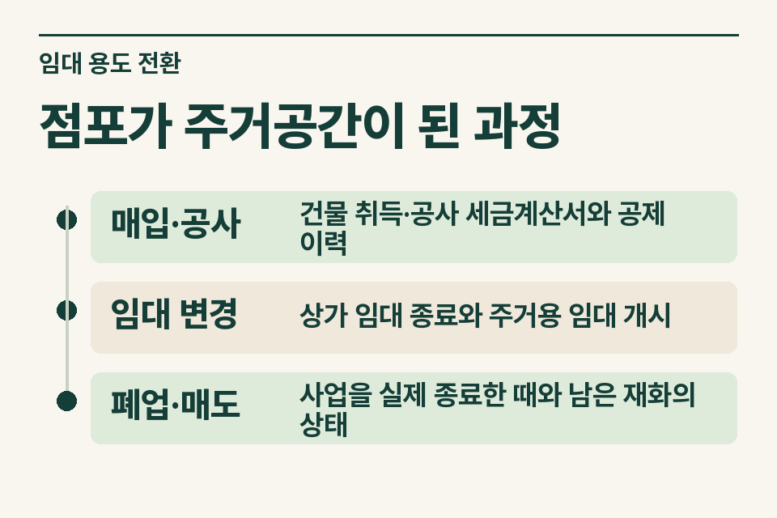

이 글은 한 건물 안의 주거·상가 면적을 나누는 양도세 계산과 다른 질문을 다룹니다. 과세 임대에 쓰던 건물을 주거용 임대로 전환한 뒤 팔 경우에는 취득·공사 당시의 매입세액 처리와 사용 변경, 사업 종료의 시점을 대조해야 합니다.

## 공사 후 첫 임대차가 바뀐 사례

상가 임차인이 퇴거한 뒤 내부 구조를 고치고 주거용으로 임대했다고 가정합니다. 매도인은 매매계약이 예정돼 있어 곧 폐업신고부터 하려 합니다. 그러나 공사가 끝난 날, 새 임차인이 주거용으로 사용한 날, 사업이 실제 종료된 날은 서로 다를 수 있습니다. 폐업신고서 한 장만으로 전 과정을 설명하기 어렵습니다.

<figure style="margin:28px 0"><figcaption>점포가 주거공간이 된 과정 — 매입·공사 · 건물 취득·공사 세금계산서와 공제 이력 / 임대 변경 · 상가 임대 종료와 주거용 임대 개시 / 폐업·매도 · 사업을 실제 종료한 때와 남은 재화의 상태</figcaption></figure>

## 세 기간을 잇는 자료

| 자료 | 무엇을 읽을까 |
|---|---|
|매입·공사|건물 취득·공사 세금계산서와 공제 이력|
|임대 변경|상가 임대 종료와 주거용 임대 개시|
|폐업·매도|사업을 실제 종료한 때와 남은 재화의 상태|

건물을 샀을 때나 주요 공사 때 부가세를 공제받았는지 당시 신고서 부속명세와 거래 증빙을 찾습니다. 임대변경 후 다른 과세 임대사업을 계속했는지, 건물의 일부만 전환했는지도 기록합니다. 공사의 목적과 사용기간이 달라지면 확인할 재화와 범위도 달라집니다.

## 면세 전용과 폐업 시 재화를 확인하는 이유

상시 주거용 주택 임대에 대한 면세 규정과 과세사업용 재화를 면세사업에 사용하거나 폐업할 때 남은 재화에 관한 규정이 각각 있습니다. 적용 여부는 실제 사용, 취득·공제 이력 및 각 시점의 재화 상태로 확인합니다. 용도를 바꿨다는 사실만으로 취득 당시 공제분 전액을 반환한다고 계산하지 않습니다. [부가가치세법 제10조](https://www.law.go.kr/법령/부가가치세법/제10조) · [부가가치세법 제26조](https://www.law.go.kr/법령/부가가치세법/제26조)

## 양도 시점의 질문과 분리하기

용도 전환 시점, 폐업 시점, 건물 매도 시점별로 해당 재화가 어디에 사용됐는지 표시합니다. 이미 어느 시점에 세무 처리한 금액이 있으면 신고 내역과 연결해 같은 금액을 두 번 반영하지 않도록 검토합니다. 건물 매도 자체의 부가세 판단도 주거용 임대가 면세라는 설명만으로 확정할 수 없습니다.

<figure style="margin:28px 0"><figcaption>사용 변경과 실제 폐업 구분 — 용도 전환 · 과세사업용 건물이 언제 어떻게 쓰였는지 / 사업 종료 · 실제 폐업 시 남은 재화가 무엇인지</figcaption></figure>

## 계약 전 전달 예시

‘상가 임대 때 건물 매입세액을 공제받은 자료가 있고 주거용 임대차계약서는 변경 후 작성됐습니다. 아직 매도계약을 체결하지 않았습니다.’ 제이티가 전환·폐업·매도 중 어떤 시점에 어떤 자료를 먼저 비교할지 안내합니다. [부가가치세 기초](https://www.jttax.co.kr/insights/vat-basics.html) · [공인중개사 상담 창구](https://www.jttax.co.kr/desk/broker.html)
