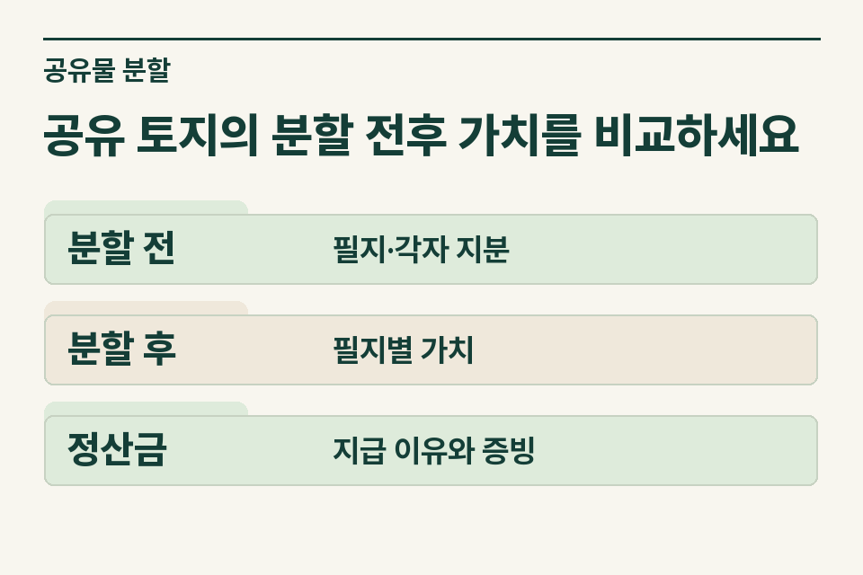
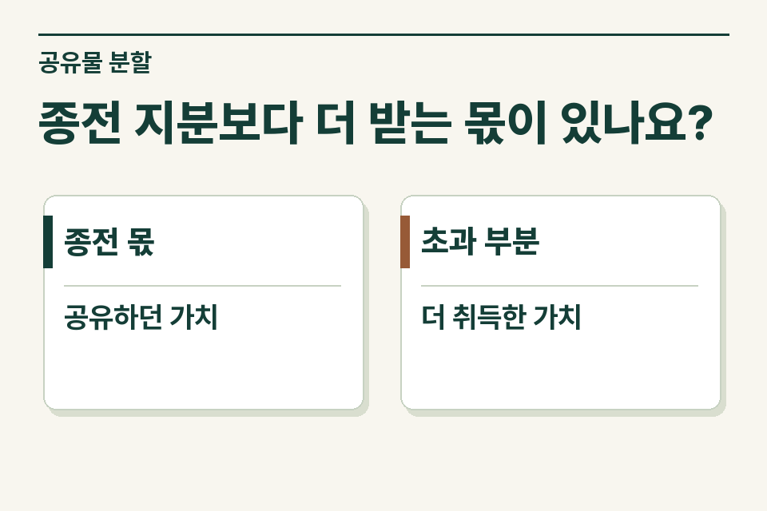

분할 전 각 공유자의 지분과 분할 후 실제로 취득할 재산의 가치를 맞춰 보세요. 같은 면적이어도 도로 접면, 용도, 위치 등에 따라 받을 재산의 가치가 달라질 수 있습니다. 정산금이 있다면 누구의 어떤 차이를 보전하는 돈인지도 구분합니다.

## 같은 넓이의 두 필지가 다른 경우

설명을 위한 사례입니다. 두 사람이 한 토지를 같은 지분으로 보유하다가 앞쪽 필지와 뒤쪽 필지를 나누어 갖기로 했습니다. 도로에 붙은 필지를 받는 사람이 상대방에게 돈을 지급하기로 했습니다. 가족은 면적이 같아 지분을 그대로 나누었다고 이해하지만, 세무 검토에는 전후 재산가액과 정산 약정이 필요합니다.

<figure style="margin:28px 0"><figcaption>공유 토지의 분할 전후 가치를 비교하세요 — 분할 전 · 필지·각자 지분 / 분할 후 · 필지별 가치 / 정산금 · 지급 이유와 증빙</figcaption></figure>

## 사무소는 무엇을 비교하면 될까요?

| 구분 | 확인할 자료 | 기록할 항목 |
|---|---|---|
| 이전 공유 | 종전 등기사항증명서, 지적 자료 | 필지와 지분, 지분 취득 경위 |
| 분할 결과 | 분할도·협의서·새 지번 | 각자 단독으로 취득할 목적물, 필지별 가치 |
| 가치 자료 | 감정 등 평가에 사용한 자료 | 평가 시점과 대상, 같은 기준인지 |
| 금전 정산 | 정산 약정·지급 내역 | 지급자·수령인, 산출 이유, 지급일 |

## 종전 지분을 초과하는지 누가 계산하나요?

지방세법은 공유물 분할에 따른 취득을 규정하면서 등기부상 본인 지분을 초과하는 부분을 구별합니다. 검토할 때 원래 지분의 가치를 먼저 놓고 분할 후 귀속 재산의 가치를 같은 기준으로 비교합니다. 등기 원인에 ‘공유물분할’이라고 적었다는 사실만으로 모든 부분에 동일한 취득세 취급이 적용된다고 안내하지 않습니다.

## 송금한 돈이 모두 정산금인가요?

서울고등법원이 살핀 사건에서는 공유 부동산 여러 건과 공유자 중 한 사람이 별도로 소유하던 재산이 한 계약에 담겼습니다. 법원은 종전 공유지분 범위에서 나눈 부분과 이를 초과해 얻은 부분을 구분해 당시 취득세 특례의 적용 범위를 판단했습니다. 대법원은 상고를 기각했습니다. 이 사건은 당시 법과 소유관계를 전제로 하므로, 지금 의뢰받은 필지마다 원래 누구의 몫이었고 정산금이 무엇을 보전하는지 따로 확인합니다. [서울고법 2021누62845 및 대법원 2022두58742](https://www.law.go.kr/precInfoP.do?precSeq=423832)

별도 측량비나 공사비를 나눠 부담한 돈과 지분 차이를 맞추려고 지급하는 돈을 따로 적습니다. 송금액이 합쳐져 있으면 협의서의 정산 조항·산출 메모와 비용 영수증을 구분해 주세요. 돈을 지급하지 않기로 한 경우에도 가치 차이를 어떻게 정리했는지 사실관계를 확인합니다.

<figure style="margin:28px 0"><figcaption>종전 지분보다 더 받는 몫이 있나요? — 종전 몫 · 공유하던 가치 / 초과 부분 · 더 취득한 가치</figcaption></figure>

## 인계할 때 남기는 문장

“앞쪽 필지를 받는 공유자가 차액을 지급할 예정입니다. 종전 지분·분할안·평가 기준을 확보했고 송금 전입니다. 측량비 분담분은 별도로 표기했습니다.” 제이티 세무법인은 지분을 초과해 취득하는 부분이 있는지와 정산 거래의 성격을 살펴 세목별 검토 범위를 안내합니다.

[지방세법 제7조](https://www.law.go.kr/법령/지방세법/제7조) · [지방세법 제11조](https://www.law.go.kr/법령/지방세법/제11조)

[취득세 자료 안내](https://www.jttax.co.kr/insights/acquisition-tax-costs.html) · [법무사 협업 상담](https://www.jttax.co.kr/desk/scrivener.html)

네이버 블로그에서 [공유자가 분할 차액과 측량비를 함께 지급하는 사례](https://blog.naver.com/jt_tax/224475530529)를 읽을 수 있습니다.
