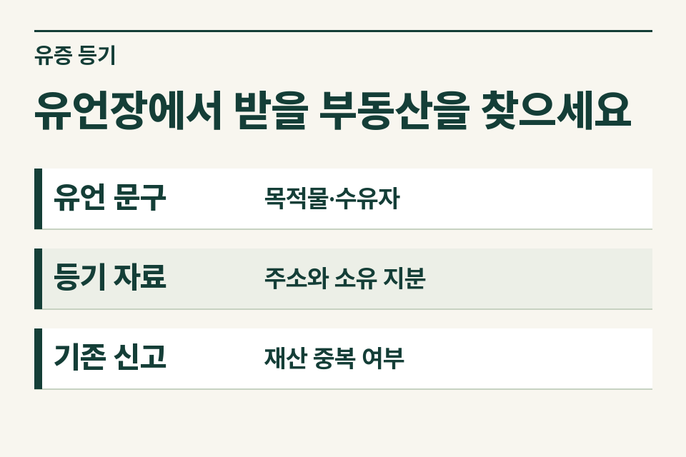
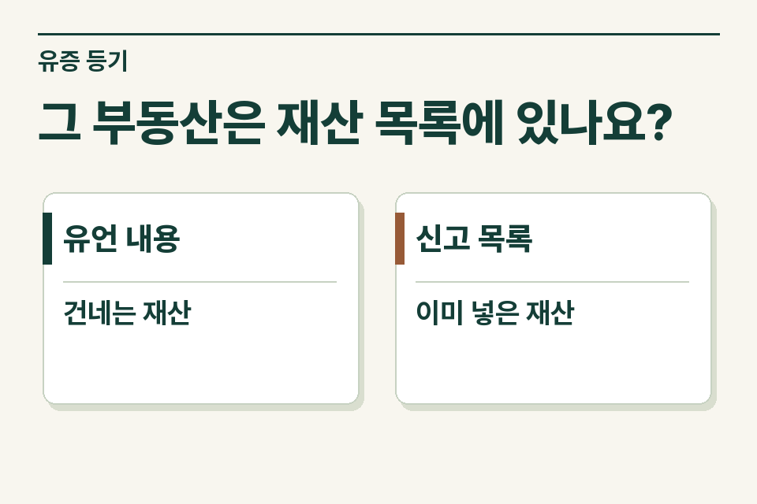

유언으로 특정 부동산을 받는 사람과 나머지 재산을 나눌 가족을 한 표에 기록하되, 부동산 한 건은 한 행에서 관리합니다. 유증은 상속세법상 상속의 범위에 포함되므로 등기 원인에 ‘유증’이 적힌다는 사정만으로 세무 검토에서 빼지 않습니다.

## 수유자와 상속인이 같은 사람인지 확인합니다

가정 사례입니다. 고인이 “내가 소유한 상가 지분을 조카에게 준다”는 유언을 남겼다고 가족이 설명합니다. 자녀가 만든 재산 목록에는 이미 그 상가 전체가 포함돼 있습니다. 먼저 원문에서 누구에게 어떤 재산을 주도록 했는지 확인하세요. 목록 작성자가 임의로 입력한 건물 전체가 실제 고인 지분과 같은지도 살핍니다.

<figure style="margin:28px 0"><figcaption>유언장에서 받을 부동산을 찾으세요 — 유언 문구 · 목적물·수유자 / 등기 자료 · 주소와 소유 지분 / 기존 신고 · 재산 중복 여부</figcaption></figure>

## 상가 한 칸을 다음 자료와 맞춰 보세요

| 자료 | 확인할 내용 | 불일치하는 경우 |
|---|---|---|
| 유언 문서 | 지정된 사람, 주소·호수, 특정 지분, 조건 | 유언의 효력과 대상은 등기 담당자·법률 전문가에게 확인 |
| 등기사항증명서 | 사망 당시 소유자와 지분 | 고인이 보유하지 않은 몫을 따로 표시 |
| 가족 작성 재산표 | 같은 물건의 기재 여부, 취득할 사람 | 재산 행을 복제하지 않고 귀속 설명을 갱신 |
| 이미 제출한 신고서 | 신고한 사람, 신고 재산과 가액 | 추가로 확인할 항목과 기존 신고 범위를 특정 |

## 유언 문구와 등기 접수일이 다른 이유

민법은 유언자의 사망을 유언 효력 발생의 원칙적인 출발점으로 삼습니다. 정지조건이 있는 유언은 조건이 성취된 시점도 보아야 합니다. 세무 인계 때 사망일과 실제 등기일을 따로 적고, 조건 또는 분쟁이 있다면 내용을 덧붙입니다. 접수일이 늦었다는 사정만으로 상속세 신고 검토를 뒤로 미루지 않습니다.

## 아직 효력을 다투는 문서는 어떻게 넘기나요?

가족이 초안이라고 설명하는 종이와 공정증서 등 실제 효력 검토 대상으로 제출한 문서를 구별합니다. 원본 확인이 어렵거나 수유자가 유증을 포기했다고 하면 그 설명과 근거 자료를 구분해 기록하세요. 재산 자체의 존재는 목록에 남겨 두고 누구에게 귀속되는지 확인 중이라고 표시하면, 귀속 다툼 때문에 자산이 통째로 빠지는 일을 줄일 수 있습니다.

<figure style="margin:28px 0"><figcaption>그 부동산은 재산 목록에 있나요? — 유언 내용 · 건네는 재산 / 신고 목록 · 이미 넣은 재산</figcaption></figure>

## 가족에게 돌려줄 확인 문구

“상가는 고인 지분까지만 한 번 기재했고, 유언에 적힌 사람이 받을 예정이라는 점을 표시했습니다. 다른 가족에게 넘어갈 재산과 이미 신고한 내용을 확인하겠습니다.” 제이티 세무법인은 법무사 사무소에서 확인한 등기 대상과 세무상 검토할 전체 재산의 범위를 나누어 안내합니다.

[민법 제1073조](https://www.law.go.kr/법령/민법/제1073조) · [상속세 및 증여세법 제2조](https://www.law.go.kr/법령/상속세및증여세법/제2조)

[상속세 재산 목록 안내](https://www.jttax.co.kr/insights/inheritance-tax-basics.html) · [법무사 협업 상담](https://www.jttax.co.kr/desk/scrivener.html)
