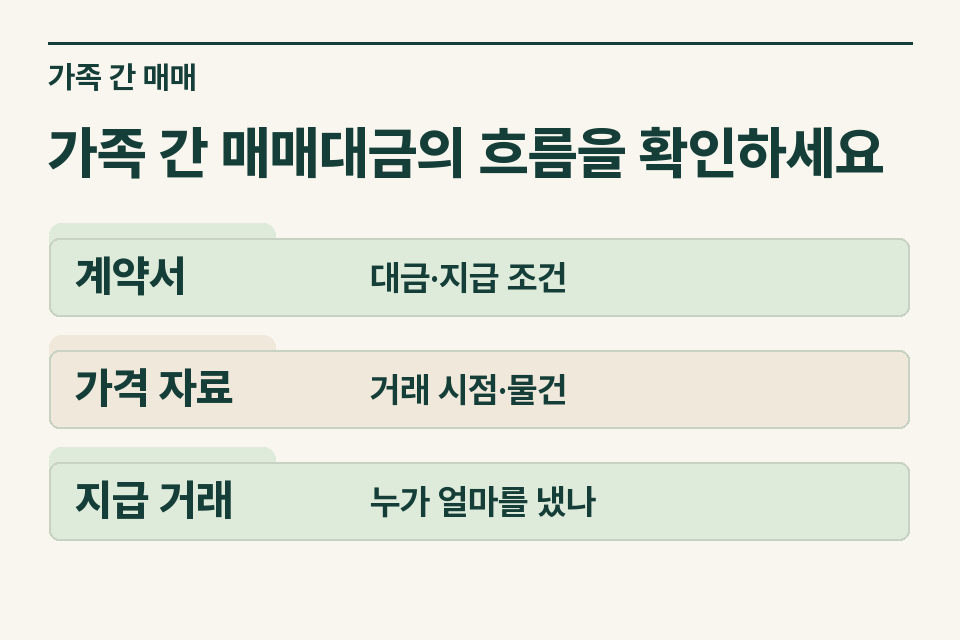
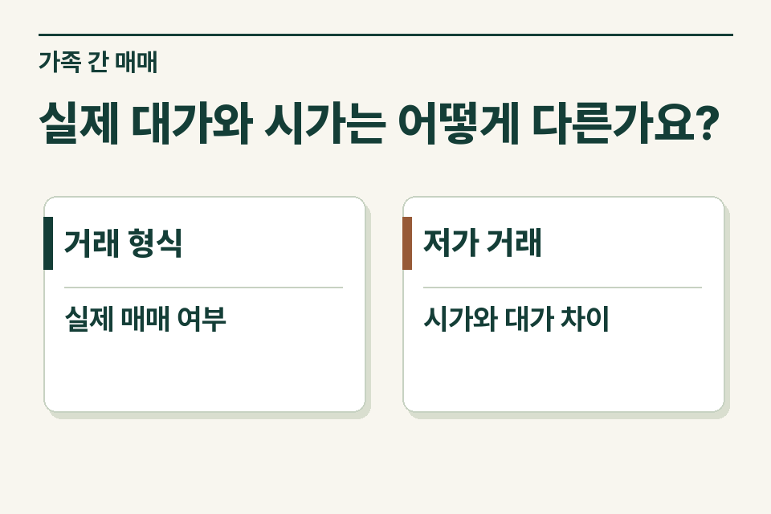

첫째, 자녀가 약정한 대금을 실제로 부담하는 유상 거래인지 살핍니다. 둘째, 거래 가격이 시가와 얼마나 차이 나는지 살핍니다. 대금을 전부 송금했다는 사실만으로 시가와 대가의 차이에 관한 검토까지 마치는 것은 아닙니다.

## 매매계약서를 가져온 가족의 사정

설명을 위한 사례입니다. 아버지는 자녀에게 아파트를 팔면서 같은 단지의 최근 거래보다 낮은 가격을 정했습니다. 집에는 세입자가 있고 자녀가 보증금을 넘겨받기로 했습니다. 가족은 “실제 송금이 적어도 전액 지급한 셈”이라고 설명합니다. 사무소는 현금 지급액, 인수한다고 설명하는 보증금, 아직 지급하지 않은 잔금을 각각 기록해야 합니다.

<figure style="margin:28px 0"><figcaption>가족 간 매매대금의 흐름을 확인하세요 — 계약서 · 대금·지급 조건 / 가격 자료 · 거래 시점·물건 / 지급 거래 · 누가 얼마를 냈나</figcaption></figure>

## 두 질문에 쓰는 자료는 다릅니다

| 질문 | 확보할 자료 | 구체적으로 볼 내용 |
|---|---|---|
| 누가 대금을 부담했나 | 계약서, 계약금·잔금 계좌내역, 자녀의 자금 자료 | 부모가 사전에 보낸 돈이나 반환 약정이 있나요? |
| 인수할 채무가 실제로 있나 | 임대차계약·갱신 이력, 보증금 잔액 | 거래일 현재 반환할 의무와 실제 인수 범위가 얼마인가요? |
| 가격을 왜 그렇게 정했나 | 해당 주택·비교 주택 거래자료, 감정 등 | 시점·면적·동호수·점유 조건이 어떻게 다른가요? |

## 시가보다 싸다는 말만으로 금액을 계산하지 않습니다

특수관계인 사이의 저가 양수 등은 법에서 정한 요건과 기준에 따라 양수자의 증여세 문제가 생길 수 있습니다. 부모·자녀 사이의 재산 이전에는 증여 추정 규정도 함께 검토하므로 거래가 실제 매매라는 자료와 저가 여부 자료는 각각 필요합니다. 양도하는 부모에게 적용되는 세금은 별개의 검토입니다. 계약서에 ‘시가’라고 기재하거나 공인중개사의 호가를 적는 것만으로 거래 당시 시가가 확정되지는 않습니다.

## 계약 후 지급 방법이 달라졌다면요?

자녀 계좌에서 잔금이 출금된 뒤 부모가 그 돈을 같은 날 다시 보내 주었다면 반환한 이유와 다음 사용처를 확인합니다. 잔금 지급을 연기한 경우에는 변경 약정과 실제 이행 여부를 남깁니다. 사후 작성한 설명문만 넘기기보다 각 거래 시점의 계약과 계좌자료를 함께 보냅니다.

<figure style="margin:28px 0"><figcaption>실제 대가와 시가는 어떻게 다른가요? — 거래 형식 · 실제 매매 여부 / 저가 거래 · 시가와 대가 차이</figcaption></figure>

## 의뢰인에게 전달할 자료 요청

“가격 결정에 참고한 자료와 계약금·잔금의 출처를 각각 알려 주세요. 보증금을 거래대금 일부로 반영했다면 임대차계약과 현재 잔액을 함께 확인하겠습니다.” 제이티 세무법인은 거래의 실질과 양도자·양수자별 검토 범위를 살핍니다.

[상속세 및 증여세법 제35조](https://www.law.go.kr/법령/상속세및증여세법/제35조) · [상속세 및 증여세법 제44조](https://www.law.go.kr/법령/상속세및증여세법/제44조)

[증여 검토 안내](https://www.jttax.co.kr/insights/gift-tax-saving.html) · [법무사 협업 상담](https://www.jttax.co.kr/desk/scrivener.html)
