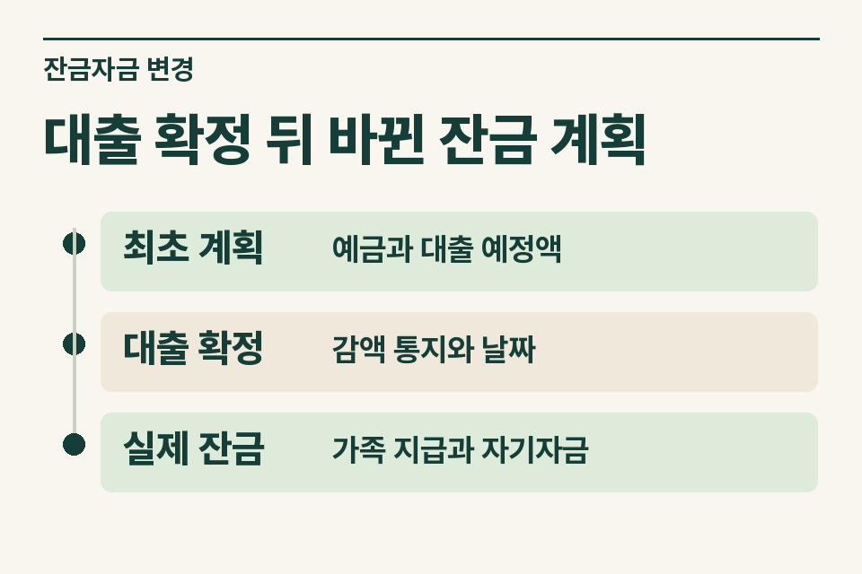
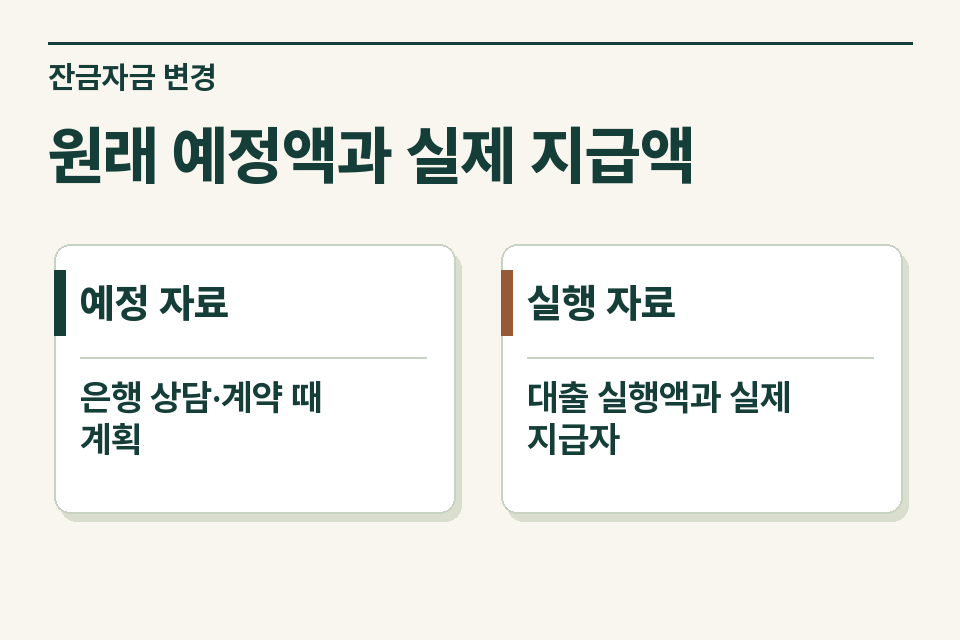

계약할 때 예상한 대출액과 잔금일에 은행이 실제로 내준 돈을 먼저 구분합니다. 부족분을 부모가 보탰다면 **계획이 바뀐 날, 실제 지급자, 매도인에게 전달된 금액**을 한 줄에 적어 두세요. 이 세 가지를 확인해야 중개사무소가 고객의 질문을 세무사에게 정확히 전달할 수 있습니다.

## 대출 한도 안내와 실제 실행액을 분리하기

매수인이 가계약 당시 은행에서 들은 한도를 기준으로 잔금 계획을 세웠다고 가정합니다. 정식 심사 때 한도가 줄었고, 부모가 부족분을 매도인에게 직접 보냈습니다. 사무소에 필요한 자료는 처음 대출 상담 내용, 은행의 확정 통지, 대출 실행계좌 내역입니다. 은행 통지일과 매도인에게 지급한 날이 다르면 두 날짜를 함께 남깁니다.

<figure style="margin:28px 0"><figcaption>대출 확정 뒤 바뀐 잔금 계획 — 최초 계획 · 예금과 대출 예정액 / 대출 확정 · 감액 통지와 날짜 / 실제 잔금 · 가족 지급과 자기자금</figcaption></figure>

## 매도인에게 바로 송금했을 때

부모가 자녀 계좌를 거치지 않고 매도인에게 이체한 내역은 자녀의 통장에서 찾을 수 없습니다. 매수인의 잔금 의무 중 어느 부분을 지급했는지 계약서 및 매도인의 수령 내역과 연결합니다. 부모가 지급한 돈을 자녀의 예금 인출액과 중복해서 적지 않도록 지급자별로 나눕니다.

|잔금 인계표|원래 계획|실제 확인할 자료|
|---|---|---|
|자기자금|계약 때 적은 예금 사용분|계약금·잔금별 출금 및 수취인|
|은행 대출|심사 전 예상 한도|확정 통지와 실행일·실행액|
|부모 자금|당초 계획에 없던 부족분|지급한 계좌, 수취인, 당시 합의|
|아직 모르는 내용|예상했던 상환 방법|상환 재원과 이후 이행 내역|

## ‘부모가 도와줬다’는 말을 풀어서 묻기

부모는 돌려받을 생각으로 보냈는지, 일부만 반환하기로 했는지, 따로 받은 증여가 있는지 묻습니다. 당시 합의나 상환 일정이 있었으면 그대로 모으고, 아직 정해지지 않았으면 그 사실을 표시합니다. 자금의 성격에 따라 취득자금의 증여 추정이나 무상·저리 대출 이익을 검토할 여지가 달라집니다. 보낸 계좌 명의 한 줄로 결론을 확정할 수 없습니다. [상속세 및 증여세법 제45조](https://www.law.go.kr/법령/상속세및증여세법/제45조) · [같은 법 제41조의4](https://www.law.go.kr/법령/상속세및증여세법/제41조의4)

## 거래신고 서류와 세무 검토를 연결하는 순서

최초 제출본이 있다면 사본을 확보하고 변경 경위를 별지에 기록합니다. 변경 또는 정정이 필요한지는 해당 계약과 접수 경위에 따라 신고 관청에 확인하세요. 세무 검토용 지급표를 작성했다고 거래신고 서류의 정정이 완료되는 것은 아닙니다. 반대로 신고서에 ‘차입금’으로 적었다는 사실만으로 세무상 차입이 확정되는 것도 아닙니다.

<figure style="margin:28px 0"><figcaption>원래 예정액과 실제 지급액 — 예정 자료 · 은행 상담·계약 때 계획 / 실행 자료 · 대출 실행액과 실제 지급자</figcaption></figure>

## 제이티에 보낼 인계 문구

“은행 한도가 잔금 직전 줄어 부모가 매도인에게 부족분을 지급했습니다. 원래 계획과 대출 실행 내역이 있고 가족 자금 중 돌려주기로 한 부분을 확인 중입니다.” 최초 문의는 이 정도면 충분합니다. 제이티는 검토할 범위와 필요한 자료를 안내하고, 자금 약정과 실제 이행을 대조해 다음 확인 사항을 정리합니다. [가족 간 차용증과 상환 자료](https://blog.naver.com/jt_tax/224425312261) · [중개사 협업 문의](https://www.jttax.co.kr/desk/broker.html)

네이버 블로그에서 [대출이 줄어 부모님이 주택 잔금을 보탠 사례](https://blog.naver.com/jt_tax/224477025303)를 읽을 수 있습니다.
