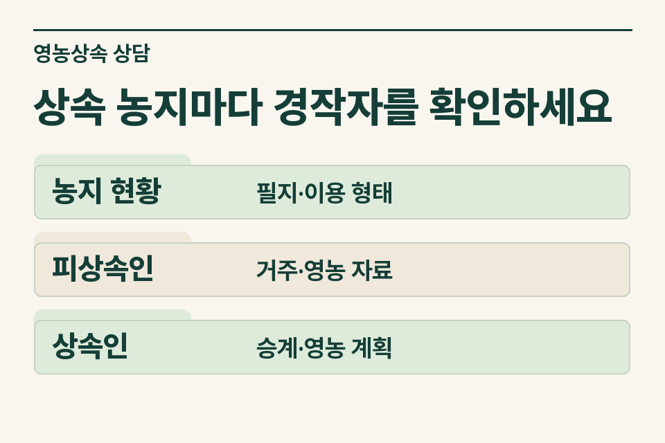
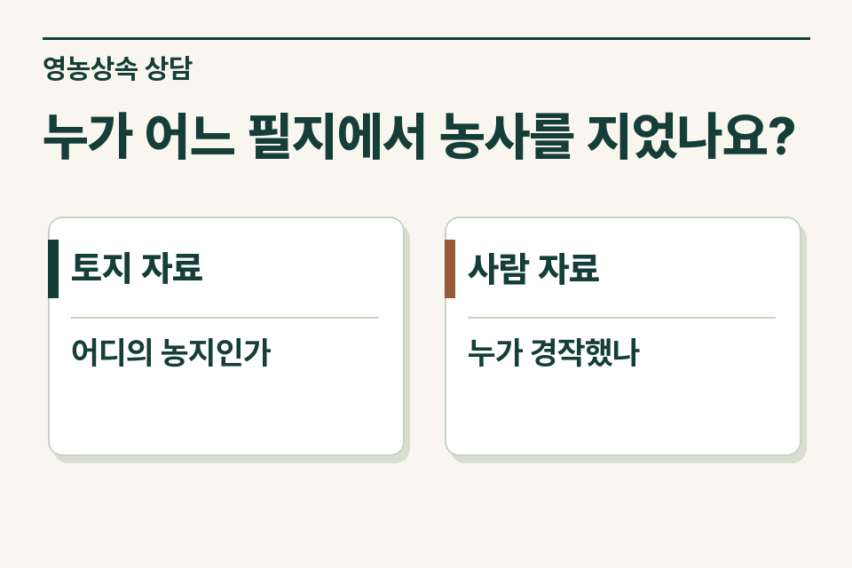

농지를 상속한다는 사실과 영농상속공제 요건을 갖춘 사실은 따로 확인합니다. 필지별 소유와 이용 상태, 돌아가신 분의 실제 영농, 농지를 이어받을 사람의 종사 내역을 맞춰 보세요. 가족이 농지라고 부르는 땅도 남에게 임대했거나 경작을 오래 중단한 필지가 섞여 있을 수 있습니다.

## 세 필지 모두 가족이 경작했을까요?

가정 사례입니다. 아버지 명의 논 세 필지 중 한 곳은 직접 경작했고 한 곳은 이웃에게 임대했습니다. 나머지는 자녀가 주말에 도왔다고 합니다. 사무소는 세 필지를 한 줄에 묶기보다 지번별로 누가 언제부터 어떻게 경작했는지 기록합니다. ‘영농상속’이라는 이름만으로 전체 농지에 공제를 적용할 수 있다고 안내하지 않습니다.

<figure style="margin:28px 0"><figcaption>상속 농지마다 경작자를 확인하세요 — 농지 현황 · 필지·이용 형태 / 피상속인 · 거주·영농 자료 / 상속인 · 승계·영농 계획</figcaption></figure>

## 토지와 사람 자료를 나눠서 받습니다

| 범위 | 자료 예시 | 사실 확인 |
|---|---|---|
| 필지별 토지 | 등기·토지대장, 이용 자료, 임대차 약정 | 상속개시일 당시 소유·이용과 임대 여부 |
| 돌아가신 분 | 주소 이력, 농업경영체 등록, 출하·농자재 거래 | 실제 영농한 시기와 장소, 다른 소득·직업 여부 |
| 상속받는 분 | 주소·직업 이력, 영농 참여·판매 자료 | 언제부터 어떤 역할을 맡았고 누가 계속 영농할 예정인지 |
| 상속 후 | 농지 사용 계획, 임대·처분 예정 | 사후관리 요건을 별도로 확인할 사정 |

## 등록증 한 장으로 확인하기 어려운 점

등록 자료는 영농 이력을 알아보는 출발점입니다. 실제 종사 여부는 농산물 판매대금의 수취인, 농자재 구입 명의, 농작업을 맡긴 경위와 함께 확인합니다. 가족 중 한 명 명의로 거래를 모아 처리했다면 실제 경작자와 다른 이유를 표시해 주세요. 한 해의 사진이나 영수증만으로 계속 영농했다는 결론을 적지 않습니다.

## 상속인 중 다른 직장을 다니는 사람이 있다면

근무 기간과 직무, 농사에 참여한 방식·기간을 구체적으로 확인합니다. 주말에 잠시 도운 경우와 영농을 직접 이어 온 경우는 사실관계가 다릅니다. 법과 시행령에는 피상속인·상속인·영농상속재산에 관한 요건과 사후관리 규정이 있으므로 자산 종류와 사건 당시 요건을 함께 검토해야 합니다. 요건을 하나 충족한다는 사정만으로 공제 가능 여부를 정하지 않습니다.

<figure style="margin:28px 0"><figcaption>누가 어느 필지에서 농사를 지었나요? — 토지 자료 · 어디의 농지인가 / 사람 자료 · 누가 경작했나</figcaption></figure>

## 협의서 작성 전 가족이 알려줄 내용

“세 필지의 소유자는 같지만 실제 이용 형태는 다릅니다. 본인 경작 필지의 출하 내역, 임대 필지의 계약서, 자녀의 종사 자료를 따로 확보 중입니다.” 농지를 받을 사람이 아직 정해지지 않았다면 분할 협의 상태도 알려 주세요. 제이티 세무법인은 재산과 사람별로 확인이 필요한 항목을 좁히고 검토 범위를 안내합니다.

[상속세 및 증여세법 제18조의3](https://www.law.go.kr/법령/상속세및증여세법/제18조의3) · [상속세 및 증여세법 시행령 제16조](https://www.law.go.kr/법령/상속세및증여세법시행령/제16조)

[상속공제 기초 안내](https://www.jttax.co.kr/insights/inheritance-tax-exemption-limit.html) · [법무사 협업 상담](https://www.jttax.co.kr/desk/scrivener.html)
