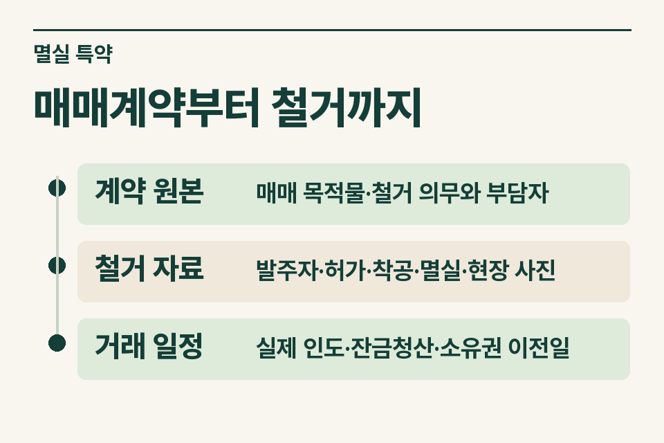
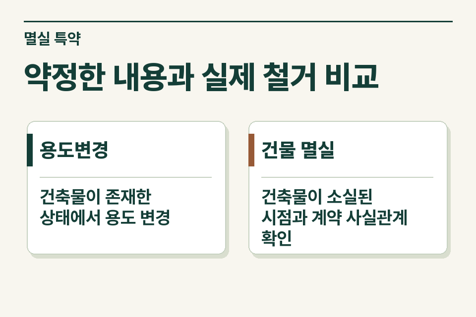

매수인이 토지를 개발하기 위해 매도인에게 잔금 전 철거를 요청하는 경우가 있습니다. 현재 건물이 사라졌다고 해서 처음 계약한 목적물과 양도 시점의 세법 판단까지 저절로 정해지지는 않습니다. 철거를 실행하기 전에 계약서와 현장 상태를 확인할 수 있을 때 자료를 보존합니다.

## 건물 값이 계약서에서 빠진 사례

계약서에는 토지와 건물이 표시됐지만 매수인의 철거 요청 후 작성한 정산서에는 토지 가격만 적혀 있다고 가정합니다. 계약 원본, 변경 특약, 철거비 견적과 발주 기록을 나란히 놓고 누가 왜 어떤 조건으로 요청했는지 확인합니다. 처음부터 나대지를 팔기로 한 경우와 같은 사실인지 다시 살핍니다.

<figure style="margin:28px 0"><picture><source media="(prefers-reduced-motion: no-preference)" srcset="/project/assets/insights/house-demolition-sale-agreement-steps.webp"></picture><figcaption>매매계약부터 철거까지 — 계약 원본 · 매매 목적물·철거 의무와 부담자 / 철거 자료 · 발주자·허가·착공·멸실·현장 사진 / 거래 일정 · 실제 인도·잔금청산·소유권 이전일</figcaption></figure>

## 계약에서 말소까지의 기록

| 자료 | 무엇을 읽을까 |
|---|---|
|계약 원본|매매 목적물·철거 의무와 부담자|
|철거 자료|발주자·허가·착공·멸실·현장 사진|
|거래 일정|실제 인도·잔금청산·소유권 이전일|

철거업체가 현장에 들어간 날, 실제로 건물이 없어진 날, 대장 말소일, 잔금 청산일이 다를 수 있습니다. 날짜별로 확인한 문서 이름을 씁니다. 실제 사용·거주 상태를 뒷받침할 자료는 공사를 시작하면 복원하기 어려우므로 사전 사진과 이전 임대차 자료도 남겨 둡니다.

## 용도변경과 멸실을 구별할 이유

양도소득세에는 대금청산일 원칙과 예외가 있고, 1세대1주택 판단에는 매매계약에 따른 주택 외 용도변경을 다루는 별도 문구가 있습니다. 이 문구가 철거 특약이 있는 모든 토지 거래에도 그대로 적용된다고 전제하지 않습니다. 거래 시점, 철거의 성격 및 개별 해석의 사실관계를 대조합니다. [소득세법 제98조](https://www.law.go.kr/법령/소득세법/제98조) · [소득세법 시행령 제154조](https://www.law.go.kr/법령/소득세법시행령/제154조)

조세심판원의 조심2024중1920(2024년 6월 11일)은 건물이 없어지기 전에 매매대금 대부분이 지급됐고 매수인의 건축 목적과 계약 특약 등 구체적 사정이 있었던 사건입니다. 심판원은 해당 건을 나대지 양도로 본 과세처분을 취소했습니다. 이 사건의 계약서와 지급 경위를 빼고 “잔금 전에 헐면 계약일을 본다”고 일반화하면 판단이 달라질 수 있습니다. [국무조정실 조세심판 사례](https://www.opm.go.kr/opm/news/press-release.do?articleNo=157373&attachNo=143670&mode=download)

## 철거 비용을 누가 부담하는가

매수인이 시공사를 선정하고 매도인이 대금을 대신 지급하는지, 철거비를 매매대금과 별도로 정산하는지 기록합니다. 명목상 지급자와 실제 부담자가 다르면 계좌 흐름과 변경 계약을 확인합니다. 인허가와 건축물 말소에 필요한 절차는 담당 기관·전문가에게 별도로 확인합니다.

<figure style="margin:28px 0"><figcaption>약정한 내용과 실제 철거 비교 — 용도변경 · 건축물이 존재한 상태에서 용도 변경 / 건물 멸실 · 건축물이 소실된 시점과 계약 사실관계 확인</figcaption></figure>

## 서명 전에 넘길 메모

‘계약 때는 주택이 있었고 매수인이 잔금 전 철거를 요청했습니다. 비용 및 철거 발주자, 인도일은 아직 협의 중입니다.’ 실행 전 검토 의뢰라면 선택 가능한 계약 조건이 남아 있어 사실을 더 정확히 정리할 수 있습니다. [양도소득세 거래 점검](https://www.jttax.co.kr/insights/capital-gains-tax-traps.html) · [공인중개사 상담 창구](https://www.jttax.co.kr/desk/broker.html)
