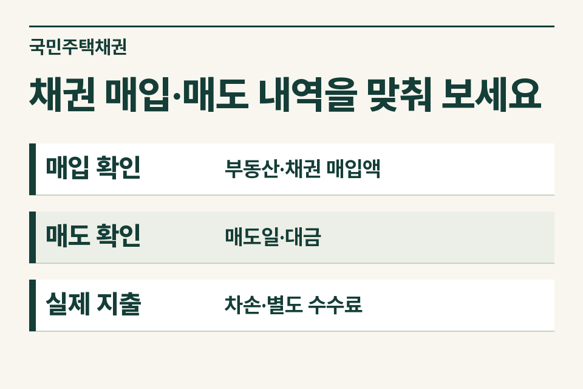
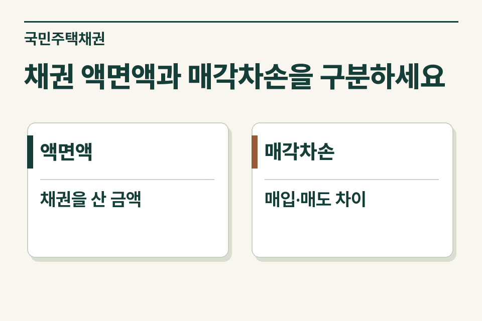

국민주택채권을 사자마자 매도한 경우에는 채권 매입액, 매도대금, 매각차손을 구분해 기록합니다. 법무사 사무소에서 고객에게 줄 자료는 세금 납부확인서와 채권 매입·매도 거래확인서입니다. 나중에 해당 부동산을 양도할 때 필요경비 검토에 쓸 수 있도록 물건과 거래를 연결해 둡니다.

## 정산서에 채권액과 고객부담금이 함께 나오는 사례

가정 사례입니다. 의뢰인은 정산서의 ‘국민주택채권 매입액’이 자신이 쓴 비용 전부라고 생각했습니다. 사무소에는 매입 당일 매도한 확인서가 있고 고객이 부담한 금액은 액면액보다 작습니다. 채권 매입액 전부를 지출비용으로 적으면 처분해 회수한 금액까지 포함하게 됩니다. 거래확인서에서 실제 매도한 금액과 차손을 확인하세요.

<figure style="margin:28px 0"><figcaption>채권 매입·매도 내역을 맞춰 보세요 — 매입 확인 · 부동산·채권 매입액 / 매도 확인 · 매도일·대금 / 실제 지출 · 차손·별도 수수료</figcaption></figure>

## 세 가지 금액을 이렇게 넘기세요

| 구분 | 증빙 | 세무사가 확인할 내용 |
|---|---|---|
| 채권 매입 | 매입 확인서·거래내역 | 대상 물건, 매입자·매입일, 법령상 매입한 채권인지 |
| 채권 매도 | 매도 확인서 | 같은 채권인지, 매도일·상대방·매도대금 |
| 실제 부담 | 차손 관련 확인자료·금융거래 | 수수료·다른 등기 실비가 합산되어 있는지 |
| 향후 양도 | 부동산 취득 자료 | 무엇을 취득할 때 매입한 채권인지 특정 가능한지 |

## 왜 매도 상대방을 적을까요?

소득세법 시행령은 토지·건물을 취득하면서 법령에 따라 매입한 국민주택채권 등을 만기 전에 양도하여 발생한 매각차손을 다룹니다. 규정상 금융기관 외의 자에게 양도했다면 같은 날 해당 금융기관에 양도했을 경우의 매각차손을 한도로 합니다. 실제 지출과 증빙 요건도 확인해야 하므로, 매도처를 알 수 없는 정산서 한 장만으로 공제액을 정하지 않습니다.

## 그날 매도하지 않고 보유했다면

매입만 했고 아직 매도하지 않았다면 현재 자료에 ‘보유 중’이라고 표시합니다. 즉시매도를 가정한 예상 할인액을 이미 발생한 차손처럼 기록하지 않습니다. 나중에 만기 전에 처분했다면 당시 매도자료를 매입 확인서와 함께 보관합니다. 다른 사람 명의로 보이는 자료라면 누구의 부동산 취득과 관련한 채권인지도 함께 확인합니다.

<figure style="margin:28px 0"><figcaption>채권 액면액과 매각차손을 구분하세요 — 액면액 · 채권을 산 금액 / 매각차손 · 매입·매도 차이</figcaption></figure>

## 고객에게 언제 전달하면 좋을까요?

등기 서류를 돌려줄 때 매입·매도 확인서와 최종 정산서를 한 묶음으로 제공하고, 부동산 주소·취득일을 표지에 적어 두세요. 이후 양도 신고를 준비할 때는 “취득 당시 채권을 당일 매도했고 거래확인서를 보관 중”이라고 설명하면 됩니다. 제이티 세무법인은 해당 물건과 실제 부담이 연결되는지, 다른 비용에 이미 반영됐는지를 확인해 검토 범위를 안내합니다.

[소득세법 제97조](https://www.law.go.kr/법령/소득세법/제97조) · [소득세법 시행령 제163조](https://www.law.go.kr/법령/소득세법시행령/제163조)

[부동산 취득 부대비용 안내](https://www.jttax.co.kr/insights/acquisition-tax-costs.html) · [법무사 협업 상담](https://www.jttax.co.kr/desk/scrivener.html)
