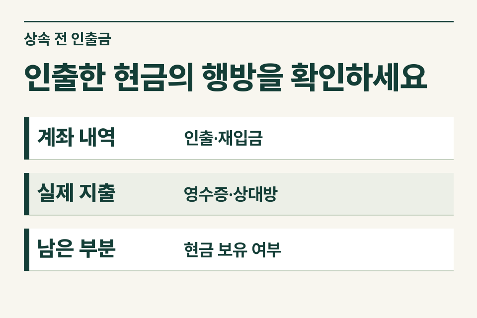
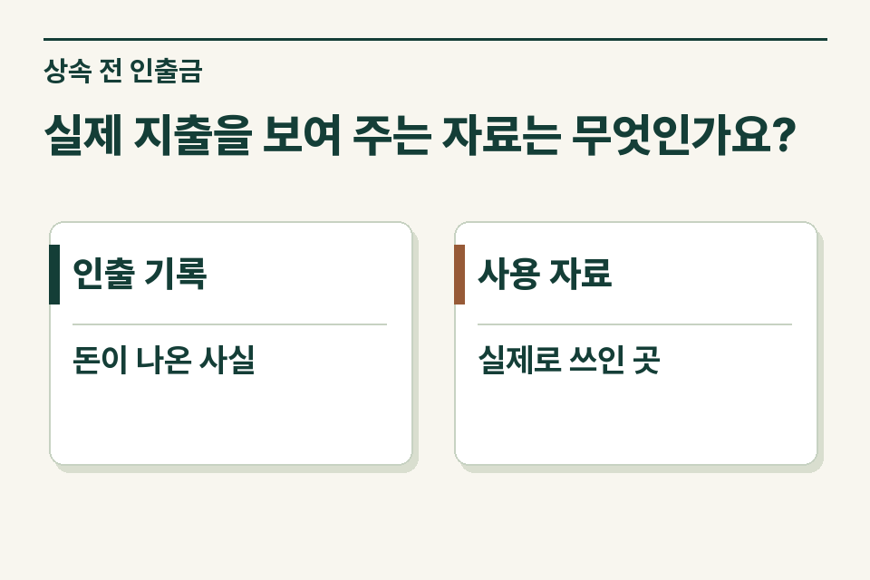

출금일과 금액이 같아도 부모님 다른 계좌로 옮긴 돈, 병원비로 지출한 돈, 집에 보관한 현금은 서로 다릅니다. 거래내역부터 분류한 뒤 사용처 자료가 필요한 부분을 좁히세요. 상속개시 전 처분·인출 등은 법이 정한 기간과 금액, 용도가 객관적으로 명백한지 등에 따라 검토하며 출금 한 줄 자체로 과세 여부를 정하지 않습니다.

## 통장을 받아 보니 적요가 모두 ‘현금’이라면

가령 아들이 사망 전 부모 계좌에서 몇 차례 큰돈이 인출됐다는 사실을 발견했습니다. 가족은 병원비로 썼다고 기억하지만 병원 카드전표 중에는 아들 본인 카드로 결제한 것도 있습니다. 부모가 현금을 인출한 날과 아들이 결제한 날이 비슷하다는 이유만으로 둘을 같은 거래라고 연결하지 않습니다.

<figure style="margin:28px 0"><picture><source media="(prefers-reduced-motion: no-preference)" srcset="/project/assets/insights/inheritance-cash-withdrawals-steps.webp"></picture><figcaption>인출한 현금의 행방을 확인하세요 — 계좌 내역 · 인출·재입금 / 실제 지출 · 영수증·상대방 / 남은 부분 · 현금 보유 여부</figcaption></figure>

## 출금 이후의 행방을 이렇게 대조합니다

| 거래 유형 | 첫 대조 자료 | 추가로 확인할 부분 |
|---|---|---|
| 피상속인 본인 계좌 간 이체 | 보낸 계좌와 받은 계좌 양쪽 내역 | 수취 계좌의 사망 당시 잔액 |
| 병원·간병 등 비용 | 청구서와 결제·지급 영수증 | 실제 지급자, 환급·보험금 등 별도 거래 |
| 가족이 수령한 돈 | 수취인 계좌와 지급 이유 | 보관금인지, 지출 대행인지, 이전한 돈인지 |
| 사용처가 남지 않은 현금 | 출금 내역과 가족별 설명 | 사망 당시 남아 있던 현금 및 확인 가능한 자료 |

## 다시 입금한 돈을 어떻게 기록할까요?

현금 출금 후 다시 입금한 경우에는 원거래와 재입금 거래의 날짜·금액·계좌를 함께 적습니다. 입금할 때 다른 돈이 섞였거나 출금 후 일부만 돌아왔다면 그 차이를 남겨 두세요. 사무소가 날짜가 비슷하다는 이유만으로 재입금 금액을 일괄 차감하지 않고 실제 연결 근거를 보존하는 것이 중요합니다.

## 자료가 끝내 없는 부분은요?

‘생전에 생활비로 썼다고 가족이 설명함’, ‘영수증 확인’, ‘수취인이 아직 확인되지 않음’을 구분합니다. 없는 증빙을 추정 소비액으로 채우면 다른 계좌에 남아 있던 재산까지 놓칠 수 있습니다. 세무사는 인출 시점과 자산별 거래 내역, 관련 법령의 적용 요건을 대조합니다. 사망 당시 실제 보유 현금, 생전 증여 여부, 법에서 정한 추정상속재산 검토는 사실관계가 서로 다릅니다.

<figure style="margin:28px 0"><figcaption>실제 지출을 보여 주는 자료는 무엇인가요? — 인출 기록 · 돈이 나온 사실 / 사용 자료 · 실제로 쓰인 곳</figcaption></figure>

## 의뢰인이 은행에서 받아 올 자료를 좁혀 주세요

“사망 전 출금 중 본인 다른 계좌로 간 거래를 먼저 대조했습니다. 병원비라고 설명하는 일부 거래는 영수증만 있고 지급자 확인 중입니다. 남은 현금이 있었는지도 가족에게 물어볼 예정입니다.” 이렇게 보내면 제이티 세무법인에서 추가로 볼 계좌와 기간, 가족에게 확인할 질문을 정리할 수 있습니다.

[상속세 및 증여세법 제15조](https://www.law.go.kr/법령/상속세및증여세법/제15조)

[상속재산 신고 안내](https://www.jttax.co.kr/insights/inheritance-tax-basics.html) · [법무사 협업 상담](https://www.jttax.co.kr/desk/scrivener.html)
