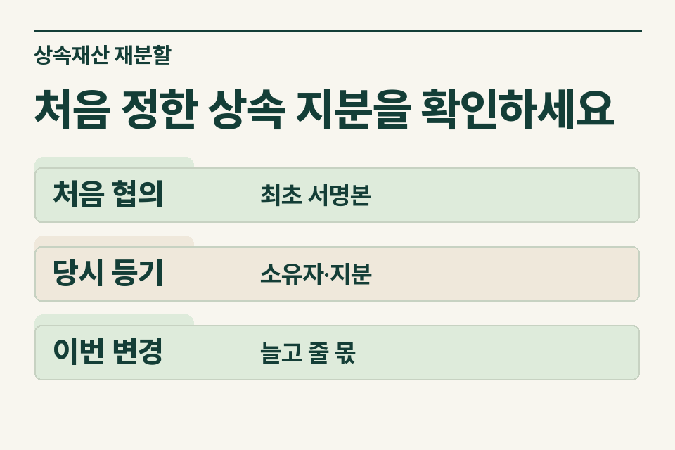
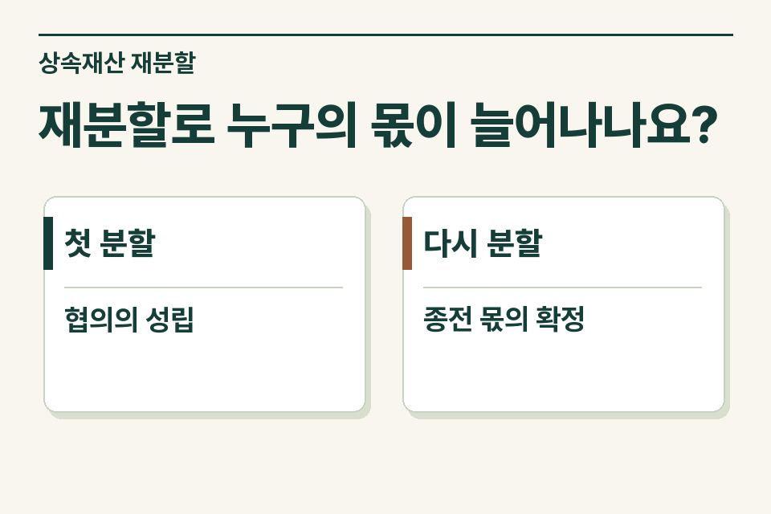

공동상속인이 예전에 나눈 집의 소유자를 바꾸려 한다면 새 협의서를 쓰기 전에 첫 분할의 결과부터 확인합니다. 처음 등기한 지분, 그때 실제로 확정한 몫, 이번에 늘어나는 사람과 줄어드는 사람을 재산별로 적습니다. 협의서를 몇 번째로 작성했는지보다 무엇이 이미 확정되어 있었는지가 중요합니다.

## 첫 분할이었나요, 이미 나눈 재산을 다시 나누나요?

설명을 위한 사례입니다. 형제는 한 사람이 아파트를 갖고 다른 사람이 예금을 갖기로 의논했습니다. 그런데 아파트 등기에는 두 사람이 올라 있습니다. 법무사 사무소는 현재 지분만 보고 둘이 같은 몫을 나눴다고 적기 전에 등기 원인과 최초 협의서를 확인합니다. 가족이 구두로 논의한 초안, 서명한 문서, 실제 사용한 문서가 서로 다를 수 있습니다.

<figure style="margin:28px 0"><picture><source media="(prefers-reduced-motion: no-preference)" srcset="/project/assets/insights/inherited-property-redivision-steps.webp"></picture><figcaption>처음 정한 상속 지분을 확인하세요 — 처음 협의 · 최초 서명본 / 당시 등기 · 소유자·지분 / 이번 변경 · 늘고 줄 몫</figcaption></figure>

## 무엇이 확정됐는지 문서별로 나눕니다

| 자료 | 확인할 항목 | 남겨 둘 질문 |
|---|---|---|
| 최초 협의서와 접수 자료 | 서명일, 분할 대상, 등기한 지분 | 이 문서로 어떤 재산의 몫을 확정했나요? |
| 당시 신고서 | 평가한 재산과 상속인별 배분 | 당시 신고와 등기 결과는 일치하나요? |
| 이번 협의안 | 바뀌는 재산, 이전·변경할 지분 | 다른 재산이나 정산금도 함께 움직이나요? |

새 분할안에 집만 나오더라도 예금 등 다른 재산의 분배가 함께 바뀌는지 확인합니다. 집의 지분이 늘어나는 것만 보고 전체 조정의 내용을 미리 단정하면 인계 자료가 불완전해집니다.

## 등기 후 지분이 늘어날 때 왜 증여세를 검토하나요?

상속재산의 등기 등으로 상속분이 확정된 후 협의분할로 특정 상속인이 당초 상속분을 초과해 취득하면 증여세 규정을 검토합니다. 상속세 과세표준 신고기한 안의 분할과 법령이 정한 정당한 사유 등 예외가 있으므로 재분할일, 최초 신고·등기 내용, 분할 사유와 관련 문서를 세무사에게 전달합니다. 법정상속분으로 등기한 때와 상속인 간 협의를 이미 마친 때가 같은 사실이라고 전제하지 않습니다.

## 날짜를 바꾼 경위까지 적어 주세요

최초 서명일, 등기 접수일, 신고일, 변경 문서 작성일을 한 줄에 올립니다. 종전 협의의 무효나 취소를 주장하는 경우에는 단순한 가족 설명과 법원·관할 기관의 문서를 구별합니다. 가족 사이에서 새로 마음을 바꾼 경우도 당시 사정을 그대로 씁니다. 불명확한 부분은 예상 사유를 정해 적기보다 추가 질문으로 남겨 두는 편이 좋습니다.

<figure style="margin:28px 0"><figcaption>재분할로 누구의 몫이 늘어나나요? — 첫 분할 · 협의의 성립 / 다시 분할 · 종전 몫의 확정</figcaption></figure>

## 사무소에서 보내는 인계 예시

“아파트 지분은 현재 형제 공동명의입니다. 최초 협의서와 등기 접수 기록을 확보했고, 동생이 지분을 더 받는 변경안을 검토 중입니다. 당시 예금 분배와 향후 정산금 지급 여부는 확인 중입니다.” 제이티 세무법인은 어느 재산에서 누구의 몫이 달라지는지와 추가로 필요한 자료를 확인하고 검토 범위를 안내합니다.

[상속세 및 증여세법 제4조](https://www.law.go.kr/법령/상속세및증여세법/제4조)

[상속세 기초 안내](https://www.jttax.co.kr/insights/inheritance-tax-basics.html) · [법무사 협업 상담](https://www.jttax.co.kr/desk/scrivener.html)
