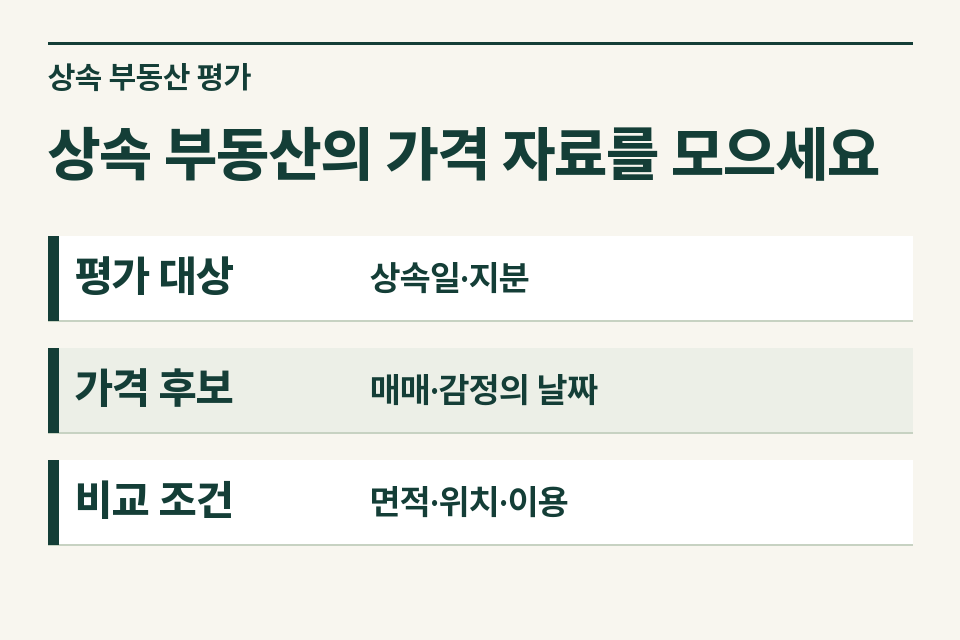
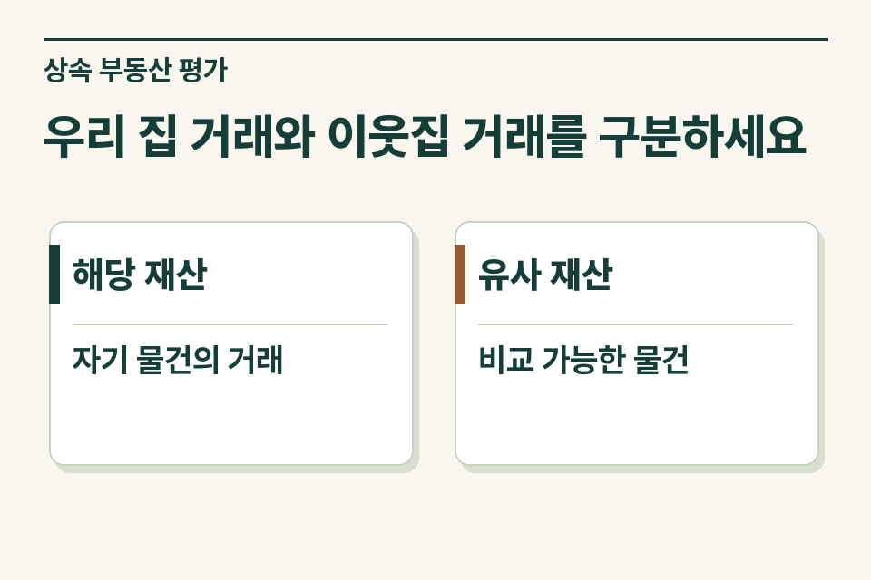

두 자료를 함께 넘기되 직접 거래된 것이 상속 부동산인지, 조건이 비슷한 다른 재산인지부터 표시하세요. 상속개시일 현재의 시가를 검토하므로 감정서의 기준시점과 작성일, 매매계약일, 비교 대상의 위치·용도·면적을 따로 봅니다. 공시가격, 매물 호가, 실제 거래가액도 구분합니다.

## 옆 동 거래가와 담보 감정이 함께 있는 사례

가정 사례입니다. 상속인은 같은 아파트 단지의 거래내역 화면과 부동산을 담보로 대출받을 때의 감정서 일부를 가져왔습니다. 매매 자료는 옆 동이고 감정서에는 해당 주택이 적혀 있습니다. 둘 중 가격이 낮은 자료를 골라 보내기보다 각 자료의 물건과 날짜를 정확하게 적는 것이 먼저입니다.

<figure style="margin:28px 0"><figcaption>상속 부동산의 가격 자료를 모으세요 — 평가 대상 · 상속일·지분 / 가격 후보 · 매매·감정의 날짜 / 비교 조건 · 면적·위치·이용</figcaption></figure>

## 가격 후보별로 무엇을 표시할까요?

| 자료 | 볼 항목 | 사무소가 확인할 내용 |
|---|---|---|
| 상속 부동산 자체 거래 | 계약일·목적물·거래조건 | 전체 재산인지 일부 지분 거래인지 |
| 감정평가서 | 평가 대상, 기준시점, 작성일, 평가 목적·기관 | 요약 화면 외에 원문 전체가 있는지 |
| 인근 실거래 | 동·면적·용도·가격·계약일 | 비교할 물건이 왜 유사하다고 보았는지 |
| 매물 호가나 공시자료 | 기준일·공개 주체 | 실제 성사된 거래와 구별하여 보관 |

## 시가를 고르는 기준은 무엇인가요?

상속세법은 평가기준일 현재 시가를 원칙으로 하고, 법령에서 정한 매매·감정 등 가액의 인정 요건을 둡니다. 평가기간, 거래 당사자의 관계, 감정자료의 요건, 해당 재산과 유사재산의 구분에 따라 적용이 달라질 수 있습니다. 시가 산정이 어려워 다른 법정 평가방법을 살펴야 하는 경우도 있습니다. 따라서 자료마다 언제 누구에게서 나온 값인지 표시하고 후보 단계에서 ‘확정 신고가액’으로 적지 않습니다.

## 물건이 같아 보여도 무엇이 다를까요?

상가라면 대로변 점포인지 건물 안쪽 점포인지, 같은 건물의 서로 다른 층인지 살펴봅니다. 토지는 지목·실제 이용 상태와 도로 접면, 아파트는 단지·면적과 층 등 차이를 확인합니다. 가격정보 사이트 화면을 보관할 때에는 조회한 날짜와 실제 계약일을 각각 표시하세요. 조회일이 상속일과 가까워도 거래가 이루어진 날짜는 훨씬 이전일 수 있습니다.

<figure style="margin:28px 0"><figcaption>우리 집 거래와 이웃집 거래를 구분하세요 — 해당 재산 · 자기 물건의 거래 / 유사 재산 · 비교 가능한 물건</figcaption></figure>

## 추가 감정 여부를 논의할 때

“동일 재산의 담보 감정서가 있지만 기준시점이 상속일과 다릅니다. 유사재산으로 본 매매 후보 두 건의 계약일과 면적을 확보했습니다.” 이처럼 자료를 나란히 놓고 제이티 세무법인에 검토를 요청할 수 있습니다. 평가기준일, 인정 요건, 다른 가격 자료의 존재를 먼저 확인해 추가 자료나 감정 검토가 필요한지 안내합니다.

[상속세 및 증여세법 제60조](https://www.law.go.kr/법령/상속세및증여세법/제60조) · [상속세 및 증여세법 시행령 제49조](https://www.law.go.kr/법령/상속세및증여세법시행령/제49조)

[상속재산 평가 안내](https://www.jttax.co.kr/insights/inheritance-tax-basics.html) · [법무사 협업 상담](https://www.jttax.co.kr/desk/scrivener.html)
