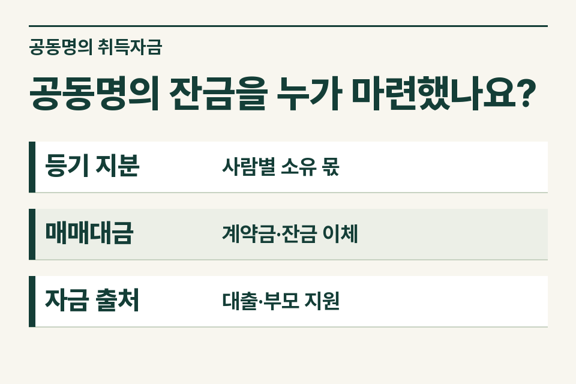
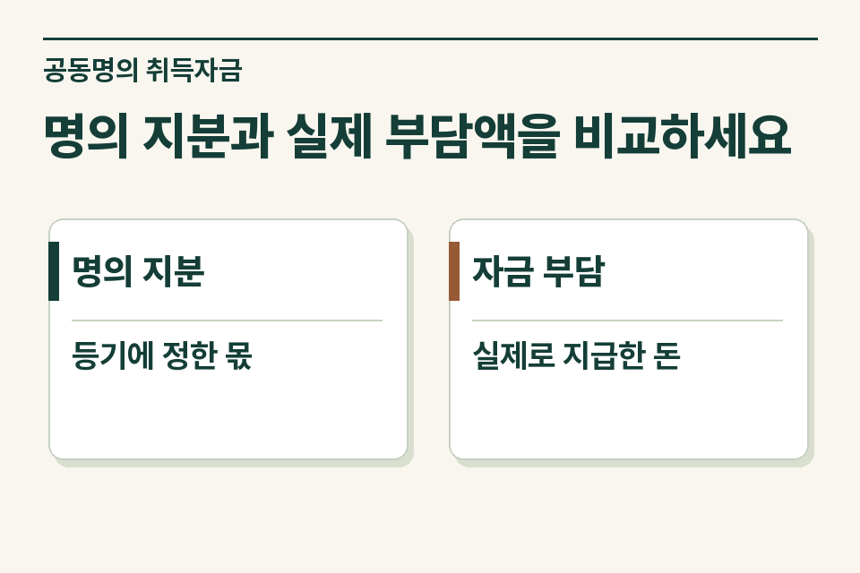

먼저 매수인별 지분을 적고 계약금·중도금·잔금을 **누구 자금으로 지급했는지** 표시합니다. 등기 지분대로 실제 자금을 부담했다고 가정하지 않습니다. 부모가 낸 돈이 선물인지 차입인지, 자기 돈을 한 계좌에 모아 보낸 것인지에 따라 확인할 내용이 다릅니다.

## 매도인은 한 번에 잔금을 받았습니다

가정 사례입니다. 부부가 주택을 공동명의로 취득합니다. 잔금은 아내 계좌에서 한 번 송금했고 그 직전에 배우자의 예금, 아내의 대출금, 친정 부모의 송금이 함께 입금됐습니다. 출금 계좌만 보면 아내가 전부 냈지만 실제 부담자는 여러 명일 수 있습니다. 부모가 누구를 지원하기로 한 돈인지까지 확인해 명의자별로 정리해야 합니다.

<figure style="margin:28px 0"><figcaption>공동명의 잔금을 누가 마련했나요? — 등기 지분 · 사람별 소유 몫 / 매매대금 · 계약금·잔금 이체 / 자금 출처 · 대출·부모 지원</figcaption></figure>

## 사무소가 작성할 대금 자료표

| 지급 단계 | 계좌에서 보이는 자료 | 따로 확인할 부분 |
|---|---|---|
| 계약금 | 이체인, 받은 사람, 계약일 | 계약 명의와 실제 부담자가 같은지 |
| 중도금 | 기존 주택 매도대금, 예금 인출, 차입 등 | 매수인 중 누구에게 귀속되는 돈인지 |
| 잔금 | 매도인 수령액, 같은 날 들어온 선행 이체 | 배우자·부모 자금을 어떻게 합쳐 보냈는지 |
| 취득 후 | 대출 원리금 상환 계좌 | 약정상 차입자와 실제 상환자, 부모 지원 여부 |

## ‘빌려준 돈’이라는 설명에는 어떤 자료가 따르나요?

차입 당시의 약정, 송금 시점, 상환 일정과 실제 지급 내역을 요청합니다. 아직 상환일이 오지 않았다면 계획과 이미 이루어진 거래를 구분합니다. 증여로 주기로 했다면 누구에게 언제 지급했는지 표시하고 이전 증여 자료도 살핍니다. 서류의 명칭만으로 거래 실질을 확정하지 않습니다.

## 자금 출처를 물으면 곧바로 증여인가요?

재산 취득자의 직업·연령·소득·재산 상태 등을 고려해 자력 취득을 인정하기 어려운 경우 법정 요건에 따라 증여 추정 규정이 적용될 수 있고, 출처가 충분히 소명되는지 등도 봅니다. 반대로 부모가 자녀 몫을 무상으로 부담한 사실이 확인되면 그 실제 이전도 검토해야 합니다. 단순히 지분과 송금 명의가 다르다는 사실 하나로 증여액을 계산하지 않습니다.

<figure style="margin:28px 0"><figcaption>명의 지분과 실제 부담액을 비교하세요 — 명의 지분 · 등기에 정한 몫 / 자금 부담 · 실제로 지급한 돈</figcaption></figure>

## 한 계좌를 거친 돈을 인계하는 예시

“부부 공동매수이고 잔금은 아내가 일괄 송금했습니다. 배우자 명의 예금과 부모님 송금 내역은 확보했고 부모님 자금의 귀속과 차입 약정 유무는 확인 중입니다.” 제이티 세무법인은 자금 원천부터 매도인 계좌까지 흐름을 연결하고 명의자별 설명이 필요한 금액을 안내합니다.

[상속세 및 증여세법 제45조](https://www.law.go.kr/법령/상속세및증여세법/제45조)

[가족 간 증여 공제 안내](https://www.jttax.co.kr/insights/gift-tax-exemption-limit.html) · [법무사 협업 상담](https://www.jttax.co.kr/desk/scrivener.html)
