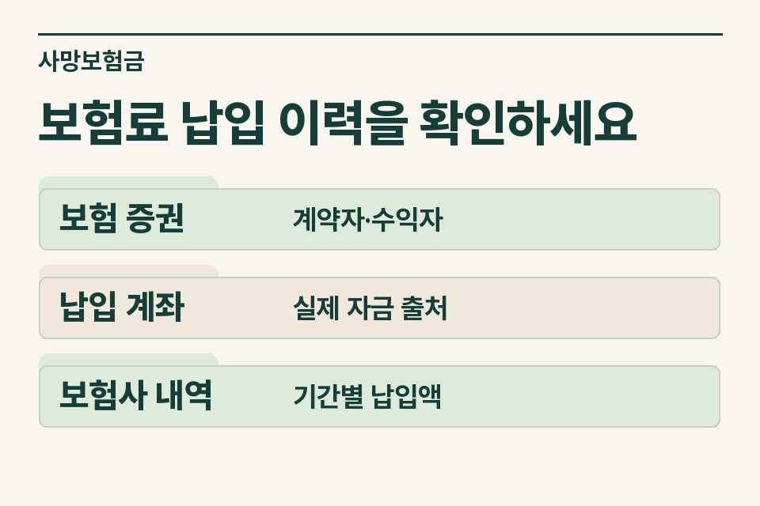
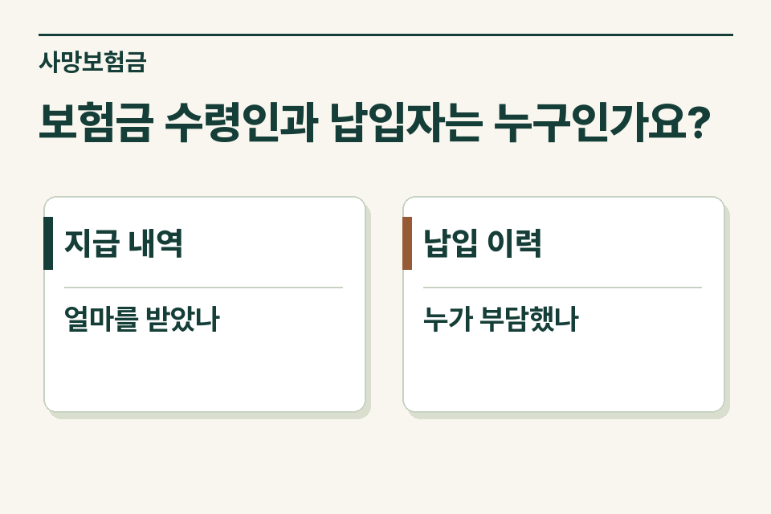

보험사가 자녀에게 사망보험금을 지급했다면 계약서에서 계약자·피보험자·수익자를 확인하고, 보험료의 실제 부담자를 기간별로 기록하세요. 계약자 이름이나 보험금 수령 계좌 한 가지로 상속세 신고 포함 여부를 정할 수 없습니다.

## 가족은 자녀 명의 보험이라고 설명합니다

가정 사례입니다. 자녀가 계약서를 작성했고 사망한 부모가 피보험자였습니다. 보험료는 자녀 계좌에서 자동이체됐지만 부모가 매월 그 계좌로 돈을 보냈다는 설명이 뒤늦게 나왔습니다. 이 경우 계약자 명의와 자동이체 계좌 외에 자금을 실제로 부담한 사람을 확인해야 합니다. 피상속인이 보험계약자인 보험의 사망보험금과, 명의상 계약자가 달라도 피상속인이 사실상 보험료를 부담한 경우를 상속세법이 다루고 있기 때문입니다.

<figure style="margin:28px 0"><figcaption>보험료 납입 이력을 확인하세요 — 보험 증권 · 계약자·수익자 / 납입 계좌 · 실제 자금 출처 / 보험사 내역 · 기간별 납입액</figcaption></figure>

## 증권과 계좌를 어떻게 짝지을까요?

| 자료 | 한 건마다 표시할 내용 | 추가 질문 |
|---|---|---|
| 증권·계약 변경 이력 | 계약자, 피보험자, 수익자와 변경일 | 처음 가입한 내용과 사망일 당시 내용이 같은가요? |
| 보험료 납입 증명 | 회차, 납입 기간, 납입액 | 계약자 변경·납입 중단 전후의 부담자가 같은가요? |
| 계좌이체 내역 | 출금 계좌와 직전 입금의 자금 출처 | 다른 가족이 실질적으로 보전해 준 돈이 있나요? |
| 지급내역 | 지급 원인, 지급받은 사람과 금액 | 여러 보험의 합계인지 계약별로 구별되나요? |

## 납입자가 중간에 바뀌었다면

초기에는 부모가 부담하고 이후 자녀가 자신의 소득으로 납입한 경우 기간을 나누어 표시합니다. 전체 기간을 마지막 납입자 기준으로 기입하면 이전에 부담한 보험료를 놓치게 됩니다. 과세 범위를 정할 때 보험금 성격과 실제 부담액을 검토하므로 보험사의 전체 납입명세와 가족의 실제 자금 자료를 함께 요청합니다.

## 계좌 주인만으로 설명이 되지 않을 때

부모가 자녀 계좌에 생활비와 보험료를 함께 송금했다면 얼마가 보험료에 쓰였는지를 처음부터 단정하지 않습니다. 자동이체일, 송금 주기, 당시 자녀의 별도 소득과 가족이 설명하는 목적을 기록합니다. 반대로 자녀가 부모 계좌로 돈을 보내 보험료를 냈다고 한다면 그 입금과 실제 출금을 대조합니다.

<figure style="margin:28px 0"><figcaption>보험금 수령인과 납입자는 누구인가요? — 지급 내역 · 얼마를 받았나 / 납입 이력 · 누가 부담했나</figcaption></figure>

## 인계용 메모에서 빠지기 쉬운 것

이미 지급받은 보험금 외에 청구 중인 계약이 있다면 지급 전으로 표시하세요. 보험금 청구일과 피상속인 사망일도 따로 적습니다. “자녀 계약자, 부모 피보험자이며 초기 납입자와 이후 납입자가 다릅니다. 보험사 납입 이력은 확보했고 계좌의 자금 출처를 확인하고 있습니다.” 제이티 세무법인은 계약별 지급 사유와 보험료 부담 내역을 보고 필요한 세무 검토 범위를 안내합니다.

[상속세 및 증여세법 제8조](https://www.law.go.kr/법령/상속세및증여세법/제8조)

[상속세 기초 안내](https://www.jttax.co.kr/insights/inheritance-tax-basics.html) · [법무사 협업 상담](https://www.jttax.co.kr/desk/scrivener.html)
