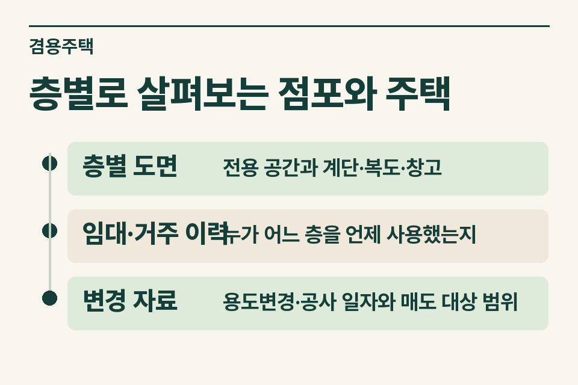
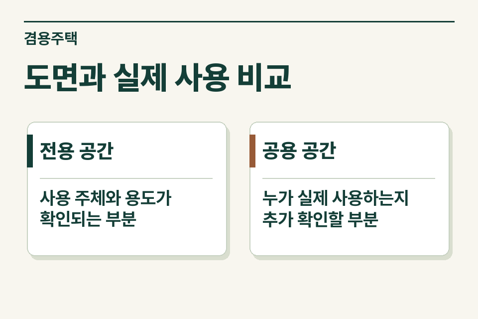

가게와 집이 한 건물에 있는 경우 먼저 실제 매도 범위를 확인합니다. 대장에 주택으로 적힌 면적, 임차인에게 빌려준 면적, 실제 거주 공간이 다를 수 있기 때문입니다. 세무 검토에 쓸 자료에는 전용 면적과 공용 부분, 대지 범위, 과거 용도변경 시점을 따로 표시합니다.

## 식당 짐을 둔 창고의 사용 이력을 확인한 사례

1층을 음식점에 임대하고 2층에는 소유자가 살았다고 가정합니다. 뒷마당 창고는 중간에 식당이 짐을 보관하는 곳으로 바뀌었습니다. 매도인이 말하는 ‘우리 집 면적’에 창고가 포함돼 있지만 계약 당시에는 임차인이 사용했다면 층별 도면과 실제 사용 이력을 다시 대조합니다.

<figure style="margin:28px 0"><figcaption>층별로 살펴보는 점포와 주택 — 층별 도면 · 전용 공간과 계단·복도·창고 / 임대·거주 이력 · 누가 어느 층을 언제 사용했는지 / 변경 자료 · 용도변경·공사 일자와 매도 대상 범위</figcaption></figure>

## 대장 면적과 현장 설명을 맞추는 표

| 자료 | 무엇을 읽을까 |
|---|---|
|층별 도면|전용 공간과 계단·복도·창고|
|임대·거주 이력|누가 어느 층을 언제 사용했는지|
|변경 자료|용도변경·공사 일자와 매도 대상 범위|

한 계단을 상가 손님과 거주자가 모두 쓴다면 그 계단을 양쪽 합계에 두 번 넣지 않습니다. 현황을 확인한 뒤 자료에 표시해 검토자에게 넘깁니다. 토지가 여러 필지면 각 필지와 건물의 연결 관계, 전부 매도하는지 일부만 매도하는지도 적습니다.

## 양도소득세에서 함께 볼 규정

주택과 주택 외 부분이 함께 있는 건물에는 면적 관계와 주택 부분, 부수토지 등에 관한 규정이 적용될 수 있습니다. 고가주택의 양도차익 계산 등 별도 검토가 필요한 경우가 있어 단순히 어느 층이 넓은지만으로 건물 전체의 비과세 여부를 확정할 수 없습니다. [소득세법 시행령 제154조](https://www.law.go.kr/법령/소득세법시행령/제154조) · [소득세법 시행령 제160조](https://www.law.go.kr/법령/소득세법시행령/제160조)

## 구조가 달라졌다면 기준일을 적기

임대차 갱신, 내부 벽체 공사, 용도변경 신청, 실제 사용 변경, 매매계약 체결이 같은 날일 필요는 없습니다. 매도인이 언제부터 거주했다고 기억하는지와 이를 확인할 자료의 작성일을 함께 남깁니다. 도면이 오래되어 현황과 다르면 수정한 스케치와 확인되지 않은 면적을 구별합니다.

<figure style="margin:28px 0"><figcaption>도면과 실제 사용 비교 — 전용 공간 · 사용 주체와 용도가 확인되는 부분 / 공용 공간 · 누가 실제 사용하는지 추가 확인할 부분</figcaption></figure>

## 검토 요청 전 마지막 확인

대장과 현황의 차이가 어느 층에서 발생하는지, 공용공간이 중복 집계되지 않았는지, 건물 일부와 대지가 매매에서 빠지는지 표시합니다. 가족 거주와 임대 부분이 섞였다면 계약과 사용 기간도 함께 전달하세요. 제이티가 대상 범위와 추가 확인 사항을 안내합니다. [양도소득세 거래 점검](https://www.jttax.co.kr/insights/capital-gains-tax-traps.html) · [공인중개사 상담 창구](https://www.jttax.co.kr/desk/broker.html)
