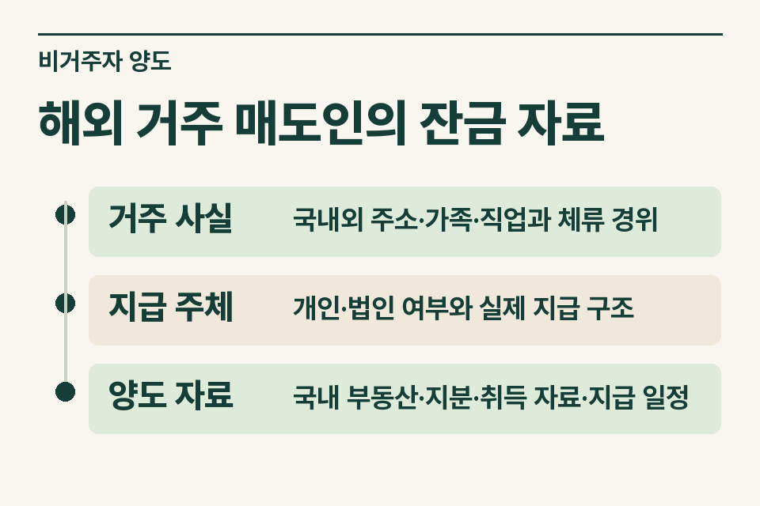
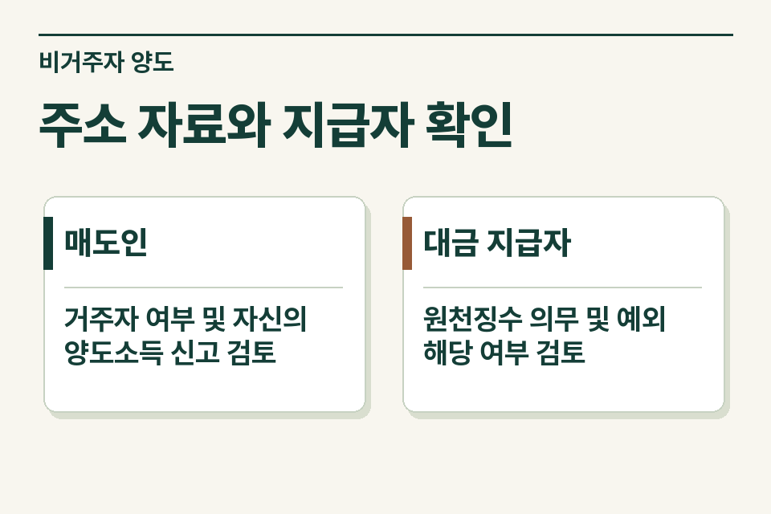

해외 주소가 적힌 매도인의 계약을 중개할 때 ‘외국인이므로 원천징수’라고 안내하면 두 가지 판단이 빠집니다. 먼저 매도인이 소득세법상 비거주자인지 확인하고, 다음으로 국내 부동산 매매대금을 지급하는 사람이 원천징수 의무에 해당하는지 살펴야 합니다.

## 법인 매수인이 잔금표를 요청한 사례

매도인이 한국 국적을 유지한 채 해외에서 장기간 근무하고 매수인은 법인이라고 가정합니다. 해외 체류 기간만 들은 상황에서 미리 일정 금액을 떼어 정산표를 만들면 실제 지급 의무와 맞지 않을 수 있습니다. 매도인의 생활 근거와 자산 소재지, 지급자 지위부터 확인합니다.

<figure style="margin:28px 0"><figcaption>해외 거주 매도인의 잔금 자료 — 거주 사실 · 국내외 주소·가족·직업과 체류 경위 / 지급 주체 · 개인·법인 여부와 실제 지급 구조 / 양도 자료 · 국내 부동산·지분·취득 자료·지급 일정</figcaption></figure>

## 당사자별로 받을 자료

| 자료 | 무엇을 읽을까 |
|---|---|
|거주 사실|국내외 주소·가족·직업과 체류 경위|
|지급 주체|개인·법인 여부와 실제 지급 구조|
|양도 자료|국내 부동산·지분·취득 자료·지급 일정|

주소·거소와 가족·직업·재산 상황 등 거주자 판단에 필요한 자료를 확인하되, 대리인이 서명하거나 대금이 국내 계좌로 지급된다는 사정만으로 지급 상대방의 세법상 지위를 정하지 않습니다. 지급할 상대, 위임·수령 관계와 공동소유 지분이 있으면 각각 기록합니다.

## 비거주자 양도와 지급자 의무

국내 부동산 양도소득은 비거주자의 국내원천소득 검토 대상입니다. 비거주자에게 해당 소득을 지급하는 자의 원천징수 규정에는 적용 범위 및 예외가 있으며 개인 양수인과 법인 양수인의 처리가 달라질 수 있습니다. 납부나 비과세 등에 관한 확인자료가 있다면 그 효력도 따로 살핍니다. 원천징수 여부와 매도인의 최종 신고는 별개 질문입니다. [소득세법 제119조](https://www.law.go.kr/법령/소득세법/제119조) · [소득세법 제156조](https://www.law.go.kr/법령/소득세법/제156조)

## 지급 전에 남겨야 할 기록

계약금·중도금이 이미 지급됐다면 일자별 금액과 지급받은 사람을 적습니다. 법인이 자금집행 주체인지, 공동매수인이나 대리인이 있는지도 확인합니다. 지급 당일 징수 여부가 미확정이라면 세무 검토가 필요한 항목으로 표시하고 확정 금액처럼 기재하지 않습니다.

<figure style="margin:28px 0"><figcaption>주소 자료와 지급자 확인 — 매도인 · 거주자 여부 및 자신의 양도소득 신고 검토 / 대금 지급자 · 원천징수 의무 및 예외 해당 여부 검토</figcaption></figure>

## 세무 인계 문구

‘매도인은 해외 근무 중이고 국내 거주관계는 확인 중입니다. 매수인은 법인이고 중도금을 지급하기 전입니다. 지급자 의무와 매도인 신고에 필요한 서류를 나누어 알려 주세요.’ 정산 전 검토해야 실제 납부·신고 절차와 계약상 대금 지급을 맞출 수 있습니다. [양도소득세 거래 점검](https://www.jttax.co.kr/insights/capital-gains-tax-traps.html) · [공인중개사 상담 창구](https://www.jttax.co.kr/desk/broker.html)
