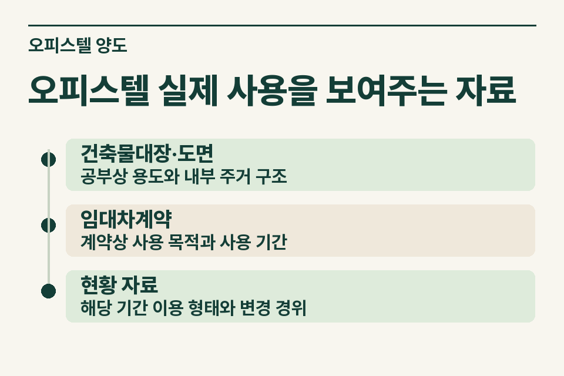

오피스텔 매도 의뢰에서 공부상 업무시설이라는 이유로 양도소득세의 주택 판단을 끝낼 수 없습니다. 세대가 독립된 주거생활을 할 수 있는 구조와 실제 주거용 사용 여부를 살펴야 합니다. 이 글은 양도소득세의 주택 판단에 쓸 자료를 다루며 관계 세목의 판단은 별도로 확인합니다.

## 업무용 임대계약과 다른 설명이 나오는 경우

계약서에는 사무실로 사용한다고 쓰였는데 고객은 임차인이 실제 거주했다고 설명합니다. 사무소는 현 임차인의 사용 기간, 내부 구조, 사용이 달라졌다면 변경 시점부터 확인합니다. 고객이 직접 확인한 사실과 소문으로 들은 내용을 같은 칸에 적지 않습니다.

<figure style="margin:28px 0"><figcaption>오피스텔 실제 사용을 보여주는 자료 — 건축물대장·도면 · 공부상 용도와 내부 주거 구조 / 임대차계약 · 계약상 사용 목적과 사용 기간 / 현황 자료 · 해당 기간 이용 형태와 변경 경위</figcaption></figure>

## 자료별로 확인할 시점

| 자료 | 무엇을 읽을까 |
|---|---|
|건축물대장·도면|공부상 용도와 내부 주거 구조|
|임대차계약|계약상 사용 목적과 사용 기간|
|현황 자료|해당 기간 이용 형태와 변경 경위|

현재 사진 한 장만으로 이전 임대기간의 용도를 설명하기는 어렵습니다. 계약 변경일, 내부 공사일, 공실을 거쳐 새 임차인이 입주한 날을 순서대로 적습니다. 임대인의 세금계산서 발행 이력이나 사업자등록 주소는 참고 자료이고 실제 사용에 대한 설명과 맞는지 대조합니다.

## 공부와 실제 용도가 다른 경우

소득세법의 주택 정의는 공부상의 분류만으로 정해지지 않습니다. 독립된 주거생활이 가능한 구조와 실제 사용을 살피며, 용도가 분명하지 않은 경우의 별도 기준도 확인해야 합니다. 전입신고 또는 사업자등록 하나만 보고 주택 수에 포함하거나 제외한다고 안내하면 필요한 사실을 놓칠 수 있습니다. [소득세법 제88조](https://www.law.go.kr/법령/소득세법/제88조)

## 공실인 채 매도할 때

임차인이 퇴거해 현재 비어 있다면 마지막 임대 기간의 사용, 퇴거 후 구조 변경 또는 공사 여부, 매도 시점의 상태를 기록합니다. 과거 사진의 촬영일과 임대기간을 맞추고 빈 기간을 표시합니다. 다른 주택 양도의 비과세를 묻는 고객이라면 그 주택을 양도한 날짜와 당시 오피스텔의 상태도 따로 확인합니다.

<figure style="margin:28px 0"><figcaption>계약상 용도와 사용 기록 — 계약 목적 · 계약 당사자가 정한 사용 방식 / 사용 현황 · 양도 무렵 실제 사용 및 구조를 보여 줄 자료</figcaption></figure>

## 사무소가 전달할 표현

매도인에게는 [업무시설로 산 오피스텔의 실제 용도를 확인하는 방법](https://blog.naver.com/jt_tax/224474277168)을 함께 안내할 수 있습니다.

‘대장에는 업무시설로 적혀 있고, 해당 기간에 주거용 사용 여부를 추가 확인 중입니다. 마지막 임차인의 계약과 내부 구조 변경 자료를 확보했습니다.’ 이렇게 사실을 넘기면 제이티가 용도 판단에 더 필요한 자료와 검토할 세목을 알려드립니다. [양도소득세 거래 점검](https://www.jttax.co.kr/insights/capital-gains-tax-traps.html) · [공인중개사 상담 창구](https://www.jttax.co.kr/desk/broker.html)
