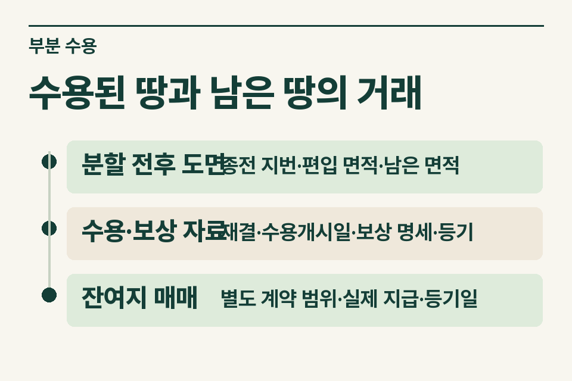
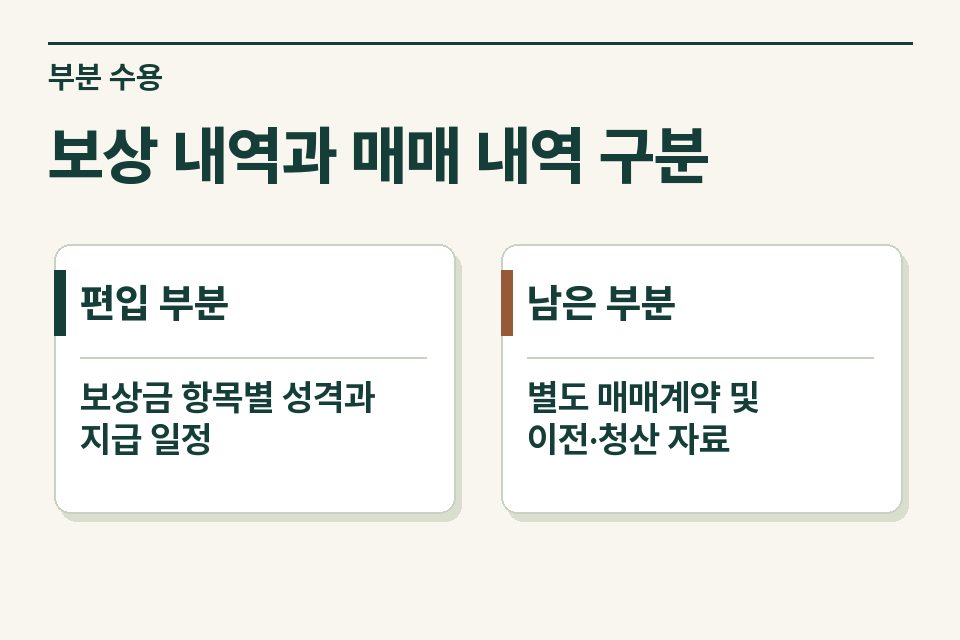

토지 일부가 공익사업에 편입된 뒤 남은 토지를 제3자에게 파는 경우 두 거래를 지번·면적·대가별로 나눕니다. 동일한 원래 토지에서 나왔어도 보상금과 일반 매매대금을 하나의 매도대금으로 기록하면 양도시기와 비용 배분을 확인하기 어렵습니다.

## 입금이 비슷한 시기에 이뤄진 가정 사례

사업시행자가 편입 토지에 대한 보상금을 지급하고 얼마 후 이웃이 남은 토지를 매수했다고 가정합니다. 통장에는 토지 소유자 앞으로 돈이 두 번 들어왔습니다. 첫 입금의 명칭이 ‘보상금’이어도 토지 대금, 지장물이나 다른 항목이 포함됐는지 보상명세와 함께 읽습니다. 두 번째 입금은 잔여지 매매계약의 계약금·잔금인지 확인합니다.

<figure style="margin:28px 0"><picture><source media="(prefers-reduced-motion: no-preference)" srcset="/project/assets/insights/partial-expropriation-remaining-land-sale-steps.webp"></picture><figcaption>수용된 땅과 남은 땅의 거래 — 분할 전후 도면 · 종전 지번·편입 면적·남은 면적 / 수용·보상 자료 · 재결·수용개시일·보상 명세·등기 / 잔여지 매매 · 별도 계약 범위·실제 지급·등기일</figcaption></figure>

## 종전 지번과 두 거래의 대응표

| 자료 | 무엇을 읽을까 |
|---|---|
|분할 전후 도면|종전 지번·편입 면적·남은 면적|
|수용·보상 자료|재결·수용개시일·보상 명세·등기|
|잔여지 매매|별도 계약 범위·실제 지급·등기일|

지적도·분할 자료에서 편입 부분과 남은 부분의 지번을 연결합니다. 전체 토지를 샀을 때의 취득계약서에 분할 후 지번이 없으면 해당 면적의 관계를 별도로 표시합니다. 보상금을 추가로 받은 경우에는 어떤 재결이나 이의 절차에서 무엇을 증액했는지, 이후 일반 매매대금과 섞이지 않았는지를 확인합니다.

## 수용과 일반 매매의 양도시기

공익사업으로 수용되는 토지는 대금청산일, 수용개시일, 소유권이전등기접수일 중 빠른 날을 봅니다. 다만 소유권에 관한 소송으로 보상금이 공탁된 경우에는 관련 소송의 판결 확정일을 봅니다. 단순히 보상액을 다투고 있다는 사정과 소유권 소송으로 공탁된 사정을 구별합니다. 잔여지 일반 매매는 대금청산과 등기 등 그 거래에 적용되는 기준을 별도로 검토합니다. [소득세법 제98조](https://www.law.go.kr/법령/소득세법/제98조) · [소득세법 시행령 제162조](https://www.law.go.kr/법령/소득세법시행령/제162조)

## 원래 토지의 취득 자료가 하나뿐이라면

원 취득가액·수수료 등의 지출이 전체 토지에 관한 것인지 특정 부분만의 비용인지 먼저 구분합니다. 단순히 전체 금액을 두 거래에 각각 넣거나 면적 비율 하나를 임의로 확정해 배분하지 않습니다. 분할 이력과 거래별 객관적 자료를 갖추고 적정한 배분 기준을 검토합니다.

<figure style="margin:28px 0"><figcaption>보상 내역과 매매 내역 구분 — 편입 부분 · 보상금 항목별 성격과 지급 일정 / 남은 부분 · 별도 매매계약 및 이전·청산 자료</figcaption></figure>

## 상담에 필요한 마지막 구분

협의매수인지 실제 수용재결인지, 잔여지도 사업시행자가 인수한 것인지 개인에게 일반 매매한 것인지부터 알려 주세요. 이 글은 두 대가와 양도시기를 구분하는 자료에 관한 것이며 개별 감면 여부를 판정하지 않습니다. [양도소득세 거래 점검](https://www.jttax.co.kr/insights/capital-gains-tax-traps.html) · [공인중개사 상담 창구](https://www.jttax.co.kr/desk/broker.html)
