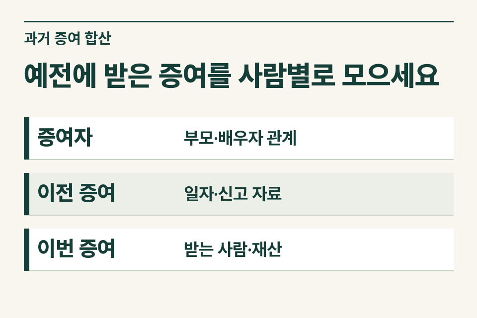
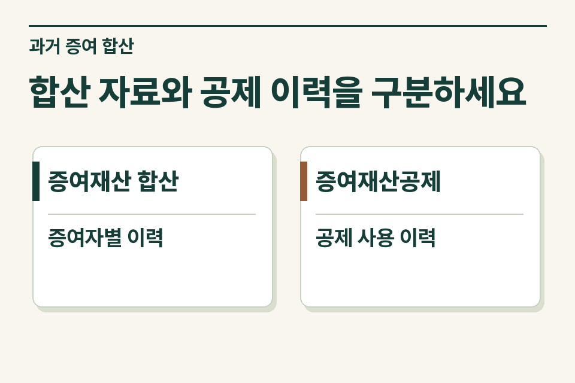

이번 수증자를 먼저 정하고, 그 사람이 과거에 누구에게 어떤 재산을 언제 받았는지 찾아야 합니다. 이전 증여세 신고서가 있으면 접수증뿐 아니라 신고 재산·증여자·공제 내역이 적힌 명세도 요청하세요. 신고서를 아직 찾지 못했다는 사정만으로 이전 증여가 없다고 기록하지 않습니다.

## 부모가 번갈아 준 재산은 어떻게 살피나요?

가령 어머니가 아들에게 아파트를 증여하려고 하고, 아버지는 예전에 아들에게 전세자금을 주었다고 합니다. 상속세 및 증여세법의 증여재산 합산 규정은 증여자가 직계존속인 경우 그 배우자를 포함한 동일인 범위를 둡니다. 부모가 각각 주었다는 이유만으로 두 과거 거래를 처음부터 나눠 제외하지 않습니다. 실제 증여자, 증여일, 재산의 성격과 합산 요건을 세무사가 검토하도록 이력을 연결합니다.

<figure style="margin:28px 0"><figcaption>예전에 받은 증여를 사람별로 모으세요 — 증여자 · 부모·배우자 관계 / 이전 증여 · 일자·신고 자료 / 이번 증여 · 받는 사람·재산</figcaption></figure>

## 과거 거래 목록에서 무엇을 남길까요?

| 자료 | 적을 내용 | 확정하지 말아야 할 점 |
|---|---|---|
| 종전 증여세 신고서·명세 | 증여일, 증여자·수증자, 신고 재산과 가액 | 접수증만으로 공제 내역을 추정하지 않음 |
| 부모와 자녀의 이체 | 송금일·명의, 받은 계좌, 사용처 | 가족 간 송금을 일률적으로 증여로 분류하지 않음 |
| 이번 증여계약안 | 증여자, 대상 지분, 예정일 | 예상 가액과 신고에 사용한 가액 구별 |
| 종전에 납부한 세금 | 신고 건별 실제 납부 자료 | 과거 납부세액을 전부 그대로 차감하지 않음 |

## 계약안에 날짜가 여러 개라면

계약서 작성일, 등기 예정일, 과거 증여일과 당시 신고일은 별개의 칸에 기재합니다. 합산 범위를 검토하는 기준일이 계약 작성일이라고 미리 단정하지 말고, 재산 종류와 가능한 취득 시점을 확인할 자료를 세무사와 공유합니다.

## 합산과 공제 사용 내역을 따로 묻는 이유

가족은 “지난번에 공제만큼 줬으니 끝난 일”이라고 기억할 수 있습니다. 이번 신고에서는 과거 증여재산을 합산하는 규정과 증여재산공제 이력을 따로 검토합니다. 증여자 관계, 이전 증여 시점, 재산별 예외 등을 살펴야 하므로 종전 신고서의 공제액만 이번 신고의 결론으로 옮겨 적지 않습니다.

<figure style="margin:28px 0"><figcaption>합산 자료와 공제 이력을 구분하세요 — 증여재산 합산 · 증여자별 이력 / 증여재산공제 · 공제 사용 이력</figcaption></figure>

## 첫 문의를 이렇게 적어 보세요

“아파트를 어머니에게서 받을 예정이고 아버지가 이전에 전세금을 송금했습니다. 예전 신고서는 접수증만 확보했으며 송금이 증여인지 대여인지 관련 약정을 확인 중입니다.” 제이티 세무법인은 신고·납부 자료와 거래 경위에서 추가로 필요한 항목을 특정합니다. 첫 문의에서 가족 전체의 거래내역을 모두 보내기보다는 수증자가 받은 관련 거래부터 정리합니다.

[상속세 및 증여세법 제47조](https://www.law.go.kr/법령/상속세및증여세법/제47조)

[증여재산공제 안내](https://www.jttax.co.kr/insights/gift-tax-exemption-limit.html) · [법무사 협업 상담](https://www.jttax.co.kr/desk/scrivener.html)
