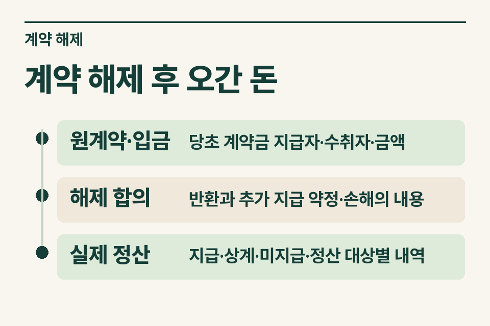
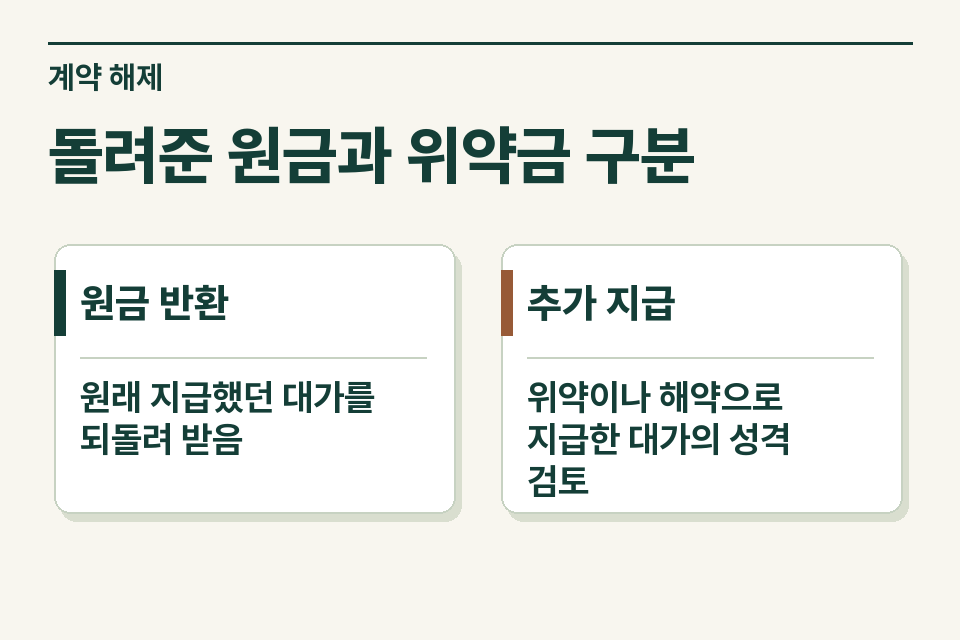

매매 해제 합의서에 ‘원만히 합의하여 정산한다’고만 적혀 있으면 입금액의 성격이 드러나지 않습니다. 매도인과 매수인 중 누가 어떤 돈을 지급했고 무엇을 돌려받았는지 처음 이체부터 마지막 합의까지 따라갑니다.

## 원금과 별도 합의금이 한 번에 들어온 경우

매수인이 낸 계약금을 매도인이 돌려주면서 다른 금액을 함께 입금했다고 가정합니다. 수취인은 전액을 위약금이라고 설명하지만 일부는 본인이 낸 계약금입니다. 사무소가 먼저 할 일은 반환 전 원래 계약금의 입금 기록을 찾아 같은 금액을 떼어 표시하는 것입니다.

<figure style="margin:28px 0"><picture><source media="(prefers-reduced-motion: no-preference)" srcset="/project/assets/insights/property-contract-cancellation-penalty-steps.webp"></picture><figcaption>계약 해제 후 오간 돈 — 원계약·입금 · 당초 계약금 지급자·수취자·금액 / 해제 합의 · 반환과 추가 지급 약정·손해의 내용 / 실제 정산 · 지급·상계·미지급·정산 대상별 내역</figcaption></figure>

## 입금액의 성격을 구별하는 표

| 자료 | 무엇을 읽을까 |
|---|---|
|원계약·입금|당초 계약금 지급자·수취자·금액|
|해제 합의|반환과 추가 지급 약정·손해의 내용|
|실제 정산|지급·상계·미지급·정산 대상별 내역|

계약이 깨졌다는 사정만으로 모든 금액이 하나의 소득이 되지는 않습니다. 지급한 원금, 별도 배상금, 지연에 따른 이자나 비용 정산이 섞였는지 확인합니다. 보관 중인 계약금을 돌려주지 않는 방법으로 정산했다면 현금 이동이 없어도 언제·왜 누구에게 귀속됐는지를 설명할 자료를 남깁니다.

## 세무 검토에 필요한 기준

재산권에 관한 계약의 위약이나 해약으로 받는 위약금·배상금 등은 소득세법과 시행령의 범위에 해당하는지 검토합니다. 계약의 이름이나 ‘손해배상’이라는 표현만으로 과세 여부를 정하지 않습니다. 본래 계약에서 지급할 금액과 실제 손해·추가 지급의 관계, 지급자와 수취인의 지위를 확인해야 합니다. [소득세법 제21조](https://www.law.go.kr/법령/소득세법/제21조) · [소득세법 시행령 제41조](https://www.law.go.kr/법령/소득세법시행령/제41조)

## 지급자와 수취인의 질문을 나누기

수취인은 받은 금액의 소득 구분과 신고가 궁금하고, 지급자는 지급 단계에서 확인할 절차를 묻습니다. 이미 지급했는지 아직 합의 단계인지도 표시합니다. 분쟁 중인 계약이나 법원 결정이 있다면 날짜·당사자·주문과 합의서가 어떤 부분에서 일치하는지 확인합니다.

<figure style="margin:28px 0"><figcaption>돌려준 원금과 위약금 구분 — 원금 반환 · 원래 지급했던 대가를 되돌려 받음 / 추가 지급 · 위약이나 해약으로 지급한 대가의 성격 검토</figcaption></figure>

## 고객 인계 문구

‘계약은 해제됐고 매수인에게 원금과 추가 금액이 함께 지급됐습니다. 합의서에는 각 항목의 금액이 구분돼 있습니다.’ 민감정보 없이 먼저 상황을 전하고 세무사가 필요한 서류와 검토 범위를 안내하도록 연결합니다. [양도소득세 거래 점검](https://www.jttax.co.kr/insights/capital-gains-tax-traps.html) · [공인중개사 상담 창구](https://www.jttax.co.kr/desk/broker.html)
