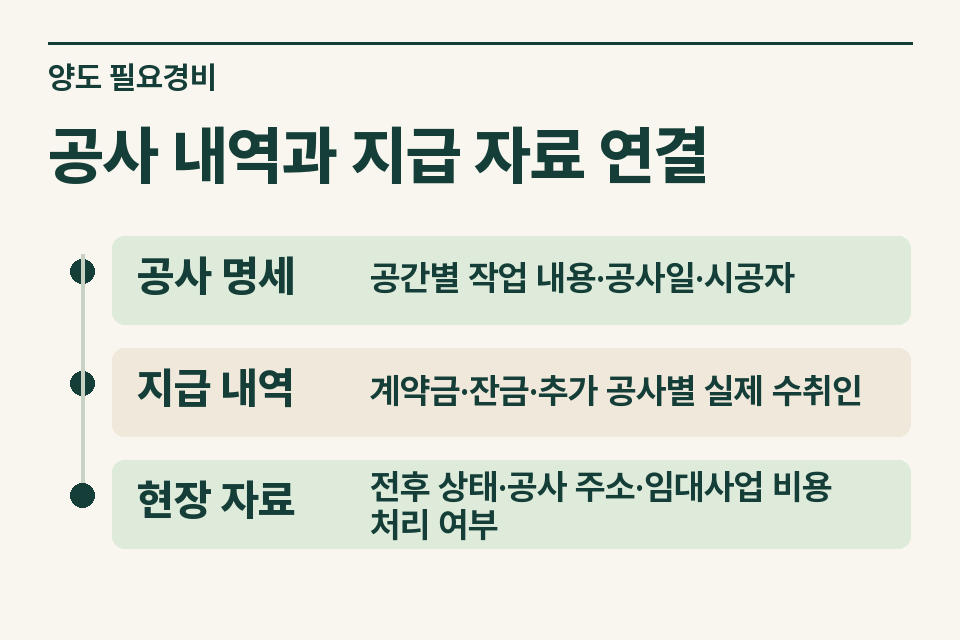
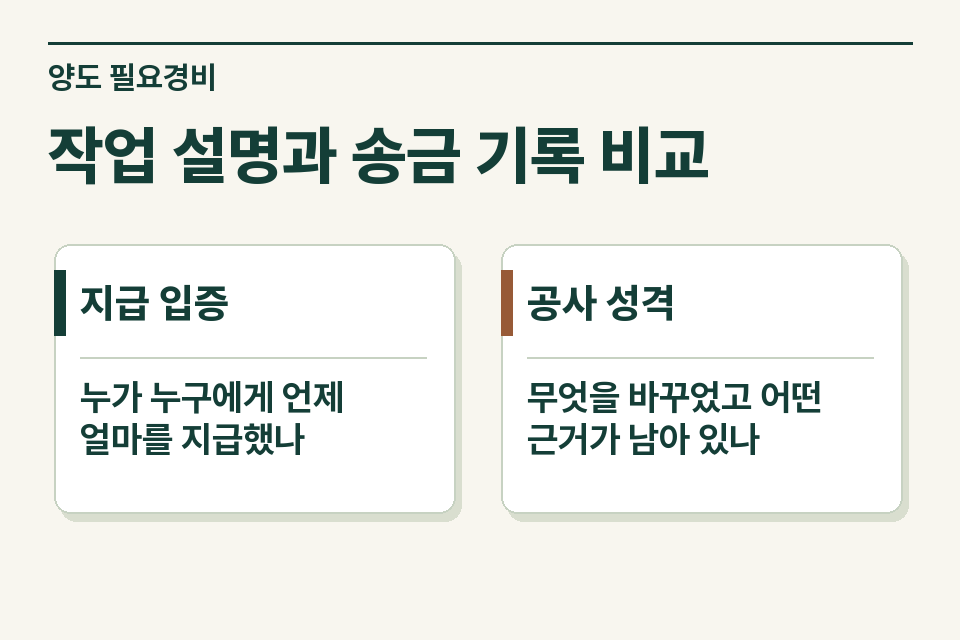

오래 거주한 주택을 파는 매도인이 공사비 이체 내역을 가져왔습니다. 송금 사실과 양도차익에서 공제할 수 있는 비용인지는 각각 검토해야 합니다. 중개사무소는 비용 전체를 합산하기 전에 공사의 장소, 작업 내용, 실제 지급자를 확인합니다.

## 한 장의 견적서에 여러 공사가 섞였다면

매도인이 창호 공사와 도배를 한 업체에 맡기고 두 번에 나눠 지급했다고 가정합니다. 견적서에는 ‘내부 공사 일체’만 적혀 있습니다. 공사비가 모두 인정되는지부터 묻기보다 계약서의 작업 항목, 추가공사 합의, 최종 정산서를 찾아 각각의 공사비가 구분되는지 확인합니다.

<figure style="margin:28px 0"><figcaption>공사 내역과 지급 자료 연결 — 공사 명세 · 공간별 작업 내용·공사일·시공자 / 지급 내역 · 계약금·잔금·추가 공사별 실제 수취인 / 현장 자료 · 전후 상태·공사 주소·임대사업 비용 처리 여부</figcaption></figure>

## 시공 내역과 이체 기록 대조

| 자료 | 무엇을 읽을까 |
|---|---|
|공사 명세|공간별 작업 내용·공사일·시공자|
|지급 내역|계약금·잔금·추가 공사별 실제 수취인|
|현장 자료|전후 상태·공사 주소·임대사업 비용 처리 여부|

견적은 예정 대가이고 실제 지출은 정산서·영수증·금융거래로 확인됩니다. 계약 명의가 배우자이거나 시공자와 입금받은 사람이 다르면 누가 실제 부담했는지 확인합니다. 전체 리모델링 사진에서 어느 집인지 드러나지 않으면 공사 당시 계약서의 주소·호수, 일정과 대조합니다.

## 필요경비 판단에서 확인할 점

양도소득세 필요경비에는 취득가액 외에 법령의 요건을 충족한 자본적 지출액과 양도비 등이 포함될 수 있습니다. 집을 유지하기 위해 쓴 모든 비용이 자동으로 공제되지는 않습니다. 공사 내용과 증빙이 모두 필요한 이유입니다. 임대기간 사업소득에서 이미 비용 처리했다면 당시 장부와 신고자료도 검토합니다. [소득세법 제97조](https://www.law.go.kr/법령/소득세법/제97조) · [소득세법 시행령 제163조](https://www.law.go.kr/법령/소득세법시행령/제163조)

## 영수증이 일부 없을 때

고객에게 없는 자료를 새로 꾸며 달라고 요청하지 않습니다. 당시에 작성된 계약, 업체의 거래명세, 실제 송금 기록 등 남은 자료를 확인한 뒤 어떤 항목이 입증되지 않는지 표시합니다. 무상 수리, 보험금 보전, 임차인이 부담한 비용도 고객이 직접 부담한 금액과 구분합니다.

<figure style="margin:28px 0"><figcaption>작업 설명과 송금 기록 비교 — 지급 입증 · 누가 누구에게 언제 얼마를 지급했나 / 공사 성격 · 무엇을 바꾸었고 어떤 근거가 남아 있나</figcaption></figure>

## 사무소 인계 예시

‘공사 견적·계좌이체는 확인되나 작업별 금액 배분은 확인 중입니다. 이 주택의 사용기간 중 일부는 임대했습니다.’ 이 메모가 있으면 세무 검토자는 부족한 증빙과 해당 비용의 성격을 함께 살필 수 있습니다. [양도소득세 거래 점검](https://www.jttax.co.kr/insights/capital-gains-tax-traps.html) · [공인중개사 상담 창구](https://www.jttax.co.kr/desk/broker.html)
