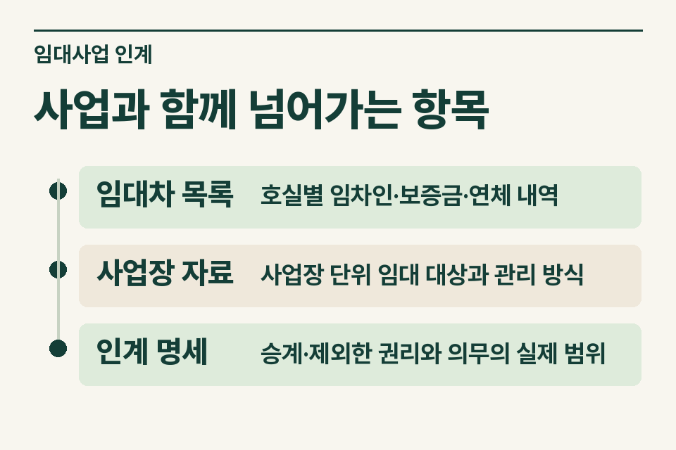
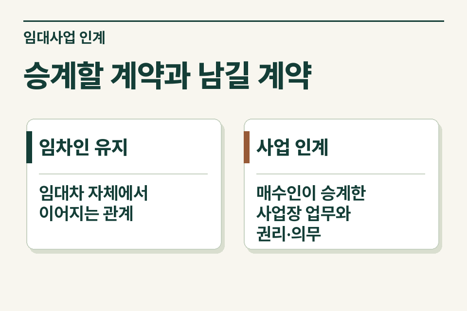

상가 매매계약의 포괄양도 조항은 인계 사실을 설명할 출발점입니다. 부가가치세에서 사업 양도로 볼 수 있는지는 기존 임차인이 계속 영업한다는 사실이나 계약 제목만으로 결정되지 않습니다. 사무소는 무엇이 매수인에게 넘어가고 무엇이 매도인에게 남는지 사업장별로 정리합니다.

## 건물의 일부 호실만 넘어가는 사례

매도인이 여러 층을 임대하다 특정 층만 팔고 다른 층은 직접 관리한다고 가정합니다. 매수인은 그 층의 기존 임차인과 계약을 유지합니다. 먼저 해당 층이 사업장에서 어떤 역할을 했는지, 공용 관리·수납 업무를 누가 계속 맡는지, 매도인의 임대업이 어느 단위로 남는지 확인합니다.

<figure style="margin:28px 0"><picture><source media="(prefers-reduced-motion: no-preference)" srcset="/project/assets/insights/rental-business-transfer-checklist-steps.webp"></picture><figcaption>사업과 함께 넘어가는 항목 — 임대차 목록 · 호실별 임차인·보증금·연체 내역 / 사업장 자료 · 사업장 단위 임대 대상과 관리 방식 / 인계 명세 · 승계·제외한 권리와 의무의 실제 범위</figcaption></figure>

## 임대계약과 사업 인계자료 대조

| 자료 | 무엇을 읽을까 |
|---|---|
|임대차 목록|호실별 임차인·보증금·연체 내역|
|사업장 자료|사업장 단위 임대 대상과 관리 방식|
|인계 명세|승계·제외한 권리와 의무의 실제 범위|

인계일부터 누가 월세를 청구하는지, 이미 받은 월세와 연체채권은 어떻게 처리하기로 했는지까지 적으면 계약서의 선언과 실제 인계 내용이 맞는지 살펴볼 수 있습니다. 일부 미수금 등 법령상 제외할 수 있는 항목도 있어 빠진 항목의 이름과 이유를 각각 남겨야 합니다.

## 사업 양도에 해당하는지 보는 기준

부가가치세법은 일정한 사업 양도를 재화 공급으로 보지 않는 규정을 둡니다. 시행령에서는 사업장별로 사업에 관한 권리와 의무를 포괄 승계시키는지와 예외 항목을 정합니다. 양수인의 사업 추가나 변경, 승계에서 제외한 항목을 계약 문구 하나만 보고 일괄 판정하지 않습니다. [부가가치세법 제10조](https://www.law.go.kr/법령/부가가치세법/제10조) · [부가가치세법 시행령 제23조](https://www.law.go.kr/법령/부가가치세법시행령/제23조)

## 현장에서 빠지는 확인

매도인 사업자등록증에 적힌 사업장과 매매 대상 필지·층·호가 일치하는지 확인합니다. 관리비 예치금과 반환할 임대보증금은 성격을 갈라 쓰고, 실제 명의변경이나 임차인 통지가 언제 이뤄지는지 적습니다. 매수인의 운영 계획이 확정되지 않았다면 예상과 계약상 의무를 각각 표시합니다.

<figure style="margin:28px 0"><figcaption>승계할 계약과 남길 계약 — 임차인 유지 · 임대차 자체에서 이어지는 관계 / 사업 인계 · 매수인이 승계한 사업장 업무와 권리·의무</figcaption></figure>

## 인계 시점을 정하기 전

‘호실은 그대로 임대하지만 공용 관리 계약은 매도인이 유지하고, 연체 월세의 귀속은 협의 중입니다.’ 이런 설명이 있어야 세무사가 어떤 추가 자료를 볼지 정할 수 있습니다. 실제로 계약할 시점에 포괄양도 여부와 세금계산서 처리 등을 함께 검토합니다. [부가가치세 기초](https://www.jttax.co.kr/insights/vat-basics.html) · [공인중개사 상담 창구](https://www.jttax.co.kr/desk/broker.html)
