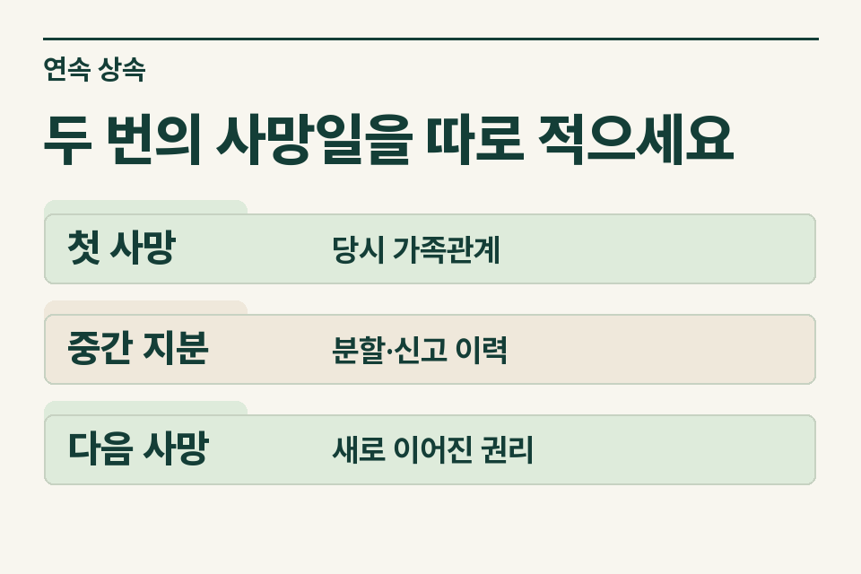
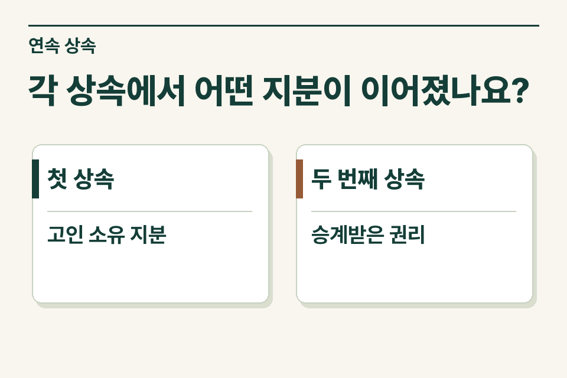

먼저 돌아가신 분의 사망일과 그때 생존해 있던 상속인을 표시한 뒤, 나중에 돌아가신 상속인의 사망일을 별도 줄에 기록합니다. 등기부에는 한 사람의 이름만 남아 있어도 중간에 발생한 상속을 따로 살펴야 합니다. 민법상 상속 개시와 재산상 권리·의무 승계의 기준은 각 상속개시 시점입니다.

## 최초 명의와 가족의 설명이 어긋나는 사례

가령 할아버지가 돌아가신 후 아버지가 생존해 있었고, 할아버지 명의의 토지를 등기하기 전에 아버지도 돌아가셨습니다. 손자는 “등기할 사람은 나와 고모”라고 설명합니다. 사무소는 현재 살아 있는 사람의 목록만으로 지분을 작성하기보다 두 번의 사망 당시 가족 구성과 기존 상속포기·분할 등 관련 사실을 확인합니다. 사망 순서가 달라지면 검토할 권리관계도 달라질 수 있습니다.

<figure style="margin:28px 0"><picture><source media="(prefers-reduced-motion: no-preference)" srcset="/project/assets/insights/successive-inheritance-registration-steps.webp"></picture><figcaption>두 번의 사망일을 따로 적으세요 — 첫 사망 · 당시 가족관계 / 중간 지분 · 분할·신고 이력 / 다음 사망 · 새로 이어진 권리</figcaption></figure>

## 사망 두 건을 어떻게 한 장에 표시하나요?

| 칸 | 첫 상속 | 두 번째 상속 |
|---|---|---|
| 사건 기준 | 할아버지 사망일, 당시 가족관계 | 아버지 사망일, 당시 가족관계 |
| 확인할 재산 | 토지의 고인 소유 지분과 다른 상속재산 | 첫 상속에서 아버지에게 귀속된 권리와 아버지의 별도 재산 |
| 분할 경위 | 당시 논의, 서명본, 등기 여부 | 두 번째 상속인들이 확인한 문서와 미정 사항 |
| 신고 이력 | 할아버지 관련 취득세·상속세 자료 | 아버지 관련 신고 여부와 예정 일정 |

## 첫 번째 분할이 미완료라면요?

서명된 협의가 있는지와 등기 접수 여부를 따로 확인하세요. 첫 상속의 협의가 이미 이루어졌으나 등기가 늦었을 수 있습니다. 반대로 가족이 구두로 의논만 하고 서명한 적이 없을 수도 있습니다. 첫 상속에서 아버지에게 돌아갈 재산이나 권리가 무엇인지 확정하기 어려우면 그 이유를 적고 관련 문서를 보냅니다.

## 토지를 두 번 적으면 중복 아닌가요?

첫 상속에서 고인의 토지를 기록한 뒤 두 번째 사건에서도 같은 지번이 나타날 수 있습니다. 각 사건에서 검토하는 소유자·귀속 권리와 기준일이 다르므로 단순 중복 삭제하지 않습니다. 두 번째 사건의 목록에 토지 전체가 적혔다면, 아버지가 실제로 취득한 몫을 가리키는지 먼저 확인합니다. 기존 신고서가 있으면 재산 목록의 성명·지번·지분부터 비교합니다.

<figure style="margin:28px 0"><figcaption>각 상속에서 어떤 지분이 이어졌나요? — 첫 상속 · 고인 소유 지분 / 두 번째 상속 · 승계받은 권리</figcaption></figure>

## 인계할 때 가장 먼저 알려 줄 내용

“할아버지 사망 후 아버지가 생존했고, 최초 등기 전에 아버지가 사망했습니다. 첫 협의서 서명 여부와 첫 신고서 사본을 확인 중입니다.” 두 사건의 연락 대표가 다르면 누가 어느 상속의 자료를 제공할지도 표시하세요. 제이티 세무법인은 사건별로 확인할 재산·신고 이력과 추가 자료를 안내합니다.

[민법 제997조](https://www.law.go.kr/법령/민법/제997조) · [민법 제1005조](https://www.law.go.kr/법령/민법/제1005조)

[상속세 신고 자료 안내](https://www.jttax.co.kr/insights/inheritance-tax-basics.html) · [법무사 협업 상담](https://www.jttax.co.kr/desk/scrivener.html)
