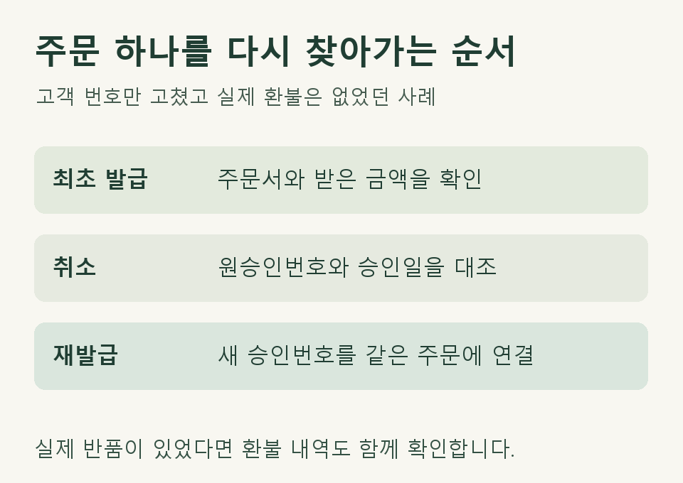

## 영수증이 두 장인데 매출도 두 건일까요?

촬영 소품을 판매하는 개인사업자가 고객의 휴대전화번호를 잘못 입력해 현금영수증을 취소하고 다시 발급했다고 해 보겠습니다. 고객은 물건 하나를 받았고 대금도 한 번 보냈습니다. 주문과 입금이 모두 한 건으로 확인되고 취소가 원래 영수증에 정상적으로 연결됐다면, 이 사례에서 장부에 남길 판매는 한 건입니다.

<strong>먼저 고객에게 돈을 돌려줬는지 확인하세요</strong>
영수증의 정보를 고친 경우와 실제 반품·환불을 구분하면, 어떤 자료를 더 봐야 할지 알 수 있습니다.

## 홈택스에서 내려받은 세 줄을 한 주문에 맞추세요

먼저 주문서에서 주문번호, 판매한 물건과 결제금액을 확인합니다. 다음은 휴대전화번호만 고치고 같은 금액으로 다시 발급한 사례입니다.

| 내역 | 무엇을 대조하나요? | 이 사례에서 확인한 내용 |
|---|---|---|
| 최초 발급 | 주문서의 금액과 원래 승인번호 | 소품 한 개를 판매하고 대금을 한 번 받았습니다. |
| 취소 | 취소 내역이 가리키는 원래 승인번호와 승인일 | 고객 번호를 잘못 입력해 해당 영수증을 취소했습니다. |
| 재발급 | 새 승인번호, 금액과 주문번호 | 같은 주문으로 영수증을 다시 발급했습니다. 고객에게 추가로 받은 돈은 없습니다. |

국세청은 취소 발급 때 당초 거래의 승인번호·승인일자와 취소사유를 입력하도록 안내합니다. 재발급 내역에는 새 승인번호가 생기므로 번호가 다르다는 이유만으로 두 번째 판매로 기록하면 같은 주문이 중복될 수 있습니다. [국세청 현금영수증 발급 안내](https://www.nts.go.kr/nts/cm/cntnts/cntntsView.do?cntntsId=7796&mi=2462)

<figure style="margin:24px 0"><figcaption>영수증을 다시 발급한 같은 주문을 대조하는 순서</figcaption></figure>

## 반품 때문에 취소했다면 무엇이 달라지나요?

고객이 소품 두 개 중 하나를 반품했다면, 반품한 품목과 돌려준 금액부터 찾으세요. 남은 물건 값으로 다시 발급한 영수증이 있을 수도 있습니다. 최초 발급액과 재발급액을 더하거나, 취소라는 표시만 보고 주문 전체를 장부에서 빼면 실제 거래와 어긋납니다.

계좌이체를 받았다면 입금 내역과 환불 이체 내역을, 결제대행사에서 정산받았다면 주문별 결제·환불 내역을 대조합니다. 고객과 환불하기로 했는데 아직 돈을 돌려주지 않았다면 메모에 ‘환불 예정’이라고 적고 실제 지급일은 비워 두세요.

## 지난달 발급분을 이번 달에 고쳤다면요?

월말에 발급하고 다음 달에 취소했다면 한 달치 파일만으로는 세 줄을 전부 볼 수 없습니다. 두 달의 자료를 이어 놓고 원래 주문번호를 표시하세요. 이미 장부를 마감했거나 신고한 기간이라면, 무엇을 언제 공급했는지, 실제 반품이 있었는지, 종전 신고에 어느 금액을 반영했는지부터 확인해야 합니다. 취소 버튼을 누른 달만으로 신고를 고칠 기간이 정해지지는 않습니다.

개인사업자의 장부에는 사업의 거래 사실을 확인할 수 있도록 기록하고 관련 증명서류를 갖춰 두어야 합니다. 이 글의 대조표는 그 거래를 설명하기 위한 예시입니다. [소득세법 제160조 제1항](https://www.law.go.kr/법령/소득세법/제160조)

## 월말에 제이티에는 무엇을 보내면 되나요?

‘같은 주문으로 영수증을 다시 발급했고 실제 환불은 없었습니다’처럼 사실을 한 줄로 적어 주세요. 제이티는 수임 동의와 등록을 거쳐 확인 가능한 홈택스 자료부터 살핍니다. 주문번호나 반품 여부가 거기서 보이지 않으면 해당 주문서나 결제대행사 정산 내역을 추가로 요청합니다. 첫 문의에 고객의 휴대전화번호 전체나 통장 사본을 보내실 필요는 없습니다.

여러 건이 어긋나면 먼저 한 주문의 처리 과정을 함께 확인한 뒤 검토 범위와 수수료를 안내합니다. [제이티 세무법인 기장 서비스와 상담 안내](https://www.jttax.co.kr/services/bookkeeping.html)

