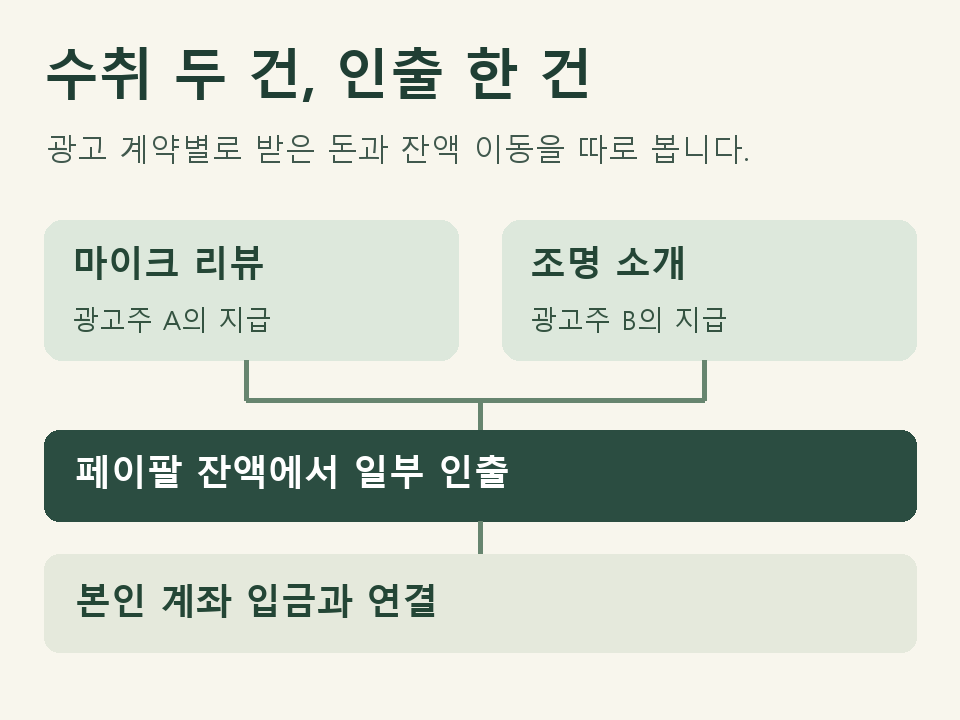

## 돈은 한 번 벌었는데 입금은 두 번 보입니다

국내에서 개인사업자로 활동하는 유튜버가 해외 광고주의 제품 소개 영상을 만들었습니다. 계약한 제작비를 페이팔로 받고 며칠 뒤 그 잔액을 본인 은행 계좌로 인출했습니다. 광고주가 송금한 거래와 본인이 잔액을 옮긴 거래임이 확인된다면, 통장에 들어온 돈까지 두 번째 협찬 매출로 더할 이유는 없습니다.

<strong>입금한 사람이 누구였는지부터 확인하세요</strong>
광고주가 지급한 내역에는 어느 영상의 대가인지 표시하세요. 잔액을 인출한 내역에는 어느 통장으로 옮겼는지 적어 두면, 장부를 정리할 때 같은 돈을 다시 찾을 수 있습니다.

## 장부를 대조할 때 어떤 자료가 필요한가요?

| 자료 | 찾아볼 항목 | 확인할 질문 |
|---|---|---|
| 광고 계약서·지급 안내 | 광고주, 캠페인명, 지급 조건, 약정 통화 | 이 송금이 어떤 영상의 대금인가요? |
| 페이팔 수취 상세 | 거래 식별번호, 상태, 거래 통화, 지급액, 표시된 수수료와 순액 | 광고주가 보낸 금액 중 얼마가 잔액에 반영됐나요? |
| 페이팔 인출 내역과 은행 명세 | 인출일, 인출 금액과 통화, 입금 계좌·일자 | 잔액을 옮긴 거래가 통장의 어느 줄에 해당하나요? |

거주자의 사업소득 총수입금액을 계산할 때는 해당 과세기간에 수입했거나 수입할 금액을 봅니다. 장부에는 사업의 거래 내용을 확인할 수 있도록 기록하고 증명서류를 갖춰야 합니다. 그래서 통장에 최종 입금된 금액만 남기면 광고 계약의 대가와 수수료를 구별하기 어렵습니다. [소득세법 제24조 제1항](https://www.law.go.kr/법령/소득세법/제24조) · [소득세법 제160조 제1항](https://www.law.go.kr/법령/소득세법/제160조)

## 두 광고주의 돈을 한꺼번에 인출했다면요?

예를 들어 첫 광고주는 마이크 리뷰 영상의 제작비를, 다른 광고주는 조명 소개 영상의 제작비를 보냈습니다. 유튜버는 두 대금이 도착한 뒤 잔액 일부만 은행으로 옮겼습니다. 통장에는 입금 한 줄만 보이고, 그 금액은 어느 계약서의 금액과도 일치하지 않습니다.

이 경우 두 계약서에 페이팔 수취 거래번호를 각각 적습니다. 그런 다음 인출 전후 잔액에서 두 건의 수취, 그 사이의 결제·환불과 인출을 차례대로 확인합니다. 잔액 일부를 남겼다면 광고주별 수취액이 은행 입금액과 일대일로 맞을 필요는 없습니다. 차액이 어디서 생겼는지 모른다면 수수료로 적기 전에 남은 잔액과 환불·환전 내역을 확인하세요.

<figure style="margin:24px 0"><figcaption>두 협찬 대금과 한 번의 인출을 연결하는 예시</figcaption></figure>

## 환불이나 환전이 있으면 어느 줄을 남기나요?

광고주에게 제작비 일부를 돌려줬다면 원래 대금을 지우지 말고, 해당 송금에 연결된 환불 내역과 계약 변경 사유를 함께 보관하세요. 환불하기로 한 날과 실제로 돈이 빠져나간 날이 다르면 두 날짜를 구분해 적습니다.

달러로 받고 원화로 인출했다면 두 금액 옆에 통화를 적어 두세요. 거래 상세에 수수료가 따로 표시된 경우와 환전 비용이 적용 환율에 포함된 경우를 구별해야 같은 비용을 두 번 빼지 않습니다. [페이팔 판매자 수수료 안내](https://www.paypal.com/kr/business/paypal-business-fees)

## 지급일과 은행 입금일 사이에 연도가 바뀌었어요

연말에 영상을 납품하고 다음 해에 인출했다면 계약상의 검수·대금 확정 조건, 실제 이행일, 지급 상태를 함께 확인하세요. 거래를 연결하는 작업과 어느 연도에 어떤 원화 금액으로 신고할지는 별도로 검토합니다. 여기서 설명한 인출 사례만으로 수입 시기나 환산 기준을 결정하기는 어렵습니다.

## 제이티에 처음 문의할 때 무엇을 보내면 되나요?

“해외 광고 두 건을 페이팔로 받고 일부만 원화 통장으로 옮겼습니다. 한 건은 금액이 변경됐습니다.” 첫 문의는 이 정도면 됩니다. 개별 검토를 맡기실 때는 거래를 구별할 수 있는 계약·정산 내역부터 안내드립니다. 비밀번호나 계정 접속 정보를 보내실 필요는 없습니다.

기장을 맡기시면 동의·등록 뒤 홈택스에서 확인 가능한 자료는 제이티가 확인합니다. 해외 플랫폼의 수취·인출 자료처럼 별도 확인이 필요한 부분을 요청드리고, 대표세무사와 여러 직원이 참여하는 카카오톡 단체방에서 확인 중인 거래를 함께 정리합니다. 개별 검토 범위와 수수료는 상담 시 안내합니다. [제이티 기장 서비스](https://www.jttax.co.kr/services/bookkeeping.html)

구글이 지급한 애드센스 수익도 함께 있다면 [애드센스 정산서와 외국환매입증명서를 대조하는 방법](https://www.jttax.co.kr/insights/adsense-foreign-exchange-certificate-records.html)을 참고하세요. 광고주와 직접 계약한 협찬은 그 계약의 지급 내역에서 출발합니다.

