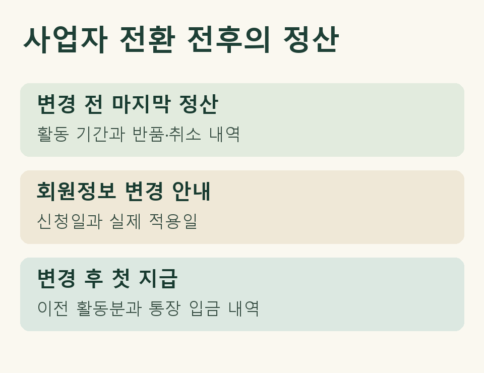

## 사업자 정보를 바꾼 뒤 첫 입금이 들어왔어요

개인으로 제휴 링크를 운영하던 분이 개인사업자로 등록하고, 쿠팡파트너스에도 사업자 정보를 제출했습니다. 지난달 활동에 대한 수수료가 이번 달에 들어왔다면 어느 자료에 넣어야 할까요? 같은 사람이 영위하던 사업을 계속하는 상황이라면, 정보 변경 전후의 정산 내역을 함께 펼치고 한 거래의 대가를 장부에 한 번 반영하는 것부터 확인하세요.

먼저 사업자등록증의 개업일, 플랫폼에서 회원정보 변경이 적용된 날, 활동 실적이 정산된 기간, 돈을 받은 날을 따로 적습니다. 변경을 신청한 날과 실제 적용일이 같았는지는 플랫폼 안내나 처리 결과에서 확인하세요. 이 글은 거주자인 개인의 사례를 다룹니다. 법인을 설립해 계약 상대방이 달라졌거나 가족에게 계정을 넘긴 경우에는 누가 수익을 얻었는지부터 별도로 살펴야 합니다.

## 전환 전 활동과 전환 뒤 지급을 어떻게 잇나요?

| 확인할 자료 | 표시해 둘 항목 | 풀리는 질문 |
|---|---|---|
| 변경 전 마지막 정산 상세 | 대상 기간, 확정액, 보류·취소 표시 | 지난달 활동 중 무엇이 확정됐나요? |
| 회원정보 변경 안내와 첫 정산 상세 | 변경 적용일, 이번 지급에 포함된 기간, 이전 실적 조정분 | 이번 입금에는 어느 기간의 대가가 섞였나요? |
| 통장과 해당 거래의 지급·세무 자료 | 거래일, 입금자, 지급액, 실제 표시된 공제 항목 | 정산액과 통장 입금액의 차이를 설명할 수 있나요? |

가령 9월에 소개한 상품의 수수료가 10월 첫 지급에 포함됐다고 해 보겠습니다. 10월에 받은 입금 한 줄에 ‘9월 활동분’이라고 표시하고 그 금액의 근거가 된 정산서를 연결합니다. 변경 전 내려받은 파일과 변경 뒤 받은 자료에 그 거래가 함께 보일 수 있습니다. 날짜나 금액만 같은 두 건을 바로 합치지 말고 정산 대상 기간, 지급 참조번호가 있다면 그 번호, 조정 사유까지 맞춰 보세요.

반대로 9월에 기록한 예상 실적 중 반품으로 빠진 건이 있다면, 줄을 지우기 전에 최종 상세에서 어느 활동분이 취소됐는지 찾아보세요. 최초 예상액, 취소 조정, 확정 지급액이 어떻게 이어졌는지 남겨 두면 다음 달 장부를 넘길 때 같은 취소분을 다시 차감하는 일을 피할 수 있습니다.

<figure style="margin:24px 0"><figcaption>회원정보를 바꾼 달에 함께 보관할 세 가지 자료</figcaption></figure>

## 통장 입금일로 신고 연도를 정해도 되나요?

소득세법은 사업소득의 총수입금액을 계산할 때 해당 과세기간에 수입했거나 수입할 금액을 보도록 합니다. 사업자는 거래 사실을 확인할 수 있는 증명서류도 갖춰야 합니다. 위의 자료 대조는 어떤 거래가 있었는지 확인하는 작업입니다. 연말 활동분이 이듬해 지급됐다면 회원정보 변경일이나 입금일 하나로 수입 연도를 정하기 어렵습니다. 적용되는 수입 시기를 검토할 수 있도록 해당 활동의 약정과 수수료 확정·취소 조건, 실제 처리 내역을 함께 보관하세요. [소득세법 제24조](https://www.law.go.kr/법령/소득세법/제24조) · [소득세법 제160조](https://www.law.go.kr/법령/소득세법/제160조)

## 변경한 달에 공제 내역이 다르게 보인다면요?

어느 기간의 대가에 얼마가 공제됐는지 먼저 확인하세요. 정산액과 실수령액의 차이에는 취소 조정도 섞일 수 있습니다. 두 금액의 차이를 전부 원천징수액으로 적거나, 사업자 정보를 바꿨다는 이유로 이전 지급분의 공제 내용을 고쳐 적으면 대조가 어려워집니다. 홈택스에 제출된 지급자료와 실제 정산 자료가 이미 다르다면 [지급명세서와 쿠팡파트너스 정산 내역이 다를 때 확인할 순서](https://www.jttax.co.kr/insights/coupang-payment-statement-mismatch.html)를 참고하세요.

## 자료 일부가 보이지 않을 때는 무엇을 요청하나요?

변경 전 파일을 내려받지 못했다면 조회할 기간과 확인할 지급 건을 좁혀 플랫폼에 문의해 보세요. 예를 들어 “사업자 정보가 적용되기 전 마지막 활동분 중 이번 지급에 포함된 금액과 반품 조정분을 확인하고 싶습니다”라고 요청할 수 있습니다. 확인할 수 없는 금액은 통장 내역을 근거로 추정해 채우기보다, 어느 거래의 자료가 빠졌는지 장부 담당자에게 알려주세요.

제이티에 기장을 맡기시면 동의·등록 뒤 홈택스에서 확인 가능한 자료를 먼저 확인하고, 플랫폼의 전환 전후 정산 상세처럼 추가로 필요한 부분을 요청드립니다. 사업자등록 지원이 필요한 경우 함께 말씀해 주세요. 대표세무사와 여러 직원이 참여하는 카카오톡 단체방에서 정산 자료의 어느 줄을 더 확인할지 안내드리며, 수수료와 개별 검토 범위는 상담 때 설명드립니다. [제이티 세무기장 안내](https://www.jttax.co.kr/services/bookkeeping.html)
