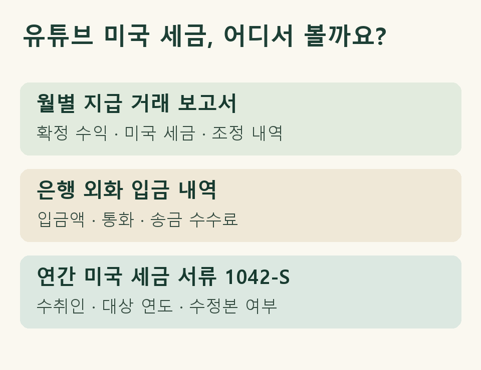

## 한 달은 입금이 없고, 다음 달에 미국 세금이 빠졌다면

국내에서 개인사업자로 유튜브 채널을 운영한다고 가정해 보겠습니다. 두 달치 통장을 펼쳐 보니 지급 내역이 눈에 띕니다. 지난달 입금란은 비어 있고 이번 달에는 평소보다 큰 금액이 들어왔습니다. 유튜브 스튜디오에서 본 예상 수익과도 다릅니다. 장부를 맡길 때는 통장과 함께 **YouTube용 애드센스의 지급 거래 보고서**를 보내주세요. 실제 원천징수액과 어느 지급에 반영됐는지를 찾는 출발점입니다.

Google은 세금 정보를 제출한 해외 크리에이터의 경우 미국 시청자에게서 발생한 유튜브 수입에 대해 해당하는 미국 세금을 원천징수한다고 안내합니다. 지급 보류가 있었다면 여러 달의 원천징수가 뒤의 보고서 한 건에 모일 수 있습니다. 보고서에 빠진 달이 보이면 그다음 지급 내역의 보류 해제와 조정 표시부터 살펴보세요. [YouTube 고객센터의 미국 원천징수 안내](https://support.google.com/youtube/answer/10391362?hl=ko)

## 월별 지급 내역과 연간 서류는 어디를 맞춰 보나요?

| 자료 | 적어 둘 내용 | 대조할 때 주의할 점 |
|---|---|---|
| 애드센스 지급 거래 보고서 | 지급 계정, 거래 기간, 통화, 확정 수익, 미국 세금·조정 항목 | 스튜디오의 예상 수익과 구분해 실제 지급 건에 연결합니다. |
| 은행 외화 입금 내역 | 입금일, 송금인, 통화, 입금액, 별도로 확인되는 수수료 | 지급액과 입금액의 차이가 무엇인지 은행 명세에서 확인합니다. |
| Google에서 받은 연간 미국 세금 서류(1042-S) | 수취인, 대상 연도, 서류에 표시된 소득과 원천징수액, 수정본 유무 | 같은 수취인·연도의 미국 보고 대상 금액끼리 대조합니다. |

예를 들어 지난달 지급이 보류됐다가 이번 달에 풀렸다면, 양쪽 달을 하나의 지급 건에 연결해 두세요. 은행 명세에 송금 수수료가 따로 찍혔다면 그 금액은 수수료 칸에 적습니다. 통장에 덜 들어온 차액 전체를 미국 세금으로 적어 두면, 나중에 연간 서류를 받아도 어느 부분이 어긋났는지 찾기 어렵습니다.

<figure style="margin:24px 0"><figcaption>세 자료에서 각각 확인할 항목</figcaption></figure>

## 1042-S에 적힌 금액을 다시 매출로 잡아야 하나요?

월별 장부에 이미 넣은 지급 건이라면 연간 서류와 연결 표시를 해 두세요. 1042-S에 적힌 소득은 그 서류가 다루는 미국 보고 대상 금액입니다. 채널 전체의 연간 매출과 바로 맞춰 보면 미국 밖 시청자에게서 발생한 수익까지 섞입니다. 같은 대상의 금액끼리 비교하고, 여러 서류를 받았다면 수취인과 소득 구분, 수정 발급 여부를 함께 보세요. 수정본과 최초 서류는 어느 쪽이 최종인지 알 수 있게 보관합니다. [Google의 미국 세금 정보 및 서류 안내](https://support.google.com/youtube/answer/10390801?hl=ko)

## 미국에서 뗀 세금은 국내 신고 때 어떻게 확인하나요?

연간 서류에는 처음 원천징수한 금액이 찍혔는데 나중에 애드센스에 환급 거래가 표시됐다고 가정해 보겠습니다. 처음 받은 서류, 환급이 표시된 지급 보고서, 수정된 연간 서류를 발급받았다면 그 수정본을 함께 보관하세요. 어느 해의 어느 지급에서 돌려받았는지 표시해 두면 처음 낸 세금과 최종 부담한 세금의 차이를 설명할 수 있습니다.

한국에서 사업소득의 총수입금액을 정할 때는 해당 과세기간에 수입했거나 수입할 금액을 봅니다. 통장에 남은 금액만으로는 수익과 공제 내역을 구분하기 어렵습니다. 또 국내 거주자의 종합소득금액에 국외원천소득이 합산돼 있고 그 소득에 대해 공제 대상 외국소득세를 납부했거나 납부할 경우에는 법에서 정한 한도 안에서 외국납부세액공제를 검토할 수 있습니다. 실제 신고 전에는 해당 소득의 원천과 귀속 연도, 외국세액의 성격 및 환급·조정 여부를 함께 확인해야 합니다. [소득세법 제24조](https://www.law.go.kr/법령/소득세법/제24조) · [소득세법 제57조](https://www.law.go.kr/법령/소득세법/제57조)

## 장부 담당자에게 무엇부터 보내면 될까요?

해당 기간의 지급 거래 보고서와 은행 명세를 먼저 모으고, 1042-S를 받았다면 같은 연도 폴더에 넣어 주세요. “지난달 지급 보류, 이번 달 합산 지급, 이후 미국 세금 조정 있음”처럼 예외가 있는 거래 한 줄에 메모를 붙이면 좋습니다. 은행에서 어떤 증빙을 발급받을지 고민된다면 [애드센스 정산서와 외국환 증빙을 대조하는 방법](https://www.jttax.co.kr/insights/adsense-foreign-exchange-certificate-records.html)을 참고하세요.

제이티는 기장 의뢰인의 동의와 등록을 거쳐 홈택스에서 확인할 수 있는 자료부터 살핍니다. 애드센스 지급 보고서와 미국 세금 서류처럼 계정에서 따로 받아야 할 자료는 대상 기간을 지정해 요청드립니다. 사업자등록을 준비 중이라면 등록 지원 범위도 함께 안내합니다. 대표세무사와 여러 직원이 참여하는 카카오톡 단체방에서 자료를 주고받으며, 기장 수수료와 외국납부세액공제 개별 검토 범위는 상담 때 설명드립니다. [제이티 세무기장 안내](https://www.jttax.co.kr/services/bookkeeping.html)

