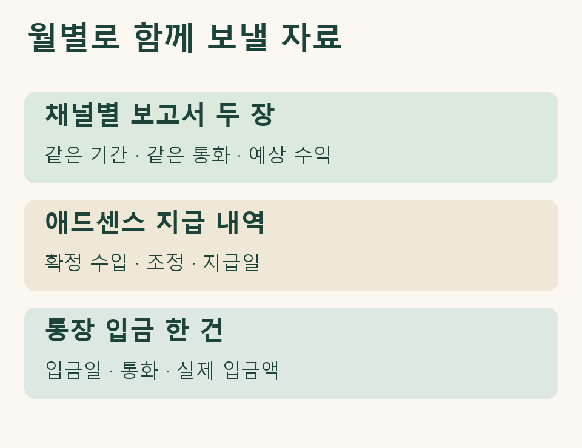

## 채널은 둘인데 통장에는 한 줄만 찍혔습니다

요리 채널을 운영하던 개인사업자가 같은 명의로 여행 채널을 시작했다고 가정해 보겠습니다. 여행 채널에 처음 광고 수익이 잡힌 달에도 통장에는 구글 입금이 한 건뿐입니다. 이때 장부 담당자에게 보낼 자료는 **채널별로 같은 달을 조회한 보고서 두 장과, 두 채널에 연결된 결제 계정의 지급 내역 한 부**입니다. 통장 내역에는 그 지급 건을 표시해 주세요. [Google의 여러 채널과 애드센스 계정 연결 안내](https://support.google.com/youtube/answer/9914702?hl=ko)

| 어떤 자료인가요? | 어디를 확인하나요? | 이 사례에서 맡는 역할 |
|---|---|---|
| 요리·여행 채널의 YouTube 스튜디오 보고서 | 채널 이름, 조회 기간, 표시 통화, 예상 수익 | 채널별 예상 수익을 같은 기간으로 비교합니다. |
| YouTube용 애드센스 지급 내역 | 결제 계정, 월별 확정 수입, 조정 내역, 지급일 | 두 보고서와 대조할 계정 단위의 금액을 찾습니다. |
| 입금 계좌 명세 | 입금일, 통화, 입금액, 별도 표시된 수수료 | 해당 지급이 어느 입금으로 이어졌는지 확인합니다. |

## 두 채널의 예상 수익 합계와 확정액이 다르면

두 채널의 보고서에서 조회 기간과 표시 통화부터 맞추세요. 요리 채널은 지난달 전체를, 여행 채널은 최근 28일을 열어 둔 상태라면 합계를 비교하기 어렵습니다. 스튜디오 고급 모드에서 보고서를 내보낼 때 채널 이름과 조회 기간을 파일명에 넣어 두면 다음 달에도 어느 자료인지 알아볼 수 있습니다. [YouTube 분석 보고서 내보내기](https://support.google.com/youtube/answer/9717005?hl=ko)

스튜디오 화면에는 예상 수익이 표시되고, 최종 수입은 YouTube용 애드센스에서 확인합니다. 예컨대 지급 내역에 조정 금액이 한 줄 찍혔는데 어느 채널 몫인지 설명이 없다면, 장부 담당자에게는 ‘채널 미확인’으로 표시해 보내세요. 예상 수익의 비율대로 나눈 금액은 채널별 실적을 추정하는 데 쓸 수 있지만, 구글이 채널별로 확정한 금액이라고 적으면 나중에 조정의 출처를 찾기 어렵습니다. [YouTube 수익 확인 안내](https://support.google.com/youtube/answer/9314488?hl=ko)

<figure style="margin:24px 0"><figcaption>장부 담당자에게 함께 보낼 세 가지 자료</figcaption></figure>

## 새 채널 수익을 장부에 한 번 더 올려야 할까요?

지난달 요리·여행 채널의 수익을 이미 장부에 반영했다면, 두 채널 몫이 합쳐진 이번 달 입금을 새 매출로 더하기 전에 기존 기록과 연결하세요. 국내 거주자의 총수입금액은 해당 과세기간에 수입했거나 수입할 금액을 기준으로 합니다. 한 번의 지급은 한 번의 매출, 두 개의 채널은 두 번의 매출이라는 식으로 건수를 맞출 수는 없습니다. 결산을 앞두고 수익이 발생한 기간과 입금 월이 갈릴 때는 [미지급 애드센스 수익의 귀속 시기](https://www.jttax.co.kr/insights/adsense-unpaid-income-tax-timing.html)도 함께 살펴보세요. [소득세법 제24조 제1항](https://www.law.go.kr/법령/소득세법/제24조)

## 다른 사람이 운영하는 채널의 돈도 함께 받았다면

두 채널의 운영자가 실제로 다른 경우에는 확인할 내용이 달라집니다. 예를 들어 여행 채널은 동업자가 운영하고 내 계좌로 받은 돈을 다시 송금한다면, 채널별 화면과 통장만으로 누구의 수입인지 가리기 어렵습니다. 채널 운영 약정, 수익 배분 기준, 상대방에게 보낸 이체 내역을 함께 준비해 주세요.

## 기장을 맡길 때 남길 메모

“요리 채널과 여행 채널을 제가 함께 운영합니다. 여행 채널은 이번 달부터 같은 결제 계정에 연결했습니다. 지급 보고서에 채널 이름이 없는 조정 한 건이 있습니다.” 이 정도면 담당자가 어느 달의 어떤 금액을 확인해야 할지 알 수 있습니다. 미국 원천징수액이 따로 보인다면 [애드센스 지급 내역과 미국 세금 서류 대조 방법](https://www.jttax.co.kr/insights/youtube-us-withholding-1042s-records.html)을 참고하세요.

제이티는 기장 의뢰인의 동의와 등록을 거쳐 홈택스에서 확인할 수 있는 자료부터 살핍니다. 채널별 스튜디오 보고서와 애드센스 지급 내역처럼 운영자 계정에서 받아야 하는 자료는 해당 기간을 짚어 요청드립니다. 사업자등록 지원이 필요하면 기장 수수료와 개별 검토 범위를 상담 때 안내합니다. 자료를 주고받는 카카오톡 단체방에는 대표세무사와 담당 직원들이 함께 참여합니다. [제이티 세무기장 안내](https://www.jttax.co.kr/services/bookkeeping.html)
