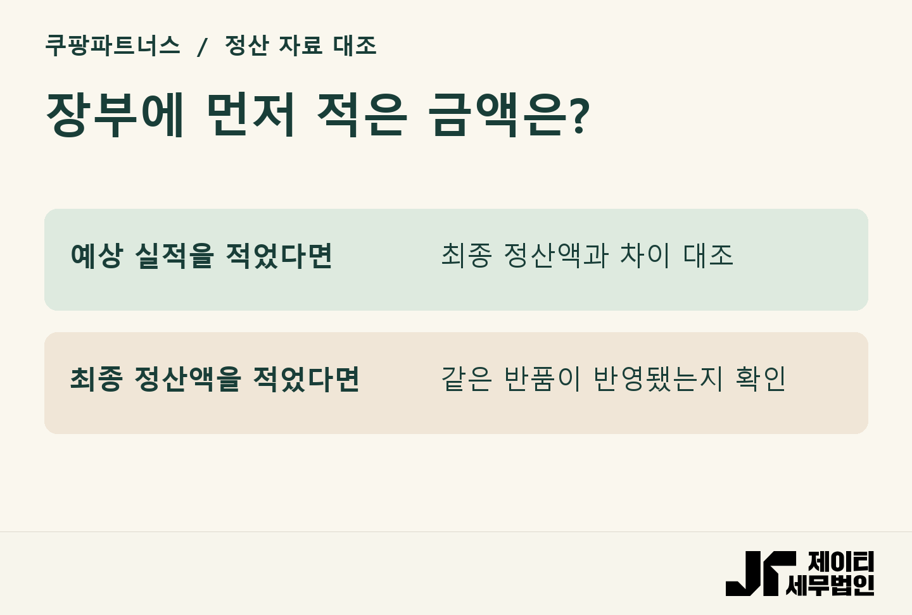

지난달 쿠팡파트너스 링크를 통해 발생한 주문이 이번 달에 반품됐습니다. 이번 달 실적에는 마이너스 수익이 찍혔고, 지난달 최종 정산액도 예상보다 작습니다. 두 표시가 같은 반품을 가리키고 최종 정산액에 차감이 반영됐다면, 그 정산액을 장부에 적은 뒤 같은 반품을 한 번 더 빼지 않습니다. 먼저 장부에 옮긴 금액이 어느 리포트에서 왔는지 확인하세요.

## 주문한 달과 반품한 달이 다릅니다

쿠팡파트너스의 공식 안내에 따르면 실적 리포트에는 취소일을 기준으로 차감 수익이 표시됩니다. 정산 리포트는 주문 월의 실적을 나중에 확정하므로 다음 달 취소분까지 반영할 수 있습니다. 가이드에 나온 예에서 1월 주문을 2월 25일까지 취소하면 2월 정산 리포트에, 2월 26일부터 취소하면 3월 정산 리포트에 반영됩니다. 이번 달의 마이너스 한 줄은 이번 달에 새로 비용을 지출했다는 뜻일까요? 지난달 주문의 제휴수수료가 줄었다는 표시일 수도 있습니다. 주문 고객이 결제한 상품값과 파트너에게 돌아올 수수료도 나누어 보세요. [쿠팡파트너스 공식 이용 가이드](https://partners.coupangcdn.com/partners-guide/partners-guide-20260917111657.pdf)

## 예상 수익을 먼저 기록한 경우

크리에이터가 주문 월말에 실적 화면을 내려받아 수익을 기록했고, 당시 파일에는 반품이 없었다고 가정해 보겠습니다. 이때는 주문 월의 최종 정산 리포트를 새로 받아 최초 기록과 대조합니다. 차이가 같은 반품에서 생겼다면, 최초 금액과 수정한 금액을 모두 수익으로 남기지 않도록 장부 담당자에게 조정 근거를 전달하세요.

## 최종 정산액부터 기록한 경우

반대로 반품이 이미 반영된 최종 정산액으로 장부를 작성했다면, 다음 달 실적에서 발견한 차감 행을 별도 비용으로 또 적을 이유가 없습니다. 다만 금액이 같다는 사실만으로 동일 주문이라고 단정하기는 어렵습니다. 보고서가 제공하는 식별 정보, 원주문 기간, 취소 반영일과 정산 대상월을 맞춰 보세요. 여러 반품이 합산됐거나 확인할 정보가 없다면 해당 기간의 조정 내역을 플랫폼에 요청할 수 있습니다.

<figure style="margin:1.5rem 0;max-width:100%"><figcaption>장부를 처음 작성할 때 사용한 자료에 따라 다음 확인 순서가 달라집니다.</figcaption></figure>

## 정산액과 통장 입금액도 다르다면

정산 리포트에서 반품으로 줄어든 수수료와 지급 단계에서 공제된 항목은 각각 어떤 금액인지 확인해야 합니다. 플랫폼이 발급한 지급 자료에 공제 항목이 있다면 그 명칭과 금액을 따로 표시하세요. 정산액과 입금액의 차이를 전부 반품액으로 채우면, 실제 반품과 지급 당시 공제를 구분하기 어렵습니다. [쿠팡파트너스 지급명세서와 정산 내역 대조](https://www.jttax.co.kr/insights/coupang-payment-statement-mismatch.html)

## 연도가 바뀐 반품은 어떤 자료를 보낼까요?

소득세법은 거주자의 각 소득에 대한 총수입금액을 계산할 때 해당 과세기간에 수입했거나 수입할 금액을 합산하도록 합니다. 정산 화면에 표시된 달만으로 어느 해의 신고를 고쳐야 하는지 결정하지 마세요. 연말 주문이 연초에 취소됐다면 수수료가 확정되는 계약 조건, 두 연도의 정산 자료, 어느 금액으로 장부나 신고서를 작성했는지를 함께 확인해야 합니다. [소득세법 제24조 제1항](https://www.law.go.kr/법령/소득세법/제24조)

예를 들어 “지난달 실적 파일로 먼저 장부를 썼고, 오늘 받은 정산표에 지난달 주문의 반품이 포함됐습니다”라고 알려 주시면 담당자가 어느 기록부터 비교할지 정할 수 있습니다. 제이티는 수임 동의와 등록 뒤 홈택스에서 확인할 수 있는 자료를 먼저 살핍니다. 플랫폼 실적·정산 리포트처럼 별도 확인이 필요한 파일은 해당 기간과 필요한 항목을 정해 요청하며, 검토 범위와 수수료를 먼저 안내합니다. [제이티 세무법인 카카오톡 채널](https://pf.kakao.com/_CcxlJG)

