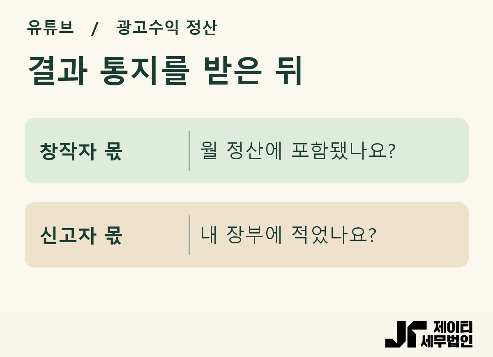

영상에 쓴 배경음악에 저작권 소유권 주장이 들어왔습니다. 이의를 제기한 뒤 유튜브 분석 화면에서 그 영상의 수익이 사라졌다면, 장부에서 지난 수익을 바로 지우지 마세요. 유튜브가 정산을 보류한 동안에는 수익을 누구에게 지급할지 아직 정해지지 않았을 수 있습니다. 해당 영상과 보류 기간을 표시해 두고, 이의 제기 결과가 나오면 실제로 누구에게 얼마가 배분됐는지 대조하세요.

## 광고가 계속 나오는데 왜 수익이 비어 있을까요?

음원 등 권리자가 등록한 콘텐츠와 영상이 일치하면 유튜브의 Content ID 시스템을 통해 소유권 주장이 제기될 수 있습니다. 창작자와 신고자가 모두 해당 영상의 수익 창출을 원하는 상황에서 창작자가 이의를 제기하면, 분쟁 기간에도 광고가 게재될 수 있습니다. 유튜브는 그동안 생긴 수익을 보류했다가 결과에 따라 지급합니다. 이의 제기 시점에 따라 보류의 시작일도 달라질 수 있으니, 영상 게시일부터 전부 보류됐다고 가정하지 마세요. [유튜브 고객센터의 이의 제기 중 수익 안내](https://support.google.com/youtube/answer/7000961?hl=ko)

## 월말에 담당자에게 보낼 자료

해당 영상의 주소, 소유권 주장 통지, 이의를 제기한 날짜를 한 줄에 적습니다. 분석 보고서는 대상 기간과 내려받은 날짜가 보이도록 보관하세요. 채널 전체의 월별 수익도 따로 남겨 두면 나중에 조정이 반영됐는지 비교하기 쉽습니다. 이 단계에서 추정 수익을 이미 장부에 반영했다면 어느 달에 입력했는지도 함께 표시하세요. 분석 화면의 빈칸을 보고 임의로 취소 금액을 적으면, 정작 어떤 기록을 고쳐야 하는지 찾기 어려워집니다.

## 주장이 취소되어 나중에 수익이 보인다면

창작자에게 수익이 돌아오는 경우에는 이의 제기 기간에 보이지 않던 수익 데이터가 이후 분석에 추가될 수 있습니다. 월말에 처음 내려받은 파일과 처리 후 같은 기간을 다시 조회한 파일을 비교해 보세요. 해당 수익이 월별 정산에 포함됐는데 영상별 수익을 다시 더하면 같은 광고수익이 두 번 들어갑니다. 영상별 자료는 총액에 더하기 전에 어떤 항목이 달라졌는지 찾는 데 쓰세요.

<figure style="margin:1.5rem 0;max-width:100%"><figcaption>분쟁 결과 통지에서 수익을 받을 사람을 확인한 뒤, 처음 장부에 적은 자료와 맞춥니다.</figcaption></figure>

## 신고자에게 수익이 돌아간다면

결과 통지와 정산 내역에서 해당 기간의 수익이 신고자 몫으로 배분된 사실을 확인했다면, 창작자가 받을 수익을 정리할 때 그 금액을 빼고 대조합니다. 과거 장부에 추정액을 넣었는지부터 보세요. 처음부터 창작자 몫으로 기록하지 않았는데 다시 차감하면 오히려 창작자의 다른 수익까지 줄어듭니다. 한 달 동안 여러 영상에서 광고수익이 발생했다면 문제 된 영상과 기간을 특정해야 채널 전체 수익을 잘못 고치는 일을 피할 수 있습니다.

## 연도가 바뀔 때는 무엇으로 판단할까요?

국내 거주 개인이 계속해서 채널을 운영하는 경우를 전제로 합니다. 소득세법상 총수입금액에는 해당 과세기간에 받았거나 받을 금액이 들어가고, 그 금액의 귀속연도는 원칙적으로 수입이 확정된 날이 속하는 과세기간입니다. 분쟁으로 받을 사람 자체가 정해지지 않은 경우와, 창작자 몫은 이미 확정됐고 송금만 늦어진 경우는 구별해야 합니다. 보고서에 다시 나타난 날짜만으로 귀속연도를 바꾸지 마세요. 계약 조건과 소득의 성격, 정산 결과를 확인해야 개별 거래의 수입시기를 판단할 수 있습니다. [소득세법 제24조](https://www.law.go.kr/법령/소득세법/제24조) · [소득세법 제39조](https://www.law.go.kr/법령/소득세법/제39조)

상담 때는 “이 영상 수익을 처음 장부에 적을 때 사용한 파일입니다”라고 알려 주세요. 그 파일에 결과 통지와 정산 내역을 붙이면 담당자가 어느 기간을 다시 봐야 할지 확인할 수 있습니다. 송금은 이미 완료됐고 정산액과 입금액만 다른 경우에는 수수료나 해외 원천징수 항목을 먼저 대조하세요. [애드센스 정산액과 통장 입금액 대조](https://www.jttax.co.kr/insights/adsense-reconciliation.html) · [제이티 세무법인 상담](https://pf.kakao.com/_CcxlJG)
