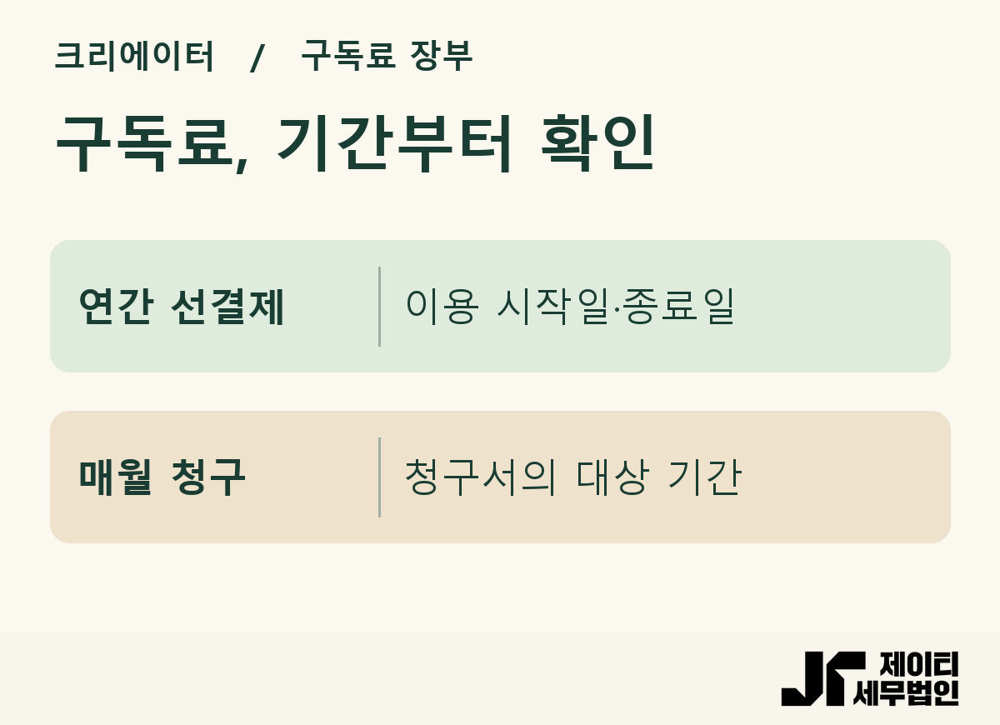

영상 편집 프로그램의 1년 구독료를 한 번에 결제했습니다. 카드 결제일만으로 전액을 그달 비용으로 확정하기는 어렵습니다. 개인사업자의 소득세 장부에서는 업무에 쓰는 비용인지와 어느 해에 반영할 비용인지를 함께 살펴야 합니다. 먼저 결제한 플랜의 이용 시작일·종료일과 청구서를 확인하세요. 구독이 다음 해까지 이어진다면 이용 기간을 장부 담당자에게 알려 주세요.

## 같은 연간 플랜도 돈을 내는 방식이 다릅니다

편집 프로그램을 고를 때 보이는 ‘연간’이라는 말은 계약 기간을 가리킬 수 있습니다. 연간 요금을 한 번에 내는 플랜과 연간 약정 아래 매월 요금이 청구되는 플랜은 확인할 자료가 다릅니다. Adobe의 개인 사용자 구독 약관도 이 두 방식을 구분합니다. 계정의 플랜 이름만 보내기보다 청구 주기와 이용 기간이 보이는 화면을 함께 보관하세요. 매월 결제된다는 사실만으로 월 단위로 자유롭게 끝나는 계약이라고 생각해서도 안 됩니다. [Adobe 구독 약관](https://www.adobe.com/kr/legal/subscription-terms.html)

## 올해 결제하고 다음 해까지 사용하는 경우

설명을 위한 가정입니다. 영상 제작자가 올해 가을부터 다음 해 가을까지 계속 사용할 업무용 편집 서비스를 연간 선결제로 구독했습니다. 카드 영수증에는 올해 결제한 총액만 보입니다. 이때 계약상 서비스를 제공받는 기간을 함께 확인하고, 다음 해 이용분을 미리 낸 부분이 있는지 검토합니다. 아직 제공받지 않은 기간의 서비스 대가는 선급비용, 즉 앞으로 사용할 서비스에 미리 지급한 돈으로 구분할 수 있습니다. 실제 비용에 반영할 시기와 금액은 계약 내용과 적용하는 장부 기준을 확인해 정합니다. 결제일만 보고 전액을 올해 비용에 넣으면 다음 해에 해당할 비용까지 앞당겨 반영할 수 있습니다.

## 연간 약정인데 매달 청구된다면

다른 가정으로, 같은 제작자가 연간 약정에 가입하되 매월 이용 요금을 청구받는 방식을 골랐다고 해 보겠습니다. 이번 달 청구서가 어느 이용 기간의 대가인지부터 확인합니다. 연간 약정 금액을 처음에 전부 비용으로 적고 이후 매월 청구액을 다시 비용에 넣으면 같은 계약을 거듭 반영할 수 있습니다. 그렇다고 월별 결제라는 이유만으로 카드 승인일이 비용의 기준일이라고 단정하지는 않습니다. 월별 청구 대상 기간, 실제 계약 조건, 이미 장부에 기록한 내용을 함께 맞추세요.

<figure style="margin:1.5rem 0;max-width:100%"><figcaption>계약 기간과 청구 대상 기간을 확인한 뒤 장부에 반영합니다.</figcaption></figure>

## 카드 내역에 어떤 자료를 붙이면 될까요?

플랜명과 이용 기간이 보이는 계약 화면, 업체가 발행한 청구서, 카드 결제 내역을 같은 구독 건으로 연결합니다. 청구서에 기간이 빠져 있다면 계정의 구독 상세 내역을 추가로 확인하세요. 중간에 플랜을 바꾸거나 구독을 취소했다면 변경일·서비스 종료일·환불 또는 추가 청구 내역도 필요합니다. 처음 계약한 기간만 보고 장부를 정리하지 않도록 변경 자료를 붙이세요. 영상 작업명이나 운영 채널을 간단히 적어 두면 업무용 구독인지 설명할 때도 도움이 됩니다.

## 비용의 귀속 시기는 어떤 원칙으로 볼까요?

소득세법은 사업소득의 필요경비를 해당 과세기간 수입에 대응하는 통상적인 비용으로 정하고, 총수입금액과 필요경비의 귀속연도는 각각 확정된 날이 속하는 과세기간을 기준으로 합니다. 또 세법에 다른 규정이 없는 범위에서는 계속 적용해 온 공정·타당한 기업회계의 기준이나 관행을 따르도록 규정합니다. 그래서 결제한 날짜와 이용한 기간을 모두 확인해야 합니다. 이 글은 개인사업자가 일정 기간 계속 제공받는 편집 서비스 구독료를 정리하는 사례이며, 영구 사용권 구입이나 부가가치세 공제 여부는 별도 검토가 필요합니다. 법령 원문 대조 기준일은 2026년 11월 18일입니다. [소득세법 제27조](https://www.law.go.kr/법령/소득세법/제27조) · [소득세법 제39조](https://www.law.go.kr/법령/소득세법/제39조)

기장 담당자에게는 “이용 기간이 다음 해까지 이어지는지, 선결제인지 매월 청구인지, 중간 변경이 있었는지”를 알려 주세요. 제이티는 수임 동의와 등록 뒤 홈택스에서 확인할 수 있는 자료를 먼저 살피고, 구독 계정의 계약 화면과 청구서처럼 당사자만 가진 자료를 필요한 범위에서 요청합니다. 자동 수집된 카드 기록을 확인하는 방법은 [경리프로그램 거래 대조 글](https://www.jttax.co.kr/insights/creator-bookkeeping-software-checks.html)에서 이어서 볼 수 있습니다. [기장·신고 업무 안내](https://www.jttax.co.kr/services/bookkeeping.html) · [제이티 세무법인 상담](https://pf.kakao.com/_CcxlJG)

