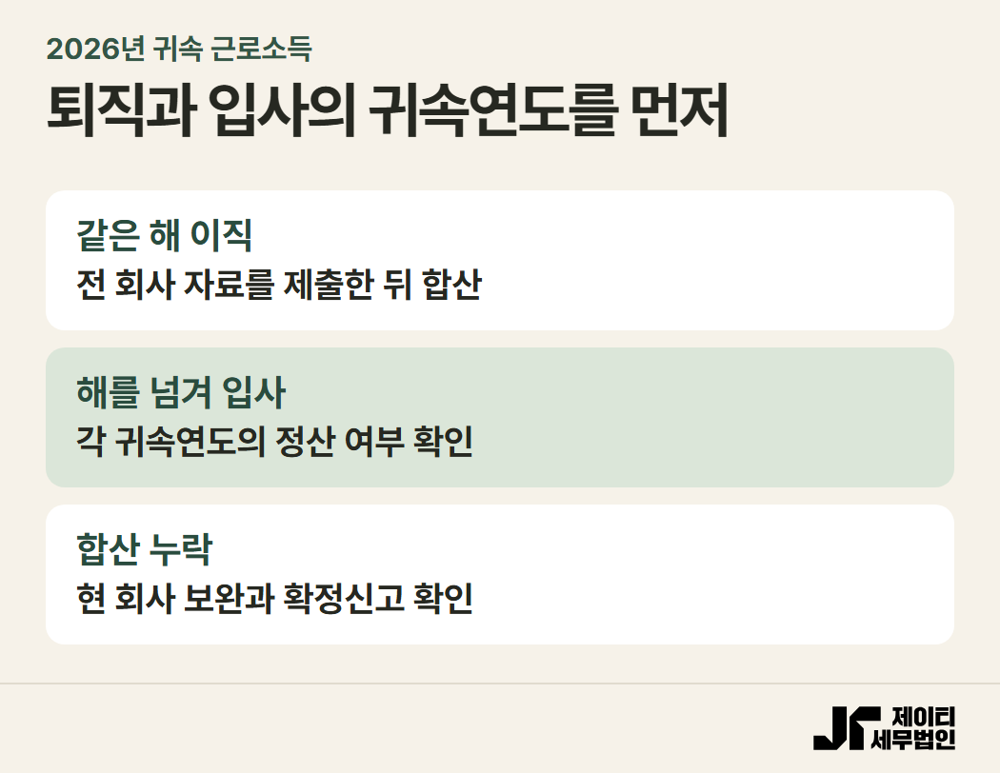
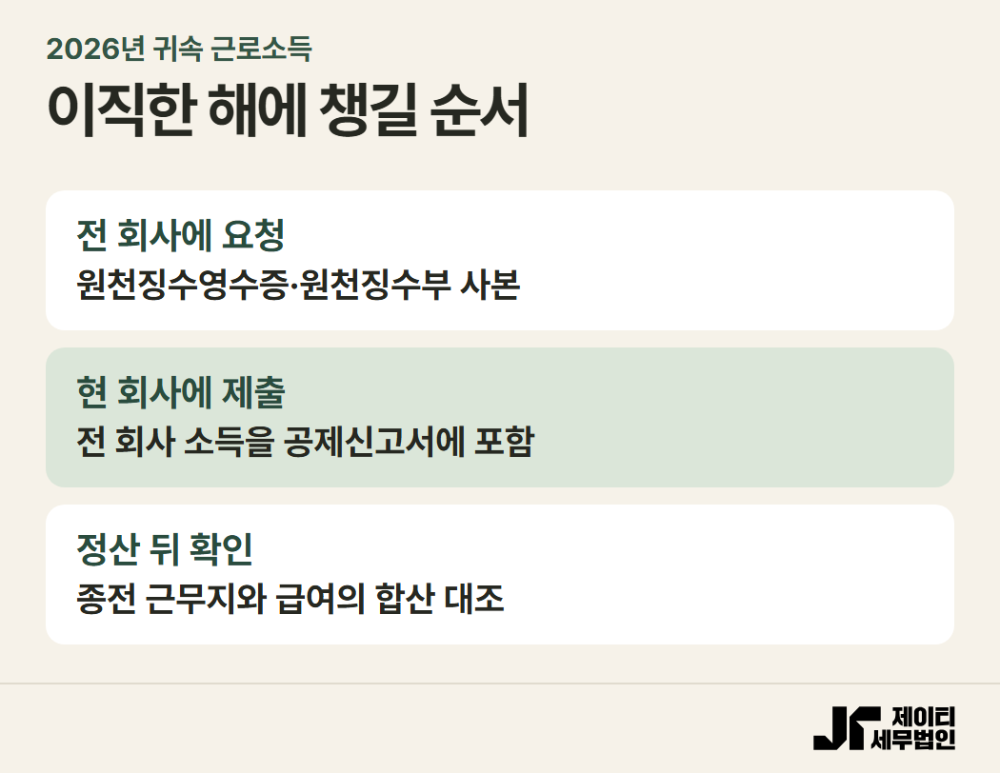

2026년 중에 퇴직한 뒤 같은 해 새 회사에 입사했다면 **현 직장 연말정산에 전 직장에서 받은 2026년 근로소득을 포함**할 수 있도록 자료를 준비합니다. 종전 근무지의 근로소득 원천징수영수증과 근로소득원천징수부 사본을 확인하고, 소득·세액 공제신고서에 전 직장 소득을 포함해 제출하는 절차입니다. 국내 회사에서 일반 근로소득을 받고 같은 해 이직한 경우를 살펴봅니다.

## 퇴사할 때 받은 정산과 현 회사 연말정산

전 회사는 퇴직하는 달의 근로소득을 지급할 때 퇴직자에 대한 정산을 합니다. 이후 같은 해에 새 회사로 옮기고 전 회사 소득을 포함한 공제신고서를 제출하면, 현 회사는 전 회사와 현 회사의 근로소득을 합산해 연말정산합니다.

상반기에 A사에서 퇴직하고 하반기에 B사에 입사한 근로자라면, A사에 근무한 기간의 자료부터 준비합니다. B사의 제출 안내에 따라 전 회사 소득을 신고하고, B사 정산 결과에서 A사 급여가 종전 근무지로 들어갔는지 확인합니다. 2026년에 퇴직하고 2027년에 입사했다면 귀속연도가 다르므로 같은 해 합산 절차와 구분합니다.

<figure style="margin:24px 0"><figcaption>퇴직과 입사의 귀속연도부터 확인합니다.</figcaption></figure>

## 전 회사에 먼저 요청할 서류

전 회사 급여 담당자에게 **2026년 귀속 근로소득 원천징수영수증**과 **근로소득원천징수부 사본**을 요청합니다. 서류가 도착하면 귀속연도·근무처·근무기간을 자신의 이력과 비교하세요. 같은 해 여러 곳을 옮겼다면 이번 회사 이전의 근무처를 빠짐없이 적어 둡니다.

간소화에서 내려받은 카드·의료비 자료는 공제에 쓰이고, 원천징수영수증은 근무처별 급여·세액을 확인하는 데 쓰입니다. 현 회사 안내에 따라 급여 합산 자료와 공제자료를 각각 준비합니다. 인사·급여 자료에는 개인정보가 있으므로 회사가 안내한 제출 경로를 이용하세요.

## 최종 영수증에서 어디를 볼까요?

전 회사가 종전 근무지에 표시됐는지, 누락된 근무처는 없는지, 종전 근무지 영수증과 급여·세액 항목이 대응되는지 확인합니다. 현 회사 급여만 기재돼 있다면 서류를 낸 기록을 찾아 급여 담당자에게 합산 여부를 문의하세요.

급여 담당자에게 숫자를 전달할 때는 **결정세액**과 **차감징수세액**을 구분해 항목 이름까지 알려 주세요. 전 회사에서 환급을 받았더라도 현 직장의 합산 정산 결과까지 환급이 된다고 예상하기는 어렵습니다.

<figure style="margin:24px 0"><figcaption>자료를 제출한 뒤 정산 결과에서 합산 내역을 확인하세요.</figcaption></figure>

## 합산이 빠진 채 연말정산이 끝났다면

회사 정산이 진행 중이면 먼저 보완 가능 여부를 물어보세요. 두 회사의 일반 근로소득이 합산되지 않은 채 연말정산이 끝난 국내 거주 근로자는 다음 해 5월 종합소득세 확정신고에서 해당 근로소득을 함께 신고해야 합니다. 회사별 영수증과 최종 정산 자료를 보관해 주세요.

중도 퇴직 뒤 같은 해 다시 취업하지 않았거나, 근로소득 외에 사업소득 등이 있다면 신고 여부를 확인할 사유가 달라집니다. 현 회사 정산 결과와 이전 근무처 서류를 먼저 비교하면 어떤 확인이 필요한지 파악하기 쉽습니다.

## 확인 근거와 관련 안내

- [소득세법 제137조](https://www.law.go.kr/법령/소득세법/제137조) · [제138조](https://www.law.go.kr/법령/소득세법/제138조)
- [소득세법 시행령 제197조](https://www.law.go.kr/법령/소득세법시행령/제197조)
- [소득세법 제70조](https://www.law.go.kr/법령/소득세법/제70조) · [제73조](https://www.law.go.kr/법령/소득세법/제73조)
- [국세청 연말정산 종합 안내](https://www.nts.go.kr/nts/cm/cntnts/cntntsView.do?cntntsId=238938&mi=2304)

2026년 11월 19일까지 공포된 규정을 바탕으로 작성했습니다. 전 회사 자료를 구하기 어렵거나 일반 근로소득과 다른 소득이 함께 있다면 [제이티 세무법인 상담](/consult.html)에서 근무처와 소득 종류를 알려 주세요.
