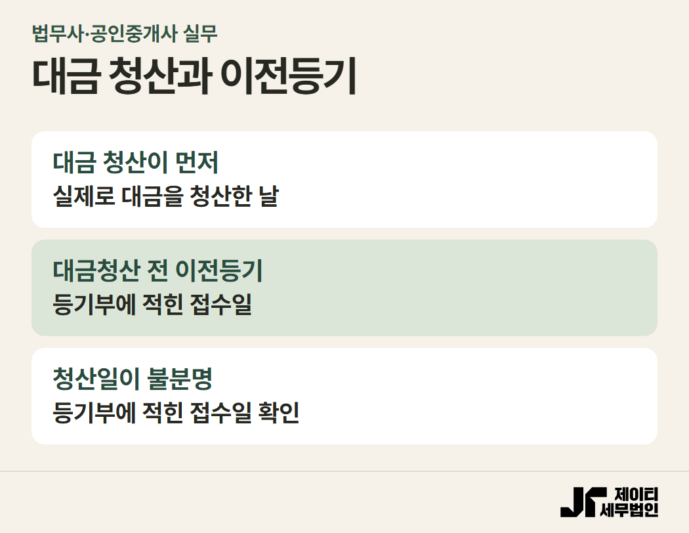
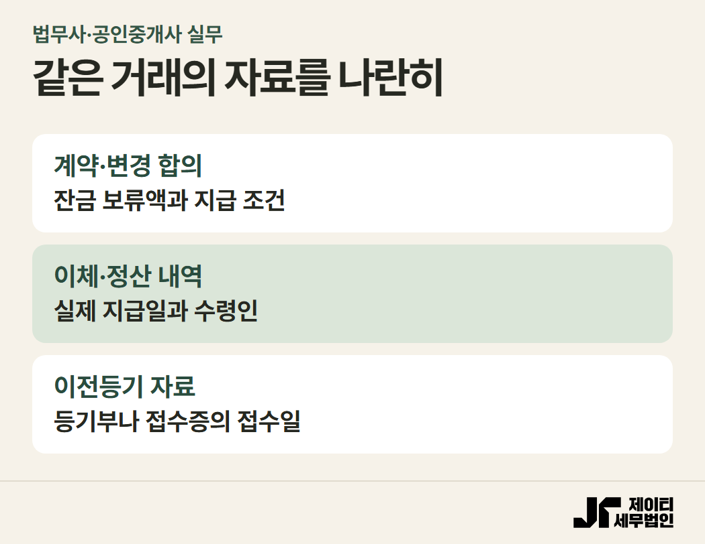

집을 팔면서 잔금 일부를 나중에 받기로 했다면 **대금이 언제 청산됐는지, 그 전에 소유권이전등기를 접수했는지**부터 확인합니다. 양도차익을 계산할 때 양도 시기는 원칙적으로 대금을 청산한 날입니다. 대금을 청산하기 전에 소유권이전등기를 한 경우에는 등기부에 적힌 접수일을 기준으로 봅니다.

## 계약서의 예정일과 실제 거래일을 나누세요

잔금 며칠 전에 누수가 확인됐다고 가정해 보겠습니다. 매수인이 잔금 일부를 수리 뒤 지급하기로 했고 매도인도 동의했습니다. 이때 당초 잔금 예정일, 변경 합의일, 실제 대금 지급일, 소유권이전등기 접수일은 각각 따로 확인할 날짜입니다.

남겨 둔 금액이 실제로 지급해야 할 **매매대금**인지도 확인해야 합니다. 당사자가 매매대금을 조정했는지, 지급 시기만 미뤘는지부터 구분합니다. 일부 금액이 남았다는 사실만으로 미청산이라고 단정하기는 어렵습니다. 아직 지급하지 않은 금액, 전체 대금에서 차지하는 비율, 지급이 미뤄진 경위를 변경 합의서와 송금·정산 내역에서 함께 확인합니다.

<figure style="margin:24px 0"><figcaption>대금 청산과 이전등기의 순서에 따라 확인할 날짜가 달라집니다.</figcaption></figure>

## 등기 접수와 대금 청산 중 어느 쪽이 빨랐나요?

**대금을 먼저 청산한 경우.** 일반적인 주택 매매에서 매매대금이 전부 정산된 뒤 소유권이전등기를 했다면 대금을 청산한 날을 기준으로 봅니다.

**대금청산 전에 이전등기를 한 경우.** 실제 대금이 청산되기 전에 소유권이전등기를 했다면 등기부에 기재된 접수일을 확인합니다. 나머지 돈을 받은 날짜와 등기 완료 사실을 알게 된 날짜도 각각 따로 기록해 두면 좋습니다.

**대금청산일이 분명하지 않은 경우.** 현금 지급 여부처럼 거래 자료가 일치하지 않아 청산일이 분명하지 않다면 시행령상 등기접수일 기준을 확인합니다. 지급 사실을 확인할 수 있는 영수증이나 약정 자료가 있다면 함께 살핍니다.

## 통장 입금액이 다르면 정산표를 보세요

매도인 계좌에 찍힌 금액이 계약서상 잔금과 다르면 정산표에 항목을 나눕니다. 매도인에게 직접 지급한 돈, 대출 상환 등을 위해 다른 수령인에게 지급한 돈, 나중에 지급하기로 한 돈을 구분해야 합니다. 다른 수령인에게 지급한 항목은 무엇을 근거로 누가 부담했는지도 확인합니다.

매매대금 정산과 하자 보수비 정산이 얽혀 있다면 양쪽 자료를 함께 봅니다. 수리비 견적서는 금액 산정의 배경을 보여주고, 변경 합의서와 지급 증빙은 당사자가 정한 정산 방식을 보여줍니다. 하나를 다른 자료로 대신하면 돈을 지급하기로 한 조건이 빠질 수 있습니다.

<figure style="margin:24px 0"><figcaption>거래 흐름을 한 장에 적어 예정과 실제를 구분합니다.</figcaption></figure>

## 법무사·중개사 사무소에서 인계할 자료

- **약정** — 매매계약서, 잔금 변경 합의서, 보류 금액의 지급 조건.
- **지급** — 잔금 정산표, 지급인·수령인·일자가 표시된 이체 내역, 제3자에게 지급한 항목의 근거.
- **등기** — 이전등기 접수증이나 접수일을 확인할 수 있는 등기사항증명서.

중개사 사무소에서는 약정과 실제 잔금일이 달라진 사유를 기록하고, 법무사 사무소에서는 등기 접수 여부와 날짜를 확인합니다. 고객이 자료 공유에 동의한 범위에서 필요한 항목을 인계합니다.

## 확인 근거와 관련 안내

- [소득세법 제98조](https://www.law.go.kr/법령/소득세법/제98조)
- [소득세법 시행령 제162조제1항제1호·제2호](https://www.law.go.kr/법령/소득세법시행령/제162조)
- [법무사 협업 안내](/desk/scrivener.html) · [공인중개사 협업 안내](/desk/broker.html)
- [두 건의 잔금을 같은 날 치를 때 남길 자료](/insights/same-day-balances-evidence.html)

장기할부나 미완성 자산처럼 별도의 시기 규정이 적용될 수 있는 거래는 해당 요건을 따로 확인합니다. 계약과 지급 흐름을 함께 살펴야 한다면 [제이티 세무법인 상담](/consult.html)에서 거래 종류와 예정일을 알려 주세요.
