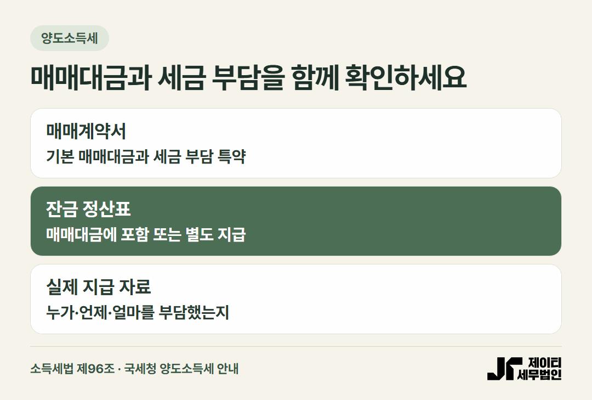
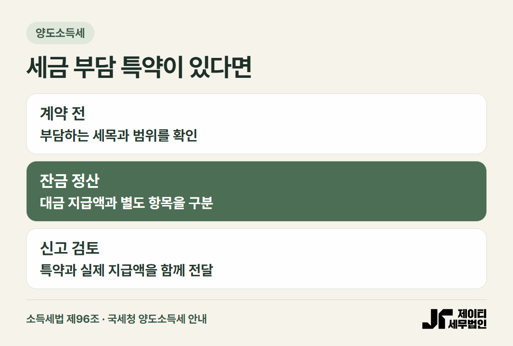

부동산 매매대금에 더해 매수인이 매도자의 양도소득세를 부담하기로 약정하고 실제로 지급했다면, 그 부담액도 매도인의 양도가액에 포함해 검토합니다. 매수인 부담 특약이 있는 일반적인 부동산 유상매매를 전제로, 계약·잔금·신고 단계에서 각각 확보할 자료를 정리합니다.

## 계약서에 적힌 매매대금만 보면 생기는 문제

소득세법 제96조 제1항은 양도 당시 당사자 간 실지거래가액을 양도가액으로 삼습니다. 국세청은 양수인이 양도자의 양도소득세를 대신 부담한 경우 그 금액도 양도가액에 포함한다고 안내합니다. 매매대금과 별도로 낸 세금이 부동산 매매의 대가에 해당하는 약정이라면, 본문 매매대금과 특약을 함께 읽어야 하는 이유입니다.

특약에 ‘양도세 매수인 부담’이라고만 적혀 있다면, 어느 세목을 얼마까지 부담하는지 확인합니다. 최초 납부세액만 예상한 협의인지, 양도가액에 세액을 포함한 뒤 늘어나는 금액까지 염두에 둔 협의인지, 계약 전에 당사자가 같은 뜻으로 이해하는지 확인하세요.

<figure style="margin:24px 0"><figcaption>계약서, 잔금 정산표, 세금 실제 지급 내역을 나란히 확인하세요.</figcaption></figure>

## 잔금일에 매매대금과 세금 정산을 어떻게 남길까요?

잔금 정산표에는 매매대금 지급 내역과 세금으로 별도 정산한 내역을 다른 칸에 적습니다. 매수인이 매도인에게 돈을 먼저 보내거나 고지서에 표시된 계좌로 직접 송금하는 경우에는 돈이 어디로 들어갔는지, 해당 금액이 어떤 납부에 쓰였는지를 확인할 수 있도록 이체 내역과 납부 자료를 확보합니다.

별도 이체 기록 하나만으로 어떤 세금을 어떻게 부담했는지 알기 어려울 수 있습니다. 원계약서와 추가 합의·정산서가 있다면 함께 두고, 나중에 전달하는 자료에는 거래와 무관한 개인정보를 가려 주세요.

## 이런 계약이라면 무엇부터 대조할까요?

계약 본문에는 부동산 매매대금이 적혀 있고, 특약에는 매수인이 매도자의 양도소득세를 별도로 부담한다는 내용이 들어 있습니다. 잔금 후 매수인이 합의대로 양도소득세를 지급했다면, 매도인은 매매대금 이체 기록과 세금 지급 자료를 함께 신고 담당자에게 전달합니다.

반대로 이체만 확인되고 세액 부담을 합의한 계약·정산 근거가 없다면, 이체 사유와 지급 경위를 먼저 확인합니다. 같은 금액이 매매대금에 들어 있는지 별도인지도 서류와 지급 흐름을 대조해야 알 수 있습니다.

<figure style="margin:24px 0"><figcaption>세액 부담 범위는 계약 전에, 실제 부담액은 지급 뒤에 대조합니다.</figcaption></figure>

## 중개사·법무사에게 무엇을 미리 공유할까요?

계약 단계에서는 특약의 문구와 부담 범위, 잔금 단계에서는 각 지급 항목과 지급 주체를 정리해 주세요. 이후 세무 검토에 필요한 자료는 매매계약서와 특약·별도 합의서, 잔금 정산표, 실제 이체 내역, 세금 납부 확인 자료입니다.

세액을 누가 부담하는지에 관한 당사자 약정과 양도소득세 신고를 어떻게 할지는 함께 확인해야 합니다. 계약서에 쓸 금액이나 신고 금액이 아직 확정되지 않았다면 최종 서명과 잔금 정산 전에 자료를 보내 검토하는 편이 안전합니다.

## 자주 묻는 질문

**매수인이 대신 내면 매도인 신고 자료에서 빼도 되나요?** 거래 대가로 매수인이 부담하기로 했고 실제 지급했다면 매도인 양도가액에 그 부담액을 포함해 검토합니다.

**계약서에 적었지만 아직 돈을 보내지 않았다면요?** 실제 지급이 확인된 건과 구분해 약정 내용과 예정된 지급 일정을 알려 주세요. 신고 전에 자료가 더 필요한지 확인합니다.

**예상 세액을 구한 뒤 특약을 정해도 될까요?** 최초 예상치와 최종 부담 범위가 달라질 수 있습니다. 양도가액에 가산하는 효과까지 고려해 최종 계약과 정산 전에 세무 검토를 받으세요.

## 확인 근거와 관련 안내

- [소득세법 제96조](https://www.law.go.kr/법령/소득세법/제96조) [API 확인]
- [국세청 양도소득세 안내](https://www.nts.go.kr/nts/cm/cntnts/cntntsView.do?cntntsId=7715&mi=2315) [웹검색 확인]
- [관련 글 · 잔금 일부를 남긴 경우의 양도일](https://www.jttax.co.kr/insights/property-balance-held-before-registration.html)

네이버 블로그에서 같은 주제를 읽어보세요. [블로그 글 읽기](https://blog.naver.com/jt_tax/224484855081)
