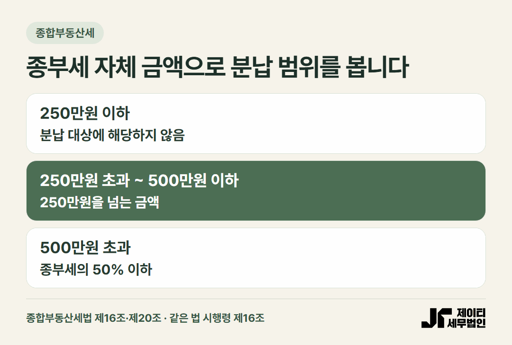
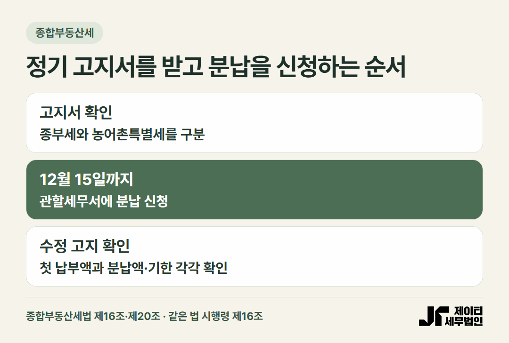

2026년 정기 종합부동산세 고지서를 받은 분은 농어촌특별세를 제외한 종합부동산세가 **250만원을 초과**하는지 먼저 확인하세요. 조건에 해당하고 분납을 원한다면 **12월 15일까지** 관할세무서에 신청합니다. 분납 가능 금액, 신청 뒤 확인해야 할 고지서와 납부 일정까지 정리합니다.

## 고지서에서 ‘종합부동산세’ 금액을 먼저 찾으세요

고지서에 종합부동산세와 농어촌특별세가 함께 보이면 종합부동산세 항목만 찾아 금액을 확인합니다. 합계가 250만원을 넘는데 종합부동산세 자체가 250만원 이하라면 종합부동산세 분납 요건에 해당하지 않습니다.

고지액이 자신의 예상과 달라 분납을 고민하고 있다면 납부 계획과 별도로 주택·토지 구분 및 세액의 산출 근거를 확인하세요. 이 글은 고지받은 세액의 분납에 관한 절차를 다룹니다.

<figure style="margin:24px 0"><figcaption>분납 대상과 상한은 농어촌특별세를 제외한 종합부동산세 기준으로 봅니다.</figcaption></figure>

## 한 번에 얼마를 내고 얼마까지 나눌 수 있나요?

종합부동산세가 250만원을 초과하고 500만원 이하이면 250만원을 넘는 부분을 분납할 수 있습니다. 종합부동산세가 500만원을 초과하면 해당 세액의 50% 이하를 분납할 수 있습니다.

분납 구간의 500만원은 앞 구간에 포함됩니다. 원하는 분납액이 한도에 맞는지 확인하고, 농어촌특별세까지 포함한 실제 고지 납부액은 수정 고지서에서 각각 확인하세요.

## 2026년에는 언제까지 무엇을 내야 하나요?

종합부동산세 정기 납부기간은 12월 1일부터 12월 15일까지입니다. 정기 고지서를 받고 분납을 원한다면 정기 납부기한인 12월 15일까지 관할세무서장에게 분납 신청서를 제출합니다. 마감일에 납부만 일부 하는 방식으로는 신청 기록이 남지 않습니다. 고지서가 늦게 도착했거나 납부기한이 별도로 변경됐다면 관할세무서에 적용 기한을 확인하세요.

세무서는 분납 신청을 받으면 원래 고지서를 정기 납부기한까지 낼 세액과 분납기간 안에 낼 세액의 고지서로 나누어 수정 고지합니다. 나머지 종합부동산세를 납부할 수 있는 법정 범위는 정기 납부기한이 지난 날부터 6개월 이내입니다. 실제 날짜와 납부할 금액은 수정 고지서에서 확인하세요.

<figure style="margin:24px 0"><figcaption>분납 신청 후 최초 고지서 대신 수정 고지서의 납부액과 기한을 확인하세요.</figcaption></figure>

## 이런 경우에는 어떤 서류를 나란히 볼까요?

고지서 합계만 보고 분납을 알아본 사람이 있다면 고지서에서 종합부동산세와 농어촌특별세의 금액을 먼저 구분합니다. 종합부동산세가 250만원을 넘고 분납을 신청했다면 접수 내역을 보관하고, 정기 납부분과 나머지 납부분 수정 고지서를 각각 확인합니다.

고지서와 이체 확인 자료를 모아서 날짜 순으로 두면 첫 납부를 끝냈는지, 다음 납부기한이 언제인지 확인하기 편합니다. 분납을 신청했는데 수정 고지가 보이지 않는다면 기한 안에 관할세무서에서 접수와 고지 상태를 확인하세요.

## 자주 묻는 질문

**고지 합계는 250만원을 넘어요. 분납이 되나요?** 농어촌특별세를 제외한 종합부동산세 금액이 250만원을 초과하는지 확인하세요.

**일단 일부만 납부하고 나머지를 내면 분납인가요?** 고지받은 뒤 분납을 하려면 납부기한까지 신청서를 제출해야 합니다.

**분납이 됐는지는 어디서 확인하나요?** 관할세무서의 수정 고지를 확인합니다. 고지별 금액과 납부기한을 각각 확인한 뒤 납부하세요.

## 확인 근거와 관련 안내

- [종합부동산세법 제16조](https://www.law.go.kr/법령/종합부동산세법/제16조) [API 확인]
- [종합부동산세법 제20조](https://www.law.go.kr/법령/종합부동산세법/제20조) [API 확인]
- [종합부동산세법 시행령 제16조](https://www.law.go.kr/법령/종합부동산세법시행령/제16조) [API 확인]
- [국세청 2026년 세무 일정](https://www.nts.go.kr/nts/ad/taxSchdul/selectList.do?mi=&taxMonth=&taxYear=2026) [웹검색 확인]
- [국세청 분납 안내](https://www.nts.go.kr/nts/cm/cntnts/cntntsView.do?cntntsId=7734&mi=40376) [웹검색 확인]
- [국세청 종합부동산세 분납신청서](https://www.nts.go.kr/nts/na/ntt/selectNttInfo.do?mi=2359&nttSn=1345277) [웹검색 확인]
- [관련 글 · 2026년 종부세 계산 안내](https://www.jttax.co.kr/insights/comprehensive-real-estate-tax-2026.html)

네이버 블로그에서 같은 주제를 읽어보세요. [블로그 글 읽기](https://blog.naver.com/jt_tax/224484854303)
