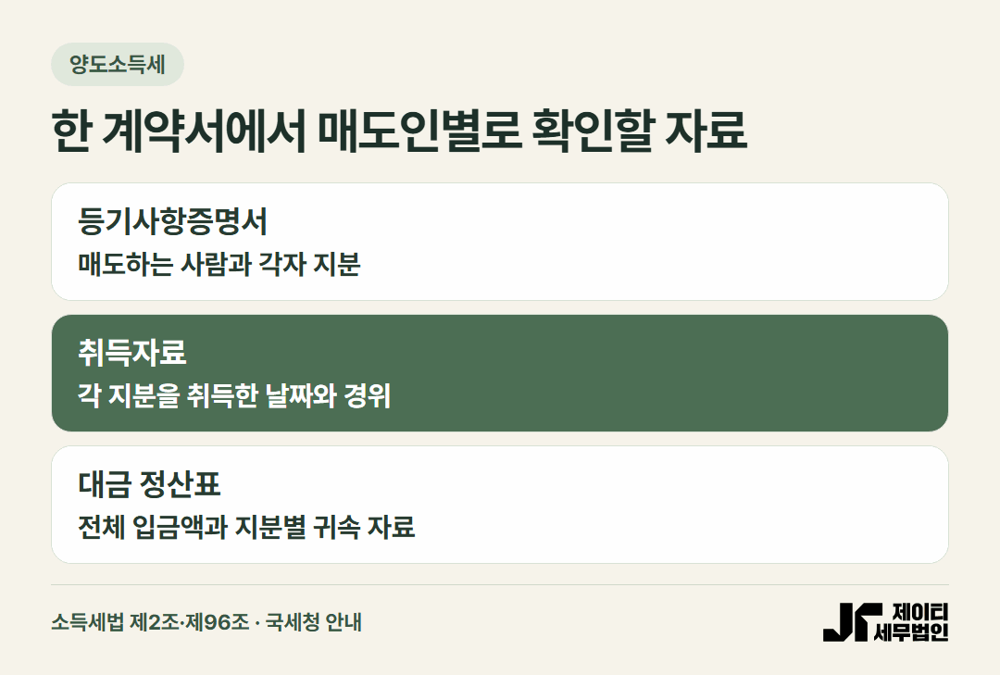
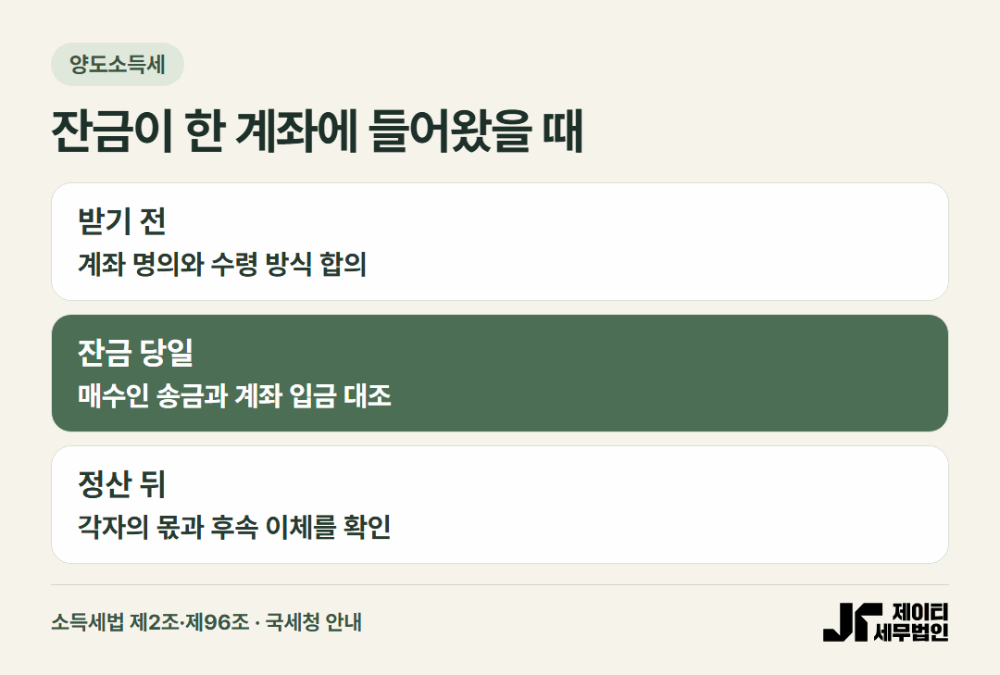

공동명의 주택을 팔면 양도소득세는 각 소유자의 양도분을 기준으로 따로 계산합니다. 신고 대상이라면 각 매도인이 자신의 양도분을 신고할 수 있도록 지분, 취득 이력, 대금 귀속을 나눠 정리하세요. 거주자인 공동소유자들이 일반 매매로 주택을 함께 파는 경우를 다룹니다.

## 매매계약서 한 장과 매도인별 자료

주택 전체를 계약서 한 장으로 팔아도 공동소유자 각자의 지분이 이전됩니다. 먼저 등기사항증명서에서 매도인의 이름과 매도하는 지분을 계약서와 맞춥니다. 취득 당시의 계약서나 등기 자료는 각 지분에 대응하도록 구분해 둡니다.

매매 계약에 전체 거래대금만 적혀 있다면 잔금 정산표에 각 매도인에게 귀속될 대금과 실제 지급 또는 수령 내역을 적으세요. 양도가액은 실지거래가액을 기준으로 판단하므로, 약정과 계좌 기록에 차이가 있으면 경위도 확인합니다.

<figure style="margin:24px 0"><figcaption>등기 지분과 매도인별 취득 경위를 먼저 나눠 확인합니다.</figcaption></figure>

## 대표 계좌로 받은 돈은 어디까지 확인할까요?

매도인 한 사람의 계좌로 계약금과 잔금을 받았다면 계좌 명의와 수령 방법이 적힌 계약서 또는 별도 합의를 보관합니다. 매수인의 송금 내역에 수령 후 정산 내역을 더하면 각 매도인의 몫과 실제 돈의 이동을 함께 설명할 수 있습니다.

한 계좌로 입금된 사실만으로 다른 공유자의 매도분이 사라지는 것은 아닙니다. 귀속 합의와 입금·후속 이체가 다르거나 아직 정산되지 않았다면 차이가 난 대목을 표시하고, 서류를 가지고 확인하세요.

## 지분을 같은 날 샀는지부터 비교합니다

두 사람의 현재 등기 지분이 같더라도 각자 그 지분을 얻은 날짜와 경위는 다를 수 있습니다. 처음부터 함께 매수했다면 당시 매매계약서와 대금 내역을 찾습니다. 한 사람이 나중에 지분을 취득했다면 그때의 계약서나 취득 경위를 보여 주는 자료를 따로 찾으세요.

공통 서류와 각자 서류를 나눠 준비하면, 한 사람의 취득금액과 날짜를 다른 사람에게 그대로 옮겨 적는 오류를 줄일 수 있습니다. 비과세 여부나 필요경비 인정은 사실관계와 증빙을 추가로 확인해야 합니다.

<figure style="margin:24px 0"><figcaption>매매대금 흐름을 따라가며 매도인별 자료를 모읍니다.</figcaption></figure>

## 중개사와 법무사가 인계할 자료

중개사 사무소는 매도인 전원이 누구인지, 대금을 어느 계좌에 받기로 했는지, 잔금 당일의 실제 수령액과 정산 기록을 계약서와 함께 전달할 수 있습니다. 법무사 사무소는 등기에서 이전되는 지분과 종전 취득 기록을 확인할 수 있는 서류를 짚어 주세요.

예를 들어 계약 날짜에는 두 사람이 잔금을 나눠 받을 예정이었지만, 잔금일에 한 사람의 계좌로 모아 받았다면 변경에 합의한 기록과 받은 뒤 나눈 내역을 함께 챙깁니다. 자료를 공유할 때는 당사자가 동의한 범위에서 필요한 부분만 전달합니다.

## 자주 묻는 질문

**대표 매도인 명의로 한 번에 신고하나요?** 신고 대상인 경우 각 매도인이 자신의 양도분을 신고할 수 있도록 자료를 각각 준비합니다.

**통장에 들어온 돈만 있으면 되나요?** 입금 내역과 함께 계약서, 등기사항증명서, 대금 정산 근거도 보관하세요.

**지분별 취득 시점이 같아 보이는데요?** 매도 당시 등기 지분과 그 지분을 처음 취득한 자료를 따로 확인하세요.

## 확인 근거와 관련 안내

- [소득세법 제2조](https://www.law.go.kr/법령/소득세법/제2조) [API 확인]
- [소득세법 제96조](https://www.law.go.kr/법령/소득세법/제96조) [API 확인]
- [국세청 부동산 양도소득세 예정신고 안내](https://ems.nts.go.kr/nts/na/ntt/selectNttInfo.do?mi=2307&nttSn=1346906) [웹검색 확인]
- [국세청 공동명의 양도 안내 자료](https://www.nts.go.kr/comm/ntsFileDown.do?filePath=%2Fupload%2Fnts%2F03%2F0308%2F030801%2F_nts_news_2020%EB%85%84+%ED%95%B4%EC%99%B8%EB%82%A9%EC%84%B8%EC%9E%90%EA%B0%80+%EC%95%8C%EC%95%84%EC%95%BC+%ED%95%A0+%EC%84%B8%EA%B8%88%EC%83%81%EC%8B%9D.pdf) [웹검색 확인]
- [관련 글 · 매수인이 양도소득세를 부담하는 계약](https://www.jttax.co.kr/insights/buyer-paid-capital-gains-tax-contract.html)
