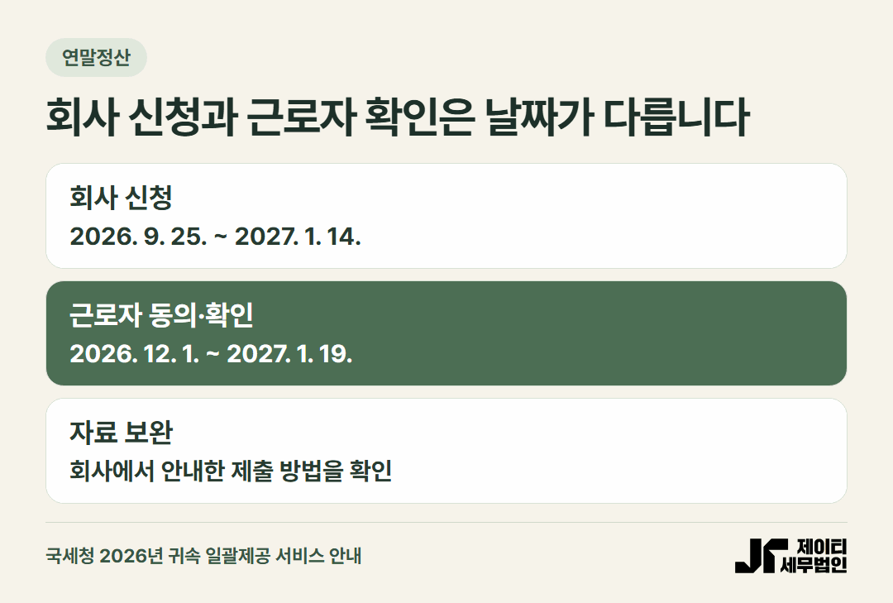
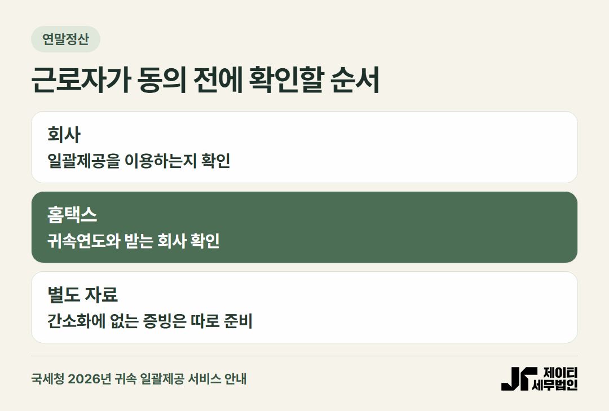

2026년 귀속 연말정산의 간소화자료 일괄제공을 이용하려면 먼저 회사가 서비스를 신청하고, 근로자는 자료를 받을 회사와 동의 상태를 확인하고, 필요한 경우 동의합니다. 국세청이 안내한 2026년 귀속 일정은 회사 신청이 2027년 1월 14일까지, 근로자 동의·확인이 2026년 12월 1일부터 2027년 1월 19일까지입니다.

## 일괄제공의 대상은 어떤 자료인가요?

일괄제공은 홈택스에서 제공하는 연말정산 간소화 증명자료를 근로자의 동의를 받아 국세청이 회사에 제공하는 서비스입니다. 각자 자료를 내려받아 제출하는 대신 회사가 제공 대상자의 간소화자료를 받는 방식입니다.

간소화에 올라오지 않은 공제 증빙을 추가로 낼 수 있는지는 회사에 문의하고, 실제 소득·세액공제 요건도 따로 확인합니다. 일괄제공 이용과 공제 항목 검토, 소득·세액 공제신고서 제출은 별개의 절차입니다.

<figure style="margin:24px 0"><figcaption>회사 신청기간과 근로자 동의·확인 기간을 구분합니다.</figcaption></figure>

## 회사와 근로자가 각각 확인할 일정

희망 회사는 2026년 9월 25일부터 2027년 1월 14일까지 홈택스에서 회사용 일괄제공 신청·관리 절차를 이용합니다. 국세청은 근로자들이 원활하게 확인할 수 있도록 회사에 11월 중 명단을 일찍 등록해 달라고 안내했습니다.

회사가 서비스를 신청했다면 근로자는 2026년 12월 1일부터 2027년 1월 19일까지 근로자용 일괄제공 동의·조회·취소 메뉴에서 자신의 상태를 확인합니다. 안내 화면의 회사와 귀속연도를 대조하고, 문의가 필요하면 회사 급여 담당자에게 등록 상태를 확인하세요.

## 회사 정보가 예상과 다를 때

본인이 근무 중인 회사가 일괄제공을 사용한다고 안내했는데 화면에서 회사가 보이지 않거나 다른 회사가 표시될 수 있습니다. 먼저 2026년 귀속인지 확인한 뒤 현 회사에 대상자 등록을 문의하세요. 화면에 표시된 회사에 자료가 가기를 원하지 않으면 동의 전에 정보부터 확인합니다.

예전에 동의한 이력이 있다면 새로 동의하기 전에 현재 조회 상태와 자료를 받을 회사를 확인하세요. 국세청의 서면 신청서는 신청일 이후 매년 제공에 대한 동의 또는 동의 취소를 함께 안내합니다.

<figure style="margin:24px 0"><figcaption>동의 화면에서 회사와 귀속연도를 확인하고 추가 자료를 준비합니다.</figcaption></figure>

## 간소화에서 보이지 않는 자료는 누가 챙기나요?

회사에서 일괄제공을 받더라도 공제에 필요한 자료가 간소화 목록에 없다면 발급처에서 확인하고 회사에 추가 제출할 방법을 문의합니다. 간소화에서 보이는 항목도 본인에게 공제 요건이 맞는지 공제신고서 작성 때 확인하세요.

회사에서 일괄제공을 쓰지 않거나 근로자가 동의하지 않는 경우에는 회사가 안내하는 연말정산 자료 제출 방식을 따릅니다. 국세청은 근로자가 직접 홈택스에서 간소화자료를 내려받아 회사에 제출하는 방법도 안내합니다.

## 자주 묻는 질문

**12월 1일부터 무엇을 하나요?** 회사가 서비스를 신청했다면 근로자용 메뉴에서 받을 회사와 내 동의 상태를 확인합니다.

**일괄제공을 동의하면 공제신고서도 제출되나요?** 서비스는 간소화 증명자료를 회사에 전달하는 절차입니다. 공제신고서는 회사 안내에 따라 따로 확인해 제출하세요.

**현 직장과 전 직장 급여 자료도 함께 보내나요?** 일괄제공은 간소화 공제 증명자료에 관한 서비스입니다. 전 직장 급여의 합산 대상이라면 현 직장의 제출 방법을 별도로 확인하세요.

## 확인 근거와 관련 안내

- [소득세법 제165조](https://www.law.go.kr/법령/소득세법/제165조) [API 확인]
- [소득세법 시행령 제198조](https://www.law.go.kr/법령/소득세법시행령/제198조) [API 확인]
- [국가법령정보센터 원천징수사무처리규정](https://www.law.go.kr/LSW/admRulLsInfoP.do?admRulSeq=2100000285388) [웹검색 확인]
- [국세청 2026년 귀속 일괄제공 안내](https://s.nts.go.kr/nowon/na/ntt/selectNttInfo.do?mi=5890&nttSn=1355933) [웹검색 확인]
- [국세청 회사 명단 조기등록 안내](https://nts.go.kr/dongjak/na/ntt/selectNttInfo.do?mi=5491&nttSn=1355849) [웹검색 확인]
- [관련 글 · 이직자의 전 직장 급여 확인](https://www.jttax.co.kr/insights/job-change-year-end-tax-2026.html)
