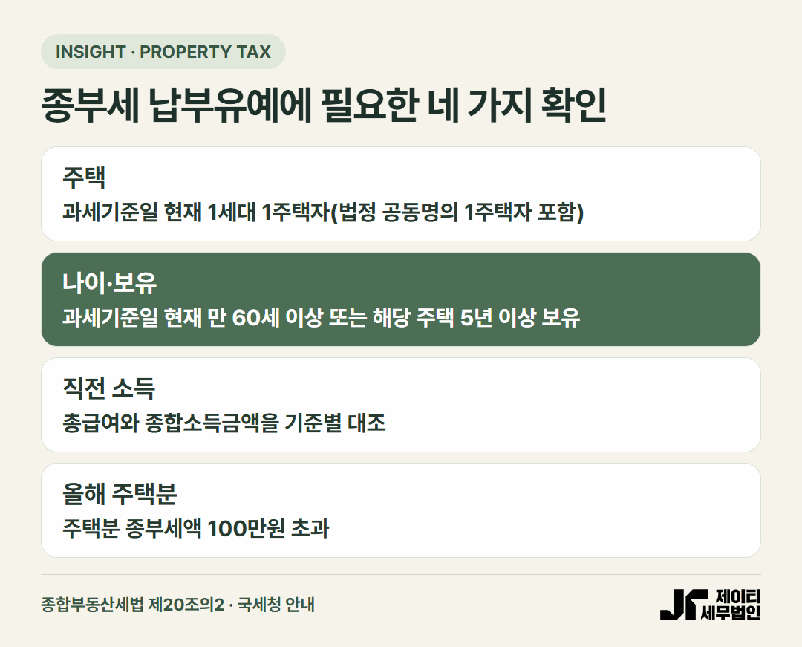
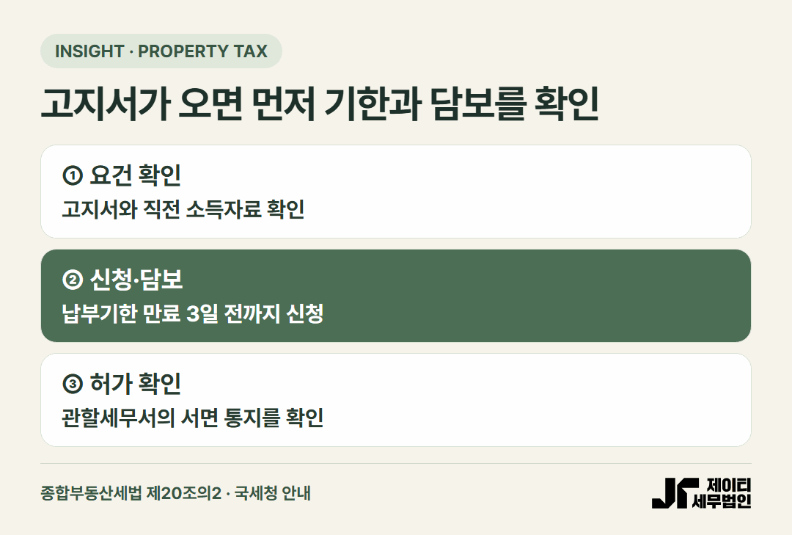

주택분 종합부동산세 납부유예를 받으려면 1세대 1주택 여부, 나이 또는 주택 보유기간, 직전 과세기간 소득, 올해 주택분 종부세액 요건을 모두 확인합니다. 신청은 해당 납부기한 만료 3일 전까지이며, 유예하려는 세액에 상당하는 담보를 제공해야 합니다.

## 과세기준일의 주택 수와 나이 또는 보유기간

과세기준일 현재 1세대 1주택자여야 하며 법에서 정한 공동명의 1주택자도 포함됩니다. 같은 기준일에 만 60세 이상이거나 해당 주택을 5년 이상 보유해야 합니다. 나이와 보유기간 중 한 가지를 충족하더라도 나머지 소득·세액 요건은 별도로 확인해야 합니다.

고지서의 주택 내역과 보유 이력을 대조하고, 공동명의라면 종합부동산세 납세의무자와 공동명의 1주택자 적용 여부부터 확인하세요.

<figure style="margin:24px 0"><figcaption>과세기준일의 상태와 직전 과세기간 소득, 올해 주택분 세액을 구분합니다.</figcaption></figure>

## 총급여와 종합소득금액의 적용 조건

직전 과세기간에 근로소득만 있거나, 근로소득이 있으면서 종합소득과세표준에 합산되지 않는 종합소득이 있는 사람은 총급여액이 7천만원 이하인지 봅니다.

직전 과세기간의 종합소득과세표준에 합산되는 종합소득금액을 기준으로 보는 경우에는 그 금액이 6천만원 이하이고 총급여액이 7천만원을 초과하지 않아야 합니다. 올해 주택분 종부세액은 100만원을 초과해야 합니다. 고지서 전체 합계 대신 주택분 종부세액을 확인하세요.

## 신청서와 담보를 준비하고 통지를 확인합니다

국세청 세무 일정의 2026년 종부세 정기 납부기한은 12월 15일입니다. 납부유예 신청은 해당 납부기한 만료 3일 전까지 해야 하므로, 실제 제출일과 담보 절차를 관할세무서에 일찍 확인하세요. 고지가 늦게 도착했거나 적용 기한이 다르다면 관할세무서에 먼저 문의합니다.

주택분 종합부동산세액 납부유예 신청서를 관할세무서에 제출하고, 유예할 주택분 세액에 해당하는 담보를 제공합니다. 관할세무서는 납부기한 만료일까지 허가 여부를 서면으로 통지합니다. 신청서를 접수했다면 허가 통지와 대상 세액을 확인해 두세요.

<figure style="margin:24px 0"><figcaption>신청서와 담보를 함께 준비한 뒤 허가 통지를 확인합니다.</figcaption></figure>

## 집을 나중에 팔거나 증여하면 어떻게 되나요?

유예한 주택을 양도하거나 증여하는 경우, 사망으로 상속이 개시되는 경우, 1세대 1주택 요건을 더 이상 충족하지 않는 경우 등에는 납부유예 허가가 취소됩니다. 취소되면 유예받은 세액 중 남은 금액에 이자상당가산액을 더해 징수합니다. 상속인이나 상속재산관리인은 상속으로 받은 재산의 한도에서 납부 의무를 집니다.

예를 들어 오래 보유한 집을 계속 갖고 있을 계획이라 유예를 검토하다가 매도 일정을 앞당겼다면, 매매 잔금을 정하기 전에 관할세무서 또는 세무사에게 기존 유예액과 납부 일정을 확인하세요.

## 자주 묻는 질문

**만 60세가 되지 않았는데 오래 보유했어요.** 과세기준일 현재 해당 주택을 5년 이상 보유했다면 나이·보유 요건을 충족할 수 있습니다. 다른 요건도 확인하세요.

**신청서만 내면 그해 납부를 미뤄도 되나요?** 담보 제공 절차와 허가 여부를 확인해야 합니다.

**분납과 어떤 차이가 있나요?** 분납은 일정 기간에 걸쳐 나누어 납부하는 방식입니다. 납부유예는 별도의 요건과 담보를 갖춰 신청하고 허가를 받아 납부를 미루는 제도입니다.

## 확인 근거와 관련 안내

- [종합부동산세법 제20조의2](https://www.law.go.kr/법령/종합부동산세법/제20조의2) [API 확인]
- [종합부동산세법 시행령 제16조의2](https://www.law.go.kr/법령/종합부동산세법시행령/제16조의2) [API 확인]
- [국세청 주택분 종부세 납부유예 신청서](https://www.nts.go.kr/nts/na/ntt/selectNttInfo.do?mi=2359&nttSn=1345278) [웹검색 확인]
- [국세청 2026년 세무 일정](https://www.nts.go.kr/nts/ad/taxSchdul/selectList.do?mi=&taxMonth=&taxYear=2026) [웹검색 확인]
- [관련 글 · 2026년 종부세 분납](https://www.jttax.co.kr/insights/comprehensive-real-estate-tax-installments-2026.html)
