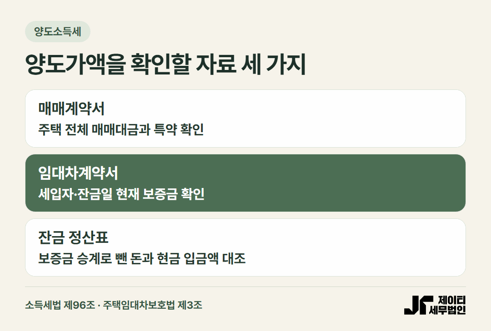
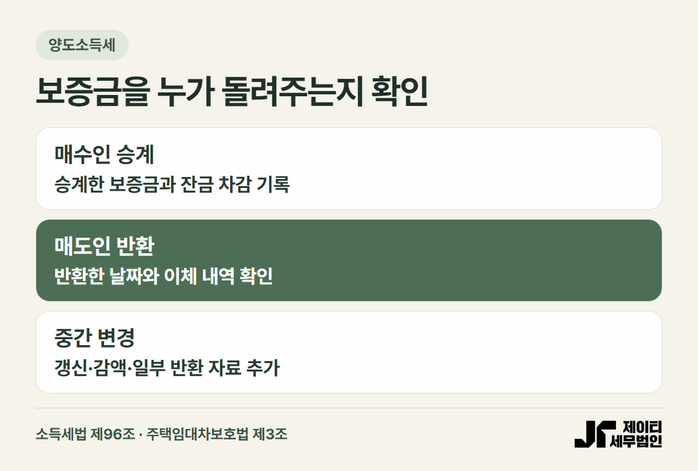

세입자가 있는 주택을 팔면서 매수인이 보증금 반환 부담을 실제로 승계하고, 그 금액을 전체 매매대금의 지급에 갈음하기로 정산했다면 통장에 들어온 돈은 매매대금의 현금 지급분입니다. 양도소득세를 신고할 때는 보증금을 뺀 입금액만 쓰지 말고, 보증금 승계로 정산한 부분까지 포함해 당사자 간 실지거래가액을 확인합니다.

## 전체 매매대금과 현금 지급분을 구분합니다

소득세법 제96조 제1항은 양도자와 양수자 사이에 실제로 거래한 가액을 기준으로 합니다. 기본 계약서에 주택 전체 매매대금이 적혀 있고 그 일부를 보증금 승계로 지급하기로 했다면, 현금 입금이 적다는 사실만으로 주택 가격이 낮아진 것은 아닙니다.

정산표에는 계약서에 적힌 전체 대금, 계약금·중도금·잔금의 송금 내역, 잔금에서 차감한 보증금을 서로 구분해 적습니다. 보증금이 전체 대금에 포함돼 있는지도 확인해 같은 금액을 두 번 더하는 일을 피하세요.

<figure style="margin:24px 0"><figcaption>계약서 전체 대금과 보증금 승계, 실제 이체 기록을 대조합니다.</figcaption></figure>

## 보증금 반환 부담이 실제로 넘어갔는지 봅니다

대항력을 갖춘 세입자가 있는 주택을 산 사람은 주택임대차보호법 제3조 제4항에 따라 원칙적으로 임대인 지위를 승계합니다. 실제 거래에서는 주택 인도와 전입신고 등 대항요건을 갖췄는지, 임대차계약과 보증금이 남아 있는지, 그 보증금을 누가 반환하게 되었는지를 확인하세요.

세입자가 잔금 전에 나가고 매도인이 보증금을 먼저 돌려줬다면, 아직 매수인에게 승계되는 보증금과 같이 표시하면 안 됩니다. 계약 후 보증금이 줄었거나 일부를 미리 돌려준 경우에는 잔금일 현재의 남은 보증금과 정산 내역을 맞춥니다.

## 같은 집이라도 잔금표가 달라지는 두 상황

임대차가 계속되고 매수인이 보증금을 인수하는 거래라면 매매계약 특약, 임대차계약서, 잔금표에 나타나는 보증금을 서로 맞춥니다. 차감액과 실제 송금액을 구분해서 기록하면 현금 지급액이 왜 적었는지 설명할 수 있습니다.

계약 후 이사 일정이 앞당겨져 매도인이 세입자에게 먼저 돌려준 거래라면 반환 이체 내역과 바뀐 잔금 조건을 확보합니다. 처음 작성한 특약과 실제 정산이 다를 때는 바뀐 합의와 지급 증빙을 함께 둡니다.

<figure style="margin:24px 0"><figcaption>잔금 정산표에서 세입자별 승계 여부와 별도 지급을 확인합니다.</figcaption></figure>

## 중개사·법무사에게 확인할 서류

최종 매매계약서와 특약, 세입자의 임대차계약서와 갱신 또는 감액 합의, 잔금 정산표, 매수인 송금 및 세입자에게 돌려준 기록을 정리합니다. 중개사 사무소에는 계약·정산 변경 기록을, 법무사 사무소에는 등기 신청·접수 일정과 전달 가능한 거래 서류를 요청할 수 있습니다.

국세청의 국외 반출용 부동산매각자금 확인서 안내에도 양도가액과, 그 금액에서 전세보증금 등 채무와 제세공과금 등을 뺀 확인금액이 구분되어 있습니다. 일반 양도소득세 신고에 쓰는 잔금 정산표와는 용도가 다릅니다.

## 자주 묻는 질문

**입금액과 계약서 금액이 다르면 계약서를 바꿔야 하나요?** 보증금 승계로 정산한 것인지, 매매대금 자체가 변경된 것인지를 자료로 먼저 확인합니다.

**보증금을 제가 이미 돌려줬습니다.** 반환일 이체와 변경 합의를 챙기고, 잔금에서 같은 금액이 또 차감되지 않았는지 정산표를 확인하세요.

**매수인이 보증금을 맡는다고 말만 했습니다.** 구두 설명만 옮기기보다 적용되는 임대차와 약정, 실제 지급 흐름을 확인해 세무 검토에 전달하세요.

## 확인 근거와 관련 안내

- [소득세법 제96조](https://www.law.go.kr/법령/소득세법/제96조) [API 확인]
- [주택임대차보호법 제3조](https://www.law.go.kr/법령/주택임대차보호법/제3조) [API 확인]
- [국세청 부동산 양도소득세 예정신고 안내](https://ems.nts.go.kr/nts/na/ntt/selectNttInfo.do?mi=2307&nttSn=1346906) [웹검색 확인]
- [국세청 국외 반출용 부동산매각자금 확인서 안내](https://www.nts.go.kr/nts/cm/cntnts/cntntsView.do?cntntsId=7822&mi=2520) [웹검색 확인]
- [관련 글 · 공동명의 주택 매도인의 신고 자료](https://www.jttax.co.kr/insights/joint-home-sale-seller-records.html)
