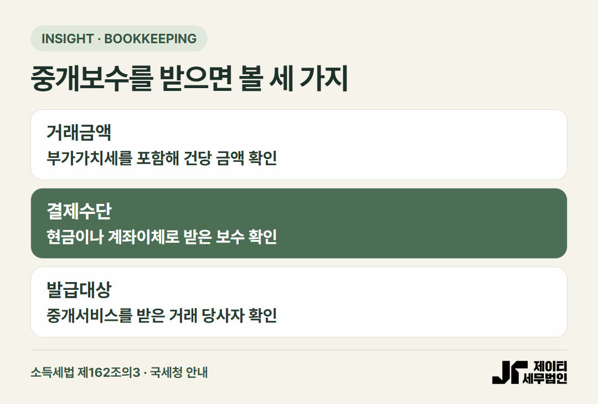
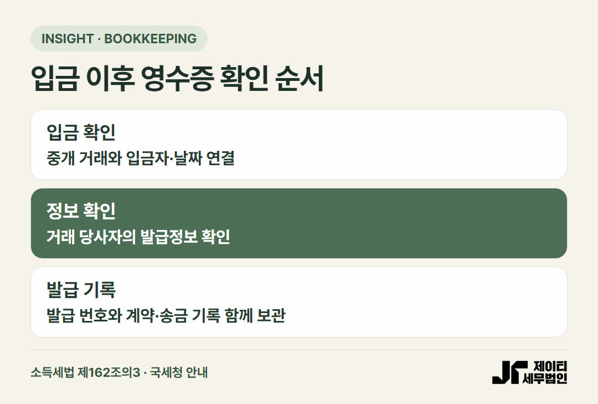

부동산 중개 및 대리업은 현금영수증 의무발행업종입니다. 부가가치세를 포함한 건당 중개보수 거래금액이 10만원 이상이고 현금이나 계좌이체로 받았다면, 소비자가 요청하지 않아도 현금영수증을 발급합니다. 계약자 가족이 대신 입금했다면 입금자 이름을 그대로 쓰기 전에 누가 중개서비스를 받았는지 확인합니다.

## 부동산 매매대금과 중개보수를 구분합니다

현금영수증 기준에서 볼 거래금액은 중개서비스의 대가입니다. 보수를 계좌로 보냈다면 계약 또는 정산자료에 적힌 중개보수와 실제 이체 내역을 대조합니다. 건당 10만원 기준에는 부가가치세가 포함됩니다.

의무발급 기준에 미달하더라도 현금으로 대금을 낸 상대방이 가맹점에 발급을 요청했다면 법에 따른 발급 의무를 확인해야 합니다. 상대방이 계산서 또는 세금계산서를 요구하는 사업자라면 일반 소비자의 처리와 구분해 봅니다.

<figure style="margin:24px 0"><figcaption>거래대금과 송금 명의, 중개서비스를 받은 사람을 확인합니다.</figcaption></figure>

## 입금자와 중개서비스를 받은 사람이 다를 때

국세청은 중개계약자와 입금자가 다를 때 용역을 받은 계약자에게 발급한다고 안내합니다. 배우자나 부모가 돈을 보냈어도 입금자 이름만으로 영수증의 귀속을 정할 수 없습니다.

예를 들어 자녀가 매수인인 계약에서 부모가 보수를 대신 냈다면 중개 의뢰 및 용역 제공 상대방을 먼저 확인합니다. 계좌이체 메모와 중개보수 약정에 실제 거래를 연결해 두면 조회 또는 정정 문의에도 대응하기 쉽습니다.

## 발급 정보가 없는 상태로 입금이 확인됐다면

의무발행 거래에서 소비자가 현금영수증 발급을 원하지 않거나 인적사항을 확인하기 어려우면 국세청 지정번호 010-000-1234로 자진발급합니다. 국세청 안내상 용역을 공급하고 현금을 받은 날부터 5일 이내이며, 통상 계좌이체는 입금일을 기준으로 놓치지 않게 확인합니다.

발급한 뒤에는 입금 날짜, 거래 식별정보와 현금영수증 승인번호를 함께 남깁니다. 개인의 연락처 등 발급에 필요한 정보는 해당 당사자에게 확인하고 사무소의 접근 권한 범위에 맞춰 보관합니다.

<figure style="margin:24px 0"><figcaption>발급 대상과 발급 내역을 계약 기록과 맞춰 둡니다.</figcaption></figure>

## 세금계산서를 발급하는 사업 거래

사업자등록을 한 상대방에게 용역을 공급하고 법에서 정한 계산서 또는 세금계산서를 교부했다면 의무발행 규정에도 현금영수증 발급을 생략할 수 있습니다. 사업자라는 말만으로 처리하지 말고 사업자등록과 실제 발급 문서를 확인합니다.

## 자주 묻는 질문

**고객이 영수증을 요청하지 않았습니다.** 건당 거래금액과 현금 수령 여부를 확인합니다. 의무발행 거래라면 요청 없이도 발급합니다.

**부모가 입금자의 이름으로 받아 달라고 합니다.** 먼저 누가 중개서비스를 받은 당사자인지 계약과 정산 자료로 대조합니다.

**법무사 사무소에서 확인할 자료는 무엇인가요?** 거래 당사자가 제공한 중개보수 약정과 지급 증빙을 구분해 정리하고, 실제 영수증 발급은 중개업소에 확인합니다.

## 확인 근거와 관련 안내

- [소득세법 제162조의3](https://www.law.go.kr/법령/소득세법/제162조의3) [API 확인]
- [소득세법 시행령 제210조의3](https://www.law.go.kr/법령/소득세법시행령/제210조의3) [API 확인]
- [법인세법 제117조의2](https://www.law.go.kr/법령/법인세법/제117조의2) [API 확인]
- [법인세법 시행령 제159조의2](https://www.law.go.kr/법령/법인세법시행령/제159조의2) [API 확인]
- [국세청 현금영수증 발급 의무 안내](https://www.nts.go.kr/nts/cm/cntnts/cntntsView.do?cntntsId=7796&mi=2471) [웹검색 확인]
- [국세청 부동산 중개업소의 계좌이체·귀속 문답](https://nts.go.kr/nts/na/ntt/selectNttInfo.do?mi=15564&nttSn=1555) [웹검색 확인]

법령 확인일은 2026년 11월 23일입니다.
