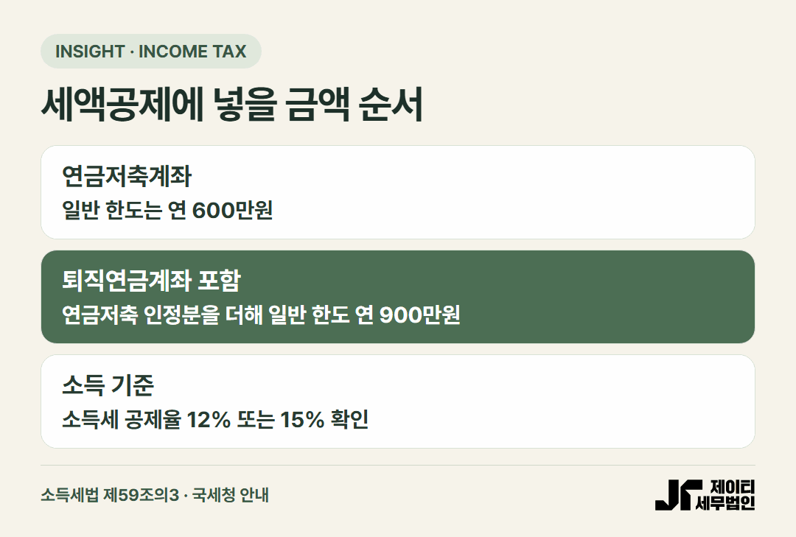
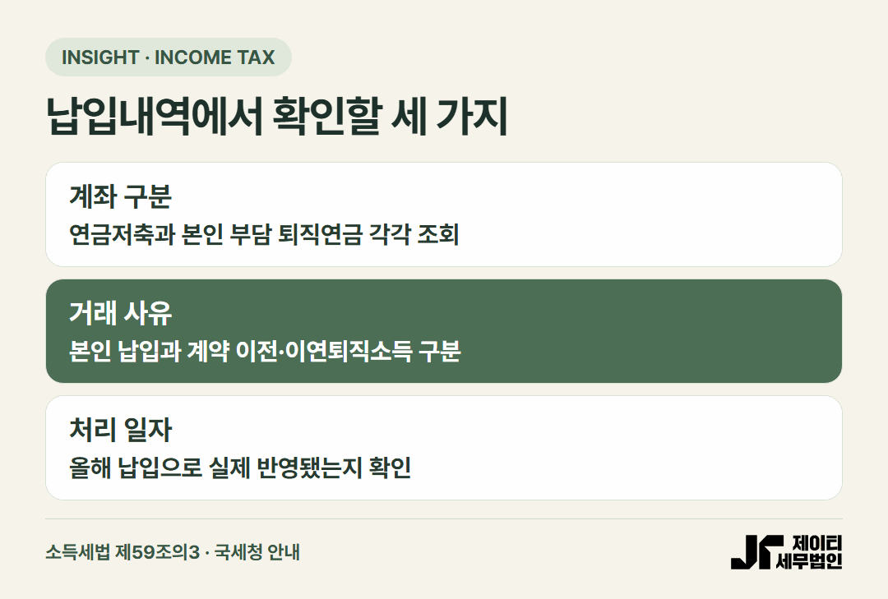

국내 세법상 거주자인 근로자의 2026년 귀속 연말정산을 기준으로 살펴봅니다. 일반 연금계좌 세액공제 한도를 보려면 먼저 연금저축계좌 납입액의 연 600만원 한도를 적용합니다. 그 금액과 개인형퇴직연금(IRP) 등 퇴직연금계좌의 공제대상 납입액을 합쳐 연 900만원 한도를 봅니다. 금융회사 앱에서 계좌별 공제대상 납입과 실제 처리 날짜를 먼저 확인하세요.

## 연금저축 한도부터 보고 합산합니다

여러 금융회사에 연금저축계좌가 있어도 연금저축계좌 납입액을 모아서 한도를 적용합니다. 연금저축만 납입했다면 일반 공제대상 납입 한도는 연 600만원입니다. 퇴직연금계좌 납입액도 있다면 규정에 맞는 연금저축 납입분을 더해 일반 합산 한도 연 900만원을 확인합니다.

공제대상 납입액은 계좌에 보이는 총잔액과 다를 수 있습니다. 올해 본인 부담금인지, 과세가 이연된 퇴직소득인지, 다른 연금계좌에서 계약을 옮겨 온 돈인지부터 나눕니다.

<figure style="margin:24px 0"><figcaption>연금저축과 퇴직연금 합산 한도를 순서대로 확인합니다.</figcaption></figure>

## 공제율은 적용되는 소득 기준에 맞춥니다

일반 소득세 세액공제율은 12%입니다. 합산하는 종합소득금액이 4,500만원 이하인 경우에는 15%를 적용하며, 근로소득만 있다면 총급여액 5,500만원 이하가 15% 기준입니다. 소득세 산출세액에서 적용하는 비율입니다.

연말정산 자료에 표시되는 납입액과 실제 환급액은 각각 다르게 확인합니다. 이미 낸 세금, 산출세액과 다른 공제도 정산에 반영됩니다.

## 금융회사에서 올해 것으로 처리한 금액을 확인합니다

소득세의 일반 과세기간은 1월 1일부터 12월 31일까지입니다. 연말에 납입할 계획이라면 거래 신청 시각과 계좌에 납입 처리된 날짜를 함께 봅니다. 개별 금융회사의 마감 시각과 휴일 처리 방식은 해당 회사 안내를 확인하세요.

앱에서 연금저축과 IRP의 내역을 따로 열어 본인 납입, 계좌 이전, 과세이연된 퇴직급여가 어떻게 표시되는지 확인해 둡니다. 홈택스에서 확인할 수 없는 납입내역이 있으면 금융회사의 연금납입확인서를 받습니다.

<figure style="margin:24px 0"><figcaption>연말에는 금융회사별 납입 구분과 처리 일자를 살펴봅니다.</figcaption></figure>

## 계좌를 옮겼다면 납입과 이전을 나눠 봅니다

올해 연금저축을 다른 금융회사로 옮기고 IRP에는 본인이 새로 입금한 경우, 연금계좌 사이 계약 이전으로 들어온 금액과 추가 입금액은 구분합니다. 이전으로 들어온 금액과 소득세 과세가 이연된 퇴직소득은 일반 공제대상 납입액에서 제외됩니다.

ISA 계약 만료 후 잔액을 요건에 맞게 연금계좌로 납입한 경우에는 별도 특례가 있습니다. 이 글의 한도 표는 일반 납입을 기준으로 하고, 그 전환을 했다면 금융회사 명세와 법 요건을 함께 확인하세요.

## 자주 묻는 질문

**연금저축을 금융회사 두 곳에 가지고 있습니다.** 공제 요건을 갖춘 연금저축 납입액을 합쳐 연 600만원 한도를 적용합니다.

**퇴직하면서 IRP로 퇴직급여가 들어왔습니다.** 과세가 이연된 퇴직소득은 공제대상 납입액에서 제외합니다. 개인이 추가한 부담금과 먼저 구분하세요.

**아직 12월이라 올해로 신청하면 되나요?** 금융회사 안내에서 납입 신청과 실제 처리 시점을 확인하고, 올해 내역으로 표시되는지 확인하세요.

## 확인 근거와 관련 안내

- [소득세법 제5조](https://www.law.go.kr/법령/소득세법/제5조) [API 확인]
- [소득세법 제59조의3](https://www.law.go.kr/법령/소득세법/제59조의3) [API 확인]
- [소득세법 시행령 제40조의2](https://www.law.go.kr/법령/소득세법시행령/제40조의2) [API 확인]
- [소득세법 시행령 제118조의2](https://www.law.go.kr/법령/소득세법시행령/제118조의2) [API 확인]
- [국세청 연금계좌 세액공제 안내](https://www.nts.go.kr/nts/cm/cntnts/cntntsView.do?cntntsId=7875&mi=6608) [웹검색 확인]
- [관련 글 · 2026년 간소화자료 일괄제공](https://www.jttax.co.kr/insights/year-end-tax-data-consent-2026.html)

법령 확인일은 2026년 11월 23일입니다.
