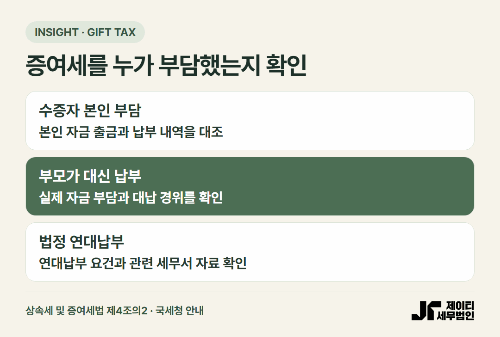
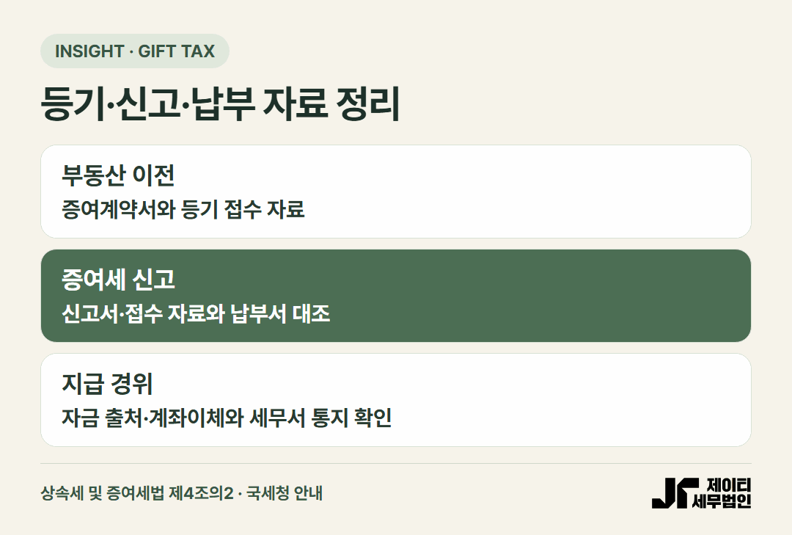

부동산을 증여받으면 수증자가 증여세를 내는 것이 원칙입니다. 부모가 자녀가 낼 증여세를 대신 부담했다면 그 지급으로 자녀에게 추가 증여가 있었는지 검토해야 합니다. 부모가 법에서 정한 연대납부의무자로서 낸 경우에는 처리가 달라집니다. 등기 자료와 납부 자료를 먼저 나눠 보세요.

## 납부서에 적힌 이름과 실제 부담자를 확인합니다

증여계약서와 등기 자료는 부동산이 누구에게 이전됐는지를 보여줍니다. 증여세 신고서와 납부확인서는 어떤 세금이 신고·납부됐는지 알려 줍니다. 실제 부담자가 누구였는지는 출금 계좌와 자녀에게 보낸 돈의 내역을 함께 봐야 확인할 수 있습니다.

예를 들어 자녀 명의 납부서를 부모가 자기 계좌로 결제했다면 결제 계좌와 지급 이유를 기록합니다. 부모가 자녀 계좌로 먼저 보냈다면 그 이체도 남겨 세무 검토 때 실제 자금 흐름을 설명합니다.

<figure style="margin:24px 0"><figcaption>납부명의와 실제 자금 부담, 법정 납부의무를 각각 확인합니다.</figcaption></figure>

## 연대납부의무와 자발적인 지원을 구분합니다

상속세 및 증여세법은 수증자의 주소나 거소가 분명하지 않아 조세채권 확보가 곤란한 경우, 수증자에게 증여세 납부능력이 없다고 인정되고 강제징수로도 확보가 곤란한 경우, 수증자가 비거주자인 경우에 증여자의 연대납부의무를 정합니다. 법에서 제외하는 증여 유형도 있으므로 실제 거래에 그 의무가 있는지 확인합니다.

국세청은 증여자가 연대납부의무를 이행해 낸 세금은 추가 증여로 보지 않고, 그런 의무가 없이 수증자 대신 부담한 증여세는 증여가액에 포함한다고 안내합니다. 해당 납부의 법적 사유와 관련 세무서 자료가 있다면 함께 챙깁니다.

## 부동산 증여와 세금 지급 기록을 따로 적습니다

부동산을 이전한 거래와 그 후 증여세를 지급한 일을 날짜 순으로 정리합니다. 타인이 자신의 채무를 대신 갚아 이익을 얻는 경우 상속세 및 증여세법 제36조가 적용될 수 있습니다. 부모에게 돌려준 돈이 있다면 실제 상환 내역과 그 이유도 함께 검토합니다.

증여세 신고의 일반 기한은 증여받은 날이 속한 달의 말일부터 3개월 이내입니다. 대납으로 별도의 증여 문제를 검토하는 경우에는 부동산 증여일을 그대로 옮기기 전에 지급 기록과 사실관계를 알려 주세요.

<figure style="margin:24px 0"><figcaption>등기 자료와 세금 납부 자료를 별도로 모아 날짜를 비교합니다.</figcaption></figure>

## 법무사와 세무사에게 전달할 자료를 구분합니다

등기 상담에서는 증여계약서와 등기 접수·완료 자료를, 세무 검토에서는 증여세 신고서와 납부확인서, 실제 송금 내역, 세무서가 보낸 문서를 함께 정리합니다. 부동산 취득세나 등기 비용을 누가 냈는지도 다른 항목으로 구분해 두면 상담에서 어떤 세금을 이야기하는지 혼동을 줄일 수 있습니다.

## 자주 묻는 질문

**납부확인서에 자녀 이름이 있습니다.** 부모가 보낸 돈이나 부모 계좌에서 결제한 내역이 있는지 함께 확인합니다.

**부모가 세무서에서 납부 관련 통지를 받았습니다.** 통지의 대상과 명시된 사유를 확인해 연대납부의무 판단 자료로 보관하세요.

**송금 기록이 둘로 나뉘었습니다.** 부모에서 자녀로 간 돈과 세무서에 납부된 돈의 날짜와 금액을 각각 적고, 실제 부담을 확인합니다.

## 확인 근거와 관련 안내

- [상속세 및 증여세법 제4조의2](https://www.law.go.kr/법령/상속세및증여세법/제4조의2) [API 확인]
- [상속세 및 증여세법 제36조](https://www.law.go.kr/법령/상속세및증여세법/제36조) [API 확인]
- [상속세 및 증여세법 제68조](https://www.law.go.kr/법령/상속세및증여세법/제68조) [API 확인]
- [국세청 증여세 납부의무 및 연대납부 안내](https://www.nts.go.kr/nts/cm/cntnts/cntntsView.do?cntntsId=7726) [웹검색 확인]
- [국세청 증여세 항목별 안내](https://www.nts.go.kr/nts/cm/cntnts/cntntsView.do?cntntsId=7960&mi=6533) [웹검색 확인]

법령 확인일은 2026년 11월 25일입니다.
