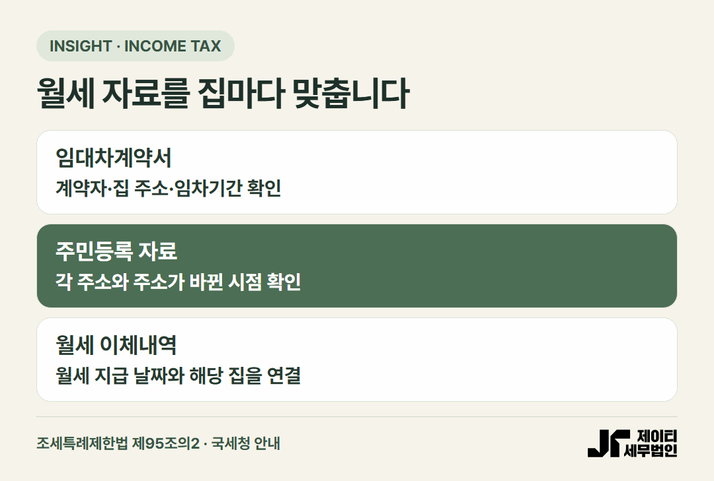
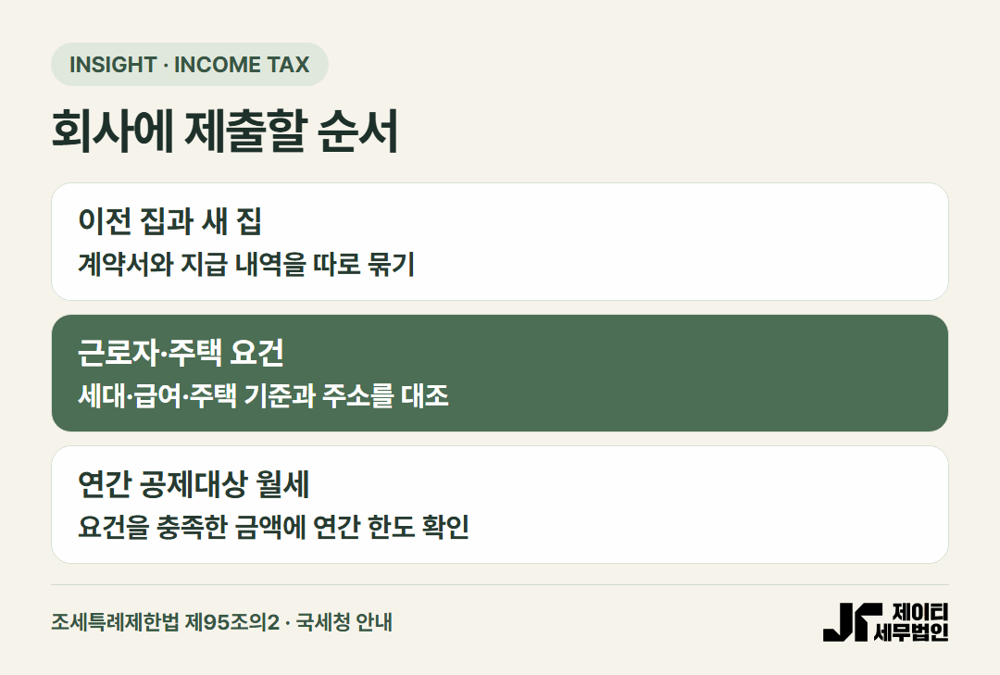

한 해에 월세집을 두 곳 거쳤다면 이전 집과 새 집의 계약서, 주민등록 주소, 월세 납부내역을 각각 준비하세요. 지금 주소만으로 두 집의 월세를 한꺼번에 판단하기보다, 각 계약에서 주소 요건을 충족했는지와 어떤 월세를 냈는지 따로 확인하는 편이 정확합니다. 이 글은 2026년 귀속에 한 근로자가 이사 전후 계약을 정리하는 일반적인 경우를 다룹니다.

## 이전 집과 새 집의 주소를 따로 확인합니다

월세 세액공제는 임대차계약서의 소재지와 주민등록표 등본의 주소가 같아야 하는 등 주택과 계약에 관한 요건을 둡니다. 같은 해 집을 옮겼다면 옛집과 새 집의 계약 주소가 주민등록상 언제 확인되는지 계약별로 검토하세요.

이전 주소가 제출하려는 등본에 드러나지 않으면 주소 변동을 확인할 수 있는 주민등록 자료를 추가로 챙겨 회사의 연말정산 담당자에게 필요한 제출물을 확인하세요. 입주일, 전입일이나 계약서 주소가 어긋난다면 일치 여부와 적용 기간을 먼저 검토해야 합니다.

<figure style="margin:24px 0"><figcaption>두 집 각각의 계약·전입 기록과 월세 납부내역을 맞춥니다.</figcaption></figure>

## 임차기간과 실제 월세 이체를 계약별로 대조합니다

임대차계약서는 주소, 계약자, 임차기간과 월세 조건을 확인하는 자료입니다. 은행 내역에서 계약 상대방과 지급일, 어느 집의 월세인지 표시합니다. 보증금과 별도 관리비가 함께 이체됐다면 계약서와 정산자료를 보면서 월세 항목을 구분합니다.

예를 들어 여름에 옛집에서 나와 새 집에 입주했다면 옛집의 마지막 월세와 새 집의 첫 월세가 어떤 계약의 어느 기간을 위한 것인지 먼저 정리합니다. 세법은 계약기간 중 월세와 해당 과세기간의 임차일수 등을 기준으로 공제대상 월세액을 산정합니다.

## 무주택 세대와 소득·주택 요건을 함께 확인합니다

일반적인 월세액 세액공제는 과세기간 종료일 현재 무주택 세대 여부, 세대주 등 신청인의 요건, 총급여액 8천만원 이하 등 법정 소득 기준을 함께 봅니다. 종합소득과세표준에 합산하는 종합소득금액이 7천만원을 초과하는 경우는 대상에서 제외합니다.

임차계약의 명의와 주택 규모 또는 기준시가도 각 집별로 확인합니다. 세대원의 신청이나 주소를 달리하는 세대주의 배우자가 추가로 신청하는 경우에는 각각의 요건을 따로 대조합니다.

<figure style="margin:24px 0"><figcaption>회사 제출을 앞두고 집별 증빙과 전체 한도를 확인합니다.</figcaption></figure>

## 공제대상 월세의 연간 한도와 증빙을 확인합니다

한 근로자가 이사 전후 두 계약을 정리할 때 연간 월세액의 일반 공제대상 한도는 1천만원입니다. 월세별 공제 요건을 먼저 확인하고 해당 금액을 모아 연간 한도를 봅니다.

국세청이 안내하는 기본 증빙은 주민등록표 등본, 임대차계약서 사본, 계좌이체 영수증이나 무통장입금증 등입니다. 이전 집 자료도 해당 기간의 계약과 지급 기록을 묶어 회사 안내에 따라 제출하세요.

## 자주 묻는 질문

**현재 주소의 임대차계약서만 보관했습니다.** 이전 집의 월세를 검토하려면 해당 계약서와 당시의 주소 및 월세 지급 자료도 확인합니다.

**이체 메모에 집 주소가 없습니다.** 계약서, 입금 받는 사람, 이체일·금액을 대조해 어떤 집 월세인지 적어 두세요.

**두 집에 살았으니 한도도 두 번 적용하나요?** 한 근로자의 일반 공제대상 월세 한도는 해당 과세기간 기준입니다. 먼저 각 집의 공제 요건을 확인한 뒤 연간 금액을 봅니다.

## 확인 근거와 관련 안내

- [조세특례제한법 제95조의2](https://www.law.go.kr/법령/조세특례제한법/제95조의2) [API 확인]
- [조세특례제한법 시행령 제95조](https://www.law.go.kr/법령/조세특례제한법시행령/제95조) [API 확인]
- [소득세법 제5조](https://www.law.go.kr/법령/소득세법/제5조) [API 확인]
- [국세청 월세액 세액공제 안내](https://www.nts.go.kr/nts/cm/cntnts/cntntsView.do?cntntsId=239025&mi=6596) [웹검색 확인]
- [관련 글 · 2026년 연말정산의 연금저축과 IRP](https://www.jttax.co.kr/insights/year-end-pension-savings-irp-credit-2026.html)

법령 확인일은 2026년 11월 25일입니다.
