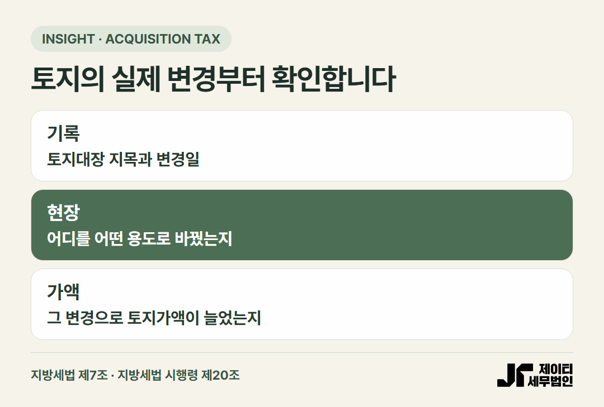
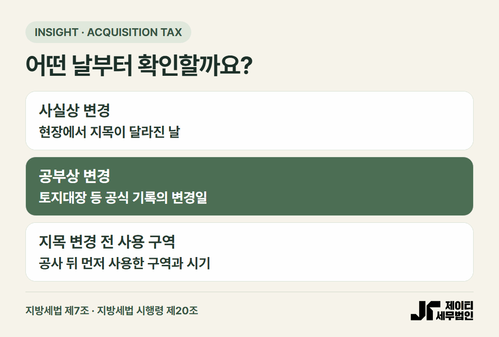

지목이 달라졌다는 안내를 받았다면 먼저 **땅의 주된 용도가 현장에서 실제로 바뀌었는지, 그 변경으로 토지의 가액이 늘었는지** 확인하세요. 지방세법은 두 조건이 모두 맞으면 소유권이 이전되지 않아도 취득으로 봅니다. 해당하는 경우에는 현장의 변경일, 토지대장 등 공부의 변경일, 지목 변경 전에 공사한 구역을 먼저 사용한 사실이 있는지까지 확인해야 신고 기준일을 잡을 수 있습니다. 토지 소유자가 자기 필지의 이용 상태를 바꾼 일반적인 경우를 다룹니다.

## 토지대장과 현장의 변화가 어떻게 이어졌나요?

지목은 토지의 주된 용도에 따라 토지대장 등에 적는 땅의 종류입니다. 예를 들어 기존에 경작하던 밭을 건축 부지로 조성하고 지목도 변경했다면, 공사 전후에 실제 이용 상태가 어떻게 달라졌는지 살펴보게 됩니다.

지방세법 제7조 제4항은 **토지의 지목을 사실상 변경함으로써 가액이 증가한 경우**를 취득으로 봅니다. 매매 때 납부한 취득세 기록이 있어도, 소유 중 일어난 지목 변경이 별도 과세요건에 해당하는지 검토합니다. 반대로 허가 문서나 토지대장에 변경이 표시됐다는 사실 하나로 가액 증가까지 단정하기 어렵습니다. 공사 내용과 변경 전후의 자료를 함께 확인하세요.

<figure style="margin:24px 0"><figcaption>장부의 지목, 현장의 실제 변경, 가액 증가를 각각 확인합니다.</figcaption></figure>

## 지목 변경 취득의 날짜는 어떻게 판단하나요?

지방세법 시행령 제20조 제10항은 **토지 지목이 사실상 변경된 날과 공부상 변경된 날 중 빠른 날**을 취득일로 봅니다. 다만 지목변경일 전에 이미 사용한 부분은 실제 사용한 날이 취득일입니다. 일부 구역을 먼저 사용한 경우에는 전체 필지의 변경 기록과 그 부분의 사용 기록을 나눠 놓는 편이 좋습니다.

설명을 위한 가정입니다. 한 필지에서 부지 조성을 먼저 마쳤고 지목 변경 등록은 그 뒤에 이뤄졌다고 해보겠습니다. 현장 자료로 지목의 사실상 변경일이 먼저 확인되면, 공적 기록상의 변경일만 신고 기준으로 잡을 수 없습니다. 같은 필지 안에 그보다 먼저 실제 사용을 시작한 구역이 있다면 그 부분의 사용 시점을 별도로 확인합니다. 준공확인서나 사진은 판단을 돕는 자료이므로, 문서 하나에 적힌 날짜를 곧바로 모든 구역의 취득일로 적용하기보다 실제 이용 기록과 대조합니다.

## 신고 전에 필지와 공사 자료를 어떻게 묶을까요?

일반적으로 취득세는 지방세법 제20조 제1항에 따라 취득한 날부터 60일 이내에 신고·납부합니다. 지목이 바뀐 날과 먼저 사용한 날이 다르다면 해당 구역의 사실관계를 먼저 정리해 관할 시·군·구 취득세 담당 부서에 신고기한을 확인하세요.

| 확인하는 자료 | 표시해 둘 내용 |
| --- | --- |
| 토지대장·지적도 | 해당 필지, 전후 지목, 공부상 변경일, 먼저 사용한 구역 |
| 허가·준공·인수 자료 | 공사의 범위, 현장이 달라진 시기, 실제 사용을 시작한 기록 |
| 기존 취득세 신고·납부 기록 | 매매 때 신고한 내용과 지목 변경으로 별도 신고했는지 여부 |

같은 현장에 여러 필지나 사용 시점이 있었다면 표를 필지별로 나누세요. 중개사 사무소에서는 계약 또는 거래 일정과 변경 기록을, 법무사 사무소에서는 공부와 변경 확인이 가능한 문서를 의뢰인의 동의를 받은 범위에서 전달할 수 있습니다.

<figure style="margin:24px 0"><figcaption>먼저 사용한 구역이 있다면 별도의 사용 자료를 대조합니다.</figcaption></figure>

## 자주 묻는 질문

**건축 허가를 받았으면 그날이 취득일인가요?** 이 경우에는 사실상 지목 변경일, 공부상 변경일, 먼저 사용한 부분의 실제 사용일을 확인합니다. 허가일은 공사 시점을 파악하는 자료입니다.

**토지대장의 지목은 그대로입니다.** 공부에 반영되기 전에 현장의 지목이 실제 바뀌거나 일부를 사용했는지 확인하는 것이 중요합니다.

**얼마를 내야 하는지도 이 날짜만으로 알 수 있나요?** 과세요건을 충족했는지부터 확인한 다음 신고할 금액의 근거를 따로 검토합니다. 관할 부서에 공사 자료와 변경 전후 상황을 보여주고 필요한 자료를 확인하세요.

## 확인 근거와 관련 안내

- [지방세법 제7조](https://www.law.go.kr/법령/지방세법/제7조) [API 확인]
- [지방세법 시행령 제20조](https://www.law.go.kr/법령/지방세법시행령/제20조) [API 확인]
- [지방세법 제20조](https://www.law.go.kr/법령/지방세법/제20조) [API 확인]
- [취득세 업무와 상담](https://www.jttax.co.kr/acquisition-tax/)
- [공인중개사 협업 안내](https://www.jttax.co.kr/desk/broker.html)

법령 확인일은 2026년 11월 26일입니다.
